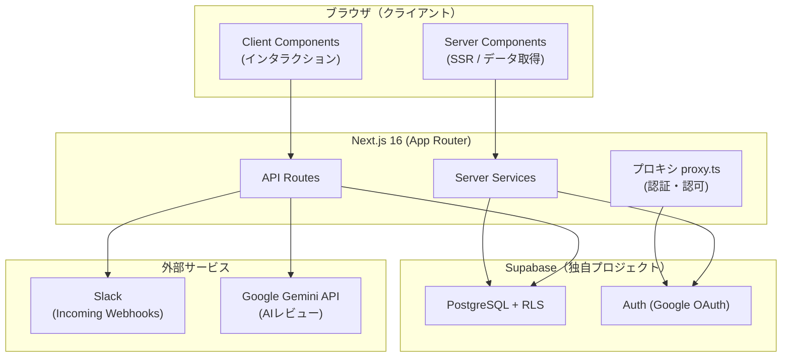
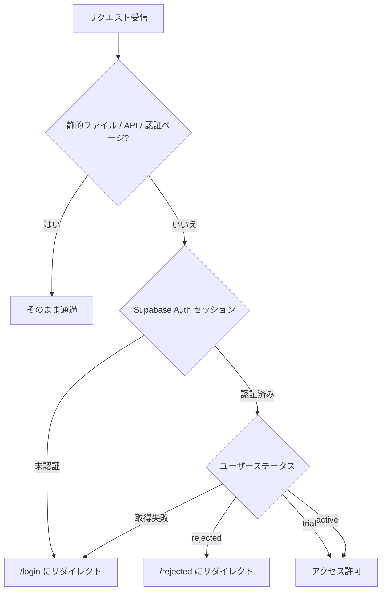
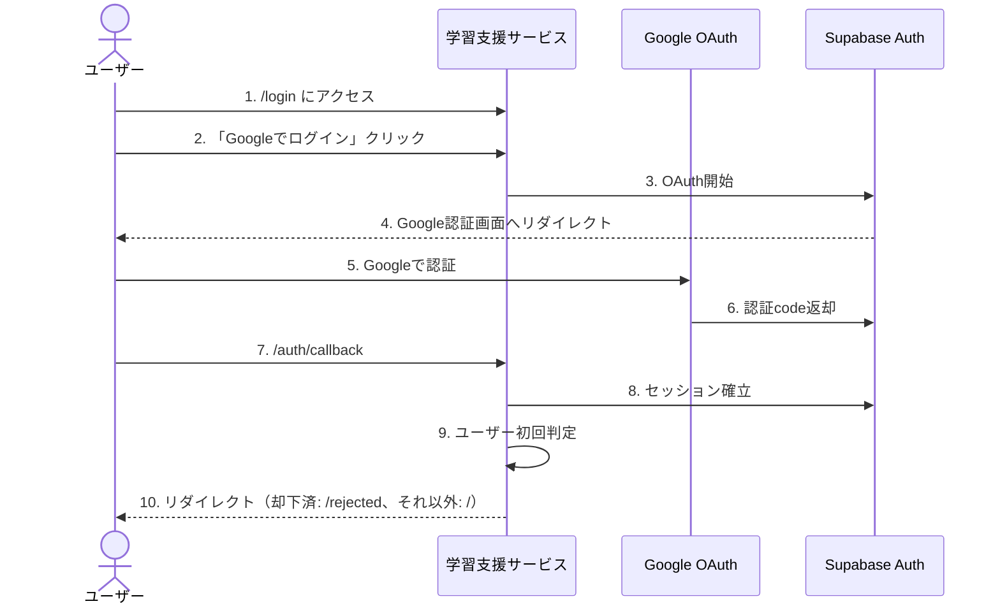
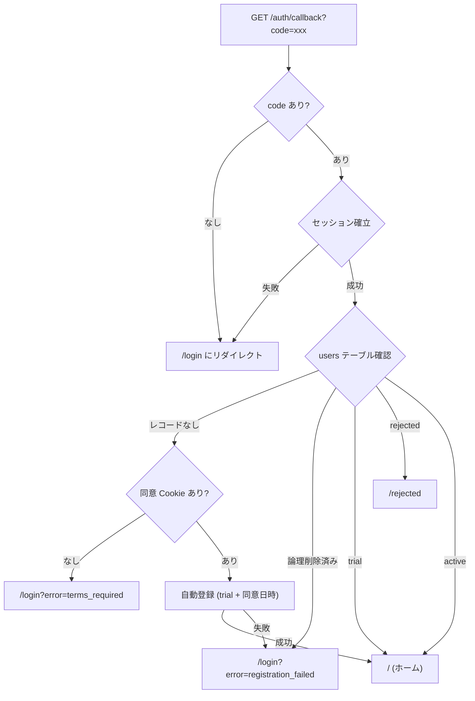
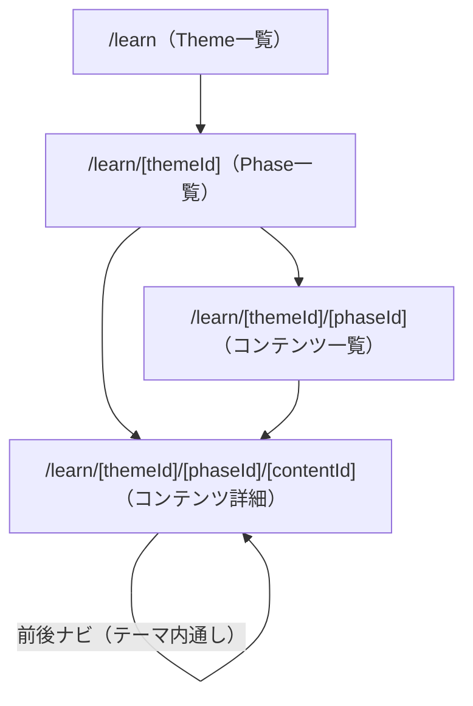

# 機能設計書

本書は、Web技術学習支援サービスの各機能の設計について記載する。

> 本書は現在の仕様のみを記載する。変更履歴は git / PR 履歴で管理し、改訂履歴節は設けない（#185）。調査ログ・一時的な運用手順は本書に残さない。

---

## 1. システムアーキテクチャ

### 1.1 全体構成



### 1.2 レイヤー構成

| レイヤー | 責務 |
|:--|:--|
| プロキシ（`proxy.ts`） | 認証・認可ゲート（静的ファイル・認証ページ以外の全リクエストをインターセプト） |
| Pages (Server Components) | ページレンダリング・Supabaseからのデータ取得 |
| Client Components | ユーザーインタラクション（フォーム、ボタン等） |
| API Routes | クライアントからのデータ更新（進捗記録、課題提出等） |
| Server Services | Supabase クエリ・ビジネスロジック |
| Auth Services | 認証・ロールベースの権限チェック |
| Notification Services | 外部通知サービスとの連携（Slack Incoming Webhooks） |

---

## 2. 認証・認可機能

### 2.1 プロキシ（proxy.ts）による認証フロー

> Next.js 16 では従来の Middleware が `proxy.ts` に改称された。本サービスの認証フローはこの `proxy.ts`（`proxy()` 関数）で実装している。



ステータス取得失敗（null）時は `/login` へ送るフェイルクローズとする。お試しユーザー（`trial`）はページアクセス自体は許可し、コンテンツ単位の制限はアプリ層とRLSで担保する（2.6参照）。インストールに必要な `/manifest.webmanifest`・`/sw.js`・`/offline`・`/apple-icon.png` だけを完全一致でスキップする（14.1節。これ以外のパスは足さない）。

### 2.2 認証の多層構造

| レイヤー | 保護対象 | 方式 |
|:--|:--|:--|
| プロキシ（`proxy.ts`） | 全ページ | Supabase Auth セッション + ユーザーステータス確認（第一の砦。`active` / `trial` のみ許可するフェイルクローズ方式。通過時に受信ヘッダー偽装を削除した上で `x-sinlab-*` リクエストヘッダーにユーザー情報を設定して下流へ引き渡す。スキップ対象パスでも偽装ヘッダーを削除） |
| Server Components（`(authenticated)/layout.tsx`） | 認証必須ページ全体 | `getServerAuth()` の `userStatus` を許可リスト検証（`active` / `trial` 以外はリダイレクト。プロキシのスキップ経路・設定不備に備えた第二の砦） |
| Server Components（layout / page） | ロール別の表示・ナビゲーション | `getServerAuth()`（`React.cache()` でリクエスト単位にメモ化。proxy からヘッダーが渡された場合は突合確認の上で `users` の再 SELECT を省略。ヘッダーは `auth_id` 一致と、status / role / 会員種別（`x-sinlab-membership-type`。空文字は「会員種別なし」、値は `MEMBERSHIP_TYPES` で検証）の許可値検証を通ったときだけ信頼し、1つでも欠落・不正なら DB から取得する。`auth.getUser()` 検証は改ざん検知のため維持）によるロール取得・権限チェック |
| Server Components（コンテンツ表示） | お試しユーザーへのコンテンツ制限 | `userStatus` と `is_open_to_trial` によるロック判定（RLSと合わせた二層防御の第一層） |
| RLS | データベース | `auth.uid()` によるRow Level Security。お試しユーザーには `learning_contents` をお試し公開分のみに制限（二層防御の第二層） |
| API Routes | データ更新操作 | サーバー側での認証チェック + ステータスに基づく認可（`rejected` は403、お試しユーザーはお試し公開コンテンツのみ書き込み可） |

### 2.3 権限チェック

| 権限レベル | 対象ロール | 用途 |
|:--|:--|:--|
| 管理者権限 | `admin` のみ | 受講生進捗、ユーザー管理 |
| コンテンツ管理権限 | `admin` または `maintainer` | コンテンツ CRUD、ダッシュボード（受講生管理グループ） |

**個人情報（メールアドレスなど）**: `maintainer` には受講生のメールアドレス等の個人情報を見せない（#414）。`/manage/*` の取得・表示は表示名のみとし、メールは `/admin/users` など admin 専用画面に限る。DB 側の列制限（RLS / ビュー）は `docs/database.md` を参照。

**会員種別（`membership_type`）**: 承認済みユーザーは「コミュニティ会員（`community`）」と「一般有料会員（`general`）」に分類する。コミュニティ会員はコミュニティ会員プラン、一般有料会員は本サービスのみを利用するプランを指す。ロール（権限）とは独立した軸であり、**現時点では種別によるコンテンツ・機能のアクセス差はない**（将来の出し分けに備えた区別のみ）。承認前（`trial`）・却下（`rejected`）ユーザーは `NULL`。

一般有料会員への昇格には2通りの経路がある。

- **Stripe決済による自動昇格**（`general` のみ）: お試しユーザーが `/upgrade` からStripe Checkoutで決済を完了すると、管理者の承認なしに自動で `status=active` / `membership_type=general` となる（2.11節参照）
- **管理者による手動承認**（`community` / `general` いずれも可）: `/admin/users` の承認操作で管理者が種別を選択して設定する（2.7節）。**コミュニティ会員はStripe決済連携の対象外**であり、従来どおり手動承認のみで入会する

### 2.4 Googleログインフロー



**OAuthコールバック処理**:


初回ログイン（自動登録）後もお試しユーザーとしてそのままホームへ遷移する。承認待ちであることはアプリ内バナーで通知する。同意 Cookie・登録失敗などのエラー導線は2.5・8.2を参照。

### 2.5 初回ログイン時のユーザー自動登録

OAuthコールバック処理中に初回ログインを検知し、`users` テーブルにレコードを自動作成する。`/login` には「利用規約およびプライバシーポリシーに同意する」チェックボックスを1つ置き、未チェックの間は Google ログインボタンを無効化する。チェックボックスのラベル内に利用規約・プライバシーポリシーの外部リンクを含める。同意は `GoogleLoginButton` が `signInWithOAuth` 直前にセットする短寿命の同意 Cookie（`SameSite=Lax`、有効期間30分。Google 側の2段階認証等で OAuth の往復が長引いても失効しない値）で callback へ持ち回り、`redirectTo` のクエリパラメータでは持ち回らない。規約改定時の再同意・管理画面での同意日時表示・規約本文のアプリ内ホスティングはスコープ外。

**自動登録データ**: `auth_id`・`email`（Supabase Auth のユーザー情報）、`display_name`・`avatar_url`（Google のユーザーメタデータ）、`role=member`、`status=trial`（いずれも既定値）、`terms_accepted_at`（サーバー現在時刻。同意 Cookie ありの場合のみ INSERT）。

INSERT 失敗・同意 Cookie なし・論理削除済み・存在確認失敗などのエラー導線と、Slack通知を送らない条件は8.2・9.5.1を参照。新規登録ユーザーのみが対象で、既存ユーザーの `terms_accepted_at` は `NULL` のまま利用継続でき、既存ユーザーの分岐では同意 Cookie を参照も更新もしない。`SUPABASE_SERVICE_ROLE_KEY` 未設定時は `createAdminSupabaseClient()` が throw し、通常クライアントへの暗黙フォールバックはしない（callback はこの例外を含む予期しない例外を `error` なしの `/login` へフェイルクローズし、500 にしない）。

### 2.6 お試し（trial）ユーザーへのコンテンツ制限

承認前ユーザー（`status = 'trial'`）を「**お試し（trial）ユーザー**」と呼ぶ。お試し体験を通じた入会動機の醸成のため、承認前でも通常どおりログインでき、お試し公開指定されたコンテンツのみ閲覧・課題提出できる。

**閲覧範囲**: `is_published = true` かつ `is_open_to_trial = true` のコンテンツのみ閲覧・進捗登録・提出が可能。

**ロック表示**:

| 対象 | 挙動 |
|:--|:--|
| コースツリー（テーマ / フェーズ / コンテンツ一覧） | 全件表示する（何が学べるかを見せるため） |
| お試し非公開のコンテンツ | 鍵アイコンでロックし、中身（本文・動画・スライド）は表示しない |
| ロック済みコンテンツへの直リンク | ロック画面を表示する（404にはしない） |
| ロック画面の構成（#288） | ①概要: 種別ごとの定型文（`getLockedContentFallbackOverview()`）。trial はお試し非公開コンテンツを RLS で読めず（0行）、service_role のカラム許可リストを増やすのは不変条件に反するため、`description` は取得しない。②規模: 「有料会員向けのコンテンツがN件（うち演習M件）」をツリー側の取得結果（`fetchThemeNavigationIndex()` の `paidOnlyCount` / `paidOnlyExerciseCount`）から算出し、service_role クエリは増やさない。③価値3点（`UPGRADE_BENEFITS`。お試し向けの導線専用で、契約画面 `/upgrade` の説明文には使わない）。④料金とCTA: `isStripeEnabled()` が true なら `fetchSubscriptionPrice()` の実額（主要画面を止めないよう2秒でタイムアウトし、取得失敗・タイムアウト時のみ `DISPLAY_MONTHLY_PRICE_JPY`）で「月額N円（税込）で全コンテンツが使えます」と `/upgrade` へのボタン、false なら「本登録は運営の承認で行います。承認後に閲覧できます」の案内のみ（`/upgrade` への導線を出さない）。`active` / admin にはロック画面自体が出ない |
| フェーズ一覧の鍵付き項目（#288） | タイトル横に「有料会員向け」バッジを付け、リスト末尾（お試しユーザーのみ・鍵付き項目があるとき）に1回だけCTAを置く（Stripe無効時は承認の案内） |
| 承認待ちの通知 | アプリ内バナーで通知（`/pending` 承認待ち専用画面は設けない） |

**承認待ちバナー**: `(authenticated)/layout.tsx` で `userStatus` が `trial` の場合に表示する（認証必須ページ全体で共通。ページごとの実装は不要）。ただし次のパスでは文面・ボタンとも表示しない（#353）: `/upgrade`（完全一致。ページ本文が料金・手続きを説明し、ボタンの遷移先も同じ画面のため）、テーマページ `/learn/[themeId]`・コンテンツ一覧 `/learn/[themeId]/[phaseId]` とそれより深いコンテンツ画面（鍵アイコン・バッジと画面側の誘導 `PHASE_LIST` / `LOCK_SCREEN` / `AI_REVIEW_LIMIT` があり、誘導が上下2箇所に並ぶため）。判定は画面の状態を見ずパスだけで行い（`shouldHideTrialBanner()`。`app/lib/trial-banner.ts`）、`/upgrade/success`・`/learn` などそれ以外では従来どおり表示する。レイアウトはクライアント遷移で再描画されず pathname も参照できないため、バナーはクライアントコンポーネント（`(authenticated)/components/TrialBanner.tsx`）が `usePathname()` で出し分ける（`trial` の判定はレイアウト側に残す）。

**`/pending` の廃止**: 旧URLのブックマークからの流入に備え、404にせずプロキシ（`proxy.ts`）で `/` へリダイレクトする。`shouldSkipMiddleware()` の対象から `/pending` を外し（残すとプロキシが判定せず素通りさせ、ページ削除後は404になる）、ステータス判定を通過した `active` / `trial` について `/pending` を `/` へ送る。`rejected` / ステータス取得不能は通常パスと同じく `/rejected` / `/login` へ送られる。

**service_role クライアントの使用範囲**:

RLS強化により、お試し非公開コンテンツはタイトルを含めて通常クライアント（`authenticated`）から取得できなくなる。ロック表示に必要な最小限の情報を得るため、**受講生向けのコンテンツ配信経路において RLS をバイパスしてよいのは以下の2箇所に限る**。

| 用途 | 理由 |
|:--|:--|
| ツリー表示の一覧サマリー取得 | ロック済みコンテンツのタイトル・並び順を表示するため |
| コンテンツ詳細ページの存在チェック | 直リンク時に「存在しない（404）」と「ロックされている」を区別するため。通常クライアントでは両者とも0行になり判別できない。同じ取得結果を前後ナビの通し列にも用いるため `phaseIds` はテーマ内の全フェーズに広がるが、WHERE条件・カラム許可リスト・呼び出し箇所は変わらない（3.3参照） |

> この制限は受講生向けのコンテンツ配信経路に限った話であり、管理者 / 講師向けの権限チェック済みクエリ（`admin-server.ts`・`/api/admin/users`・`/api/upload-pdf`・AIレビュー等）や、`user_id` フィルタで安全性を担保している既存の service_role 利用（`submissions-server.ts` 等）は従来どおりで、本設計の対象外。

**service_role クエリの必須条件**:

service_role は RLS を素通りするため、上記2箇所のクエリには以下を必ず課す。条件を省くと、`active` ユーザーにすら見えない未公開コンテンツのタイトルがお試しユーザーに露出する。

| 項目 | 内容 |
|:--|:--|
| WHERE 条件 | **`is_published = true AND is_deleted = false` で必ず絞る**（RLSが効かないため、通常の公開制御をアプリ側で再現する） |
| カラム許可リスト | `id, title, content_type, display_order, is_open_to_trial, phase_id` のみ。`phase_id` はフェーズごとのグルーピングおよびコンテンツ詳細ページの所属フェーズ判定に使用する。本文カラム（`text_content` / `video_url` / `pdf_url` / `exercise_instructions` / `reference_answer` / `hint`）は select しない |
| 0行だった場合 | 未公開・論理削除済み・存在しないコンテンツのいずれかであり、**404 として扱う**（ロック画面は表示しない） |

ロック済み（`is_open_to_trial = false`）と判定した場合はタイトルのみ表示するロック画面を返し、本文・動画・スライドは一切取得しない。

**親階層の公開判定はロック判定より先に行う**: 上記サマリーはコンテンツ行の `is_published` / `is_deleted` しか見ないため、コンテンツ詳細ページは member / お試しユーザーに対して、ロック判定の前に通常クライアントで取得したフェーズ（テーマの埋め込み付き）の2階層が公開済み・未削除であることを `isPhaseHierarchyPublished()`（`learning-server.ts`）で確認し、満たさなければ 404 とする（コンテンツ行自体の公開・未削除はサマリーの WHERE 条件で担保される）。順序を逆にすると、未公開テーマ配下のロック対象コンテンツでタイトルとパンくずがロック画面に表示される（#242）。service_role の利用箇所・カラム許可リストはこのために増やさない。

**進捗率の分母**: ホームおよび `/learn` の進捗率は、お試しユーザーではお試し公開コンテンツのみを分母とする（体験範囲内の進捗を示す）。集計は通常クライアントのネスト select で行うため、RLSによる絞り込みがそのまま分母に反映される。ツリーは全件表示・進捗率はお試し公開分の分母、という差異は意図的なもの。

**提出物の引き継ぎ**: 承認前の提出・進捗は `user_id` ベースで記録されるため、承認後（`trial` → `active`）もそのまま引き継がれる。管理者 / メンテナーのレビュー一覧にもお試しユーザーの提出が表示される。

**既知のエッジケース（お試し公開フラグの取り下げ）**: 提出済みコンテンツの `is_open_to_trial` を後から `false` に戻すと、提出履歴画面（提出物とコンテンツを通常クライアントでネスト取得している）でお試しユーザーにはコンテンツのタイトルが取得できず、表示が欠ける。提出レコード自体は残り、承認後は再び表示される。運用上まれなケースのため、タイトル欠落時のフォールバック表示（「非公開のコンテンツ」等）に留める。

**スライドPDF**: ロック画面ではスライドPDFも取得しない。署名付きURLはロック判定の後にのみ発行する（3.2節）。

### 2.7 ユーザー管理（管理者向け）

**パス**: `/admin/users`

**アクセス権限**: `admin` ロールのみ

**機能**:
- 全ユーザー一覧の表示（ステータスでフィルタ可能）
- ユーザーの承認（`trial` → `active`）。承認時に会員種別を選択する
- ユーザーの却下（`trial` → `rejected`）
- ステータス変更のリカバリ（`rejected` → `active`）
- ユーザーのロール変更（`member` / `maintainer` / `admin` を画面上のセレクトボックスで切り替え）
- 案内メールの配信停止状態の表示（停止中なら停止日時）と、管理者による停止・再開（`opt_out_email` / `resume_email`。10.8節）。ステータスに関係なく操作でき、トランザクションメールには影響しない

**ロール変更の制約**:
- 管理者（`admin`）のロールは変更不可（セルフロック防止）
- ロール変更は `active` ユーザーのみ対象
- ロール変更後はページを即時リロードして反映

**会員種別の設定**:
- 承認ボタンの隣のセレクトボックスで「コミュニティ会員」「一般有料会員」を選択し、承認と同時に `membership_type` を設定する（既定は「コミュニティ会員」。ただし対象がStripe契約中の場合は下記のとおり「一般有料会員」が既定になる）
- 却下すると `membership_type` は `NULL` に戻る（承認前・却下ユーザーは会員種別を持たない）
- 却下ボタンは `active` ユーザーにも表示されるため、種別が設定済みのユーザーを却下する際は、確認ダイアログに現在の種別と「設定は解除されます」を明示する（誤操作で種別が失われることを防ぐ）
- `active` ユーザーは会員種別欄がセレクトボックスになり、選択変更と同時に `membership_type` が更新される（ロール変更セレクトと同じ操作感で、確認ダイアログなし）。`trial` / `rejected` ユーザーは種別を持たないため表示しない

**Stripe契約中ユーザーの会員種別制約**: `membership_type` と課金状態の不整合を防ぐため、Stripeサブスク契約中（現在契約中とみなせるステータスの `stripe_subscriptions` 行を持つ）ユーザーは、承認時・変更時のいずれも「一般有料会員」以外を選べない（コミュニティ会員の選択肢を無効化し、注記を表示する）。「一般有料会員」への設定自体は契約中でも常に許可する。これは、却下や `trial` からの再承認・種別誤選択などで「契約中なのに `community`」という不整合が生じた場合に、`change_membership` で「一般有料会員」へ是正する経路を塞がないため（承認だけにガードを掛けると是正できない詰みが生じる）。契約状況を取得できない場合の扱いはアクション・画面ごとに異なる:
- **会員種別変更（`active` ユーザー）**: 契約の有無を判定できないため、セレクトボックス自体を無効化する（「Stripe契約状況を取得できないため変更できません」。フェイルクローズ）
- **承認（`trial` / `rejected` ユーザー）**: 承認対象の大半はStripe非契約のお試しユーザーであり、承認フロー自体をStripeの一時的な取得失敗で止めないため、制約は掛けない（契約中と判定できた場合のみガードする）

**表示項目**: 表示名、メールアドレス、ロール（編集可能）、ステータス、会員種別（`active` はセレクトボックス、`trial`/`rejected` はバッジ。未設定は `-`）、Stripeサブスク契約中バッジ（現在契約中とみなせるステータスの `stripe_subscriptions` 行を持つユーザーのみ表示。2.11参照）、登録日時、操作ボタン

**Stripeサブスク契約中ユーザーの却下**: 却下してもStripe側のサブスクリプションは自動解約されない（自動連携はスコープ外）。却下確認ダイアログに「Stripeダッシュボードでの手動キャンセルが別途必要です」の警告を表示する。手動キャンセル手順は運用者向けドキュメントを参照。

**契約状況の取得に失敗した場合**: 契約中バッジを一律非表示にする（「契約なし」への誤ったフォールバック）と、実際には契約中のユーザーを却下した際に警告が出ずStripe課金が継続してしまう。取得エラー時はページ上部にエラーメッセージを表示し、却下確認ダイアログにも「契約状況を判定できないため、却下前にStripeダッシュボードで確認してください」という警告を全ユーザー分に表示する（フェイルクローズ）。

### 2.8 ログアウト

サイドナビゲーションからSupabase Authのセッションを破棄し、`/login` にリダイレクトする。

### 2.9 OAuthセキュリティ

| 項目 | 対策 |
|:--|:--|
| PKCE | Supabase Auth が自動的にPKCEフローを使用 |
| CSRF保護 | OAuth stateパラメータによるCSRF防止（Supabase管理） |
| セッション管理 | HTTP-only cookieでセッショントークンを管理 |
| トークン更新 | リフレッシュトークンによる自動更新 |
| ステータス改ざん | `users` テーブルの更新はRLSでadminロールのみに制限 |
| 自動登録の悪用 | Googleアカウントが必要。登録後は `trial`（お試し）となり、お試し公開コンテンツ以外の閲覧には管理者の承認が必須 |

### 2.10 Supabase Auth 設定

**Google OAuthプロバイダー設定**（Supabaseダッシュボード > Authentication > Providers）:
- Google Cloud ConsoleのOAuth 2.0クライアントID / クライアントシークレット
- リダイレクトURI: `https://<supabase-project-id>.supabase.co/auth/v1/callback`

**Google Cloud Console側の設定**:
- 承認済みリダイレクトURI: Supabaseが提供するコールバックURLを追加
- 承認済みJavaScript生成元: 本アプリのドメインを追加

**Supabase Auth URL設定**:

| 設定項目 | 値 |
|:--|:--|
| Site URL | 本アプリのURL（`http://localhost:3000` / 本番URL） |
| Redirect URLs | `http://localhost:3000/auth/callback`, `https://本番ドメイン/auth/callback` |

### 2.11 Stripeサブスク決済によるアップグレード

**機能フラグ（`STRIPE_ENABLED`）**: 本決済機能全体は環境変数 `STRIPE_ENABLED` で有効・無効を切り替える。判定は `isStripeEnabled()`（`app/constants/stripe.ts`）に集約し、未設定または `"true"` 以外の値は無効として扱う（フェイルクローズ）。`app/constants/stripe.ts` はStripe SDKに依存しないため、layout等の非決済系コードからも軽量に参照できる（決済系コードへは `app/services/api/stripe-server.ts` から再exportして提供する）。以降の節は有効時（`STRIPE_ENABLED=true`）の仕様を記述する。

無効時の挙動は以下のとおり。

| 対象 | 挙動 |
|:--|:--|
| `/upgrade` | Checkout導線（お試しユーザー向け）・お支払い管理導線（一般有料会員向け）をいずれも非表示にし、準備中である旨の案内を表示 |
| `/upgrade/success` | 決済確認・会員昇格処理を一切行わず同様の案内を表示。Stripeのホスト型Checkoutセッションは作成から最大24時間有効なため、無効化の直前に開始されたセッションから再訪しても昇格させない |
| トライアルバナー（`(authenticated)/components/TrialBanner.tsx`） | アップグレードボタンを非表示 |
| サイドナビ（`(authenticated)/components/SideNav.tsx`） | プラン導線は設定配下のため、無効時の追加変更なし（#394） |
| `POST /api/stripe/{checkout,portal,webhook}` | 認証・署名検証より前段で503を返す（応答メッセージは `STRIPE_DISABLED_MESSAGE` に一元化） |

**対象フロー**: お試しユーザー（`status=trial`）が `/upgrade` からStripe Checkout（ホスト型）で月額サブスクリプションを契約すると、決済完了と同時に**管理者承認なし**で一般有料会員（`status=active` / `membership_type=general`）へ自動昇格する。**コミュニティ会員はスコープ外**で、従来どおり2.7節の手動承認のみを経由する。

**データモデル**: 専用テーブル `stripe_subscriptions`（ユーザーごとの課金状態のミラー、1ユーザー1行）と `stripe_events`（Webhook冪等性用）を用いる。アプリの認可判定は引き続き `users.status` / `users.membership_type` が唯一の真実であり、`users` テーブルにStripe関連カラムは追加しない（詳細は[データベース設計書](./database.md)の3.9/3.10・6.6/6.7を参照）。

**決済日の固定**: 決済日（請求サイクルのアンカー）は登録日ベースではなく、全ユーザー一律で**毎月27日 UTC 0:00（＝JST 9:00）**に固定する（`app/constants/stripe.ts` の `BILLING_ANCHOR_DAY_OF_MONTH` / `BILLING_ANCHOR_HOUR_UTC`）。27日を選んだのは全ての月に存在する日付で短い月の繰り上げ処理が不要なため、UTC 0:00（JST 9:00）を選んだのは決済失敗の検知・対応がしやすい日中帯のためである。`createCheckoutSession()` は `subscription_data.billing_cycle_anchor_config` を指定し、月の長さ・うるう年の考慮をStripe側に委ねる。この設定はCheckoutセッション作成時にのみ適用されるため、既存契約者への遡及適用（アンカー移行）は行わない（スコープ外）。

初回請求は日割り（`proration_behavior: "create_prorations"`）とする。無償（`"none"`）にすると「27日直前に登録して1ヶ月弱を無償で使い切って解約する」抜け道ができるため。ただし、アンカー直前の登録では日割り額がStripeの最低請求額（JPY ¥50）を下回りCheckout作成・決済が失敗しうるため、`isProrationBelowMinimum()` で判定し、下回る場合に限り `"none"` に切り替える。無償化されるウィンドウは月額に反比例して狭く（月額¥3000なら約12.4時間）、全面 `"none"` 採用時の1ヶ月弱とは規模が異なるため抜け道にはならない、という判断で採用している。判定にはPriceの `unit_amount`（`fetchSubscriptionPrice()` と共有するTTLキャッシュ）を用い、Priceが1ヶ月間隔でない（誤設定）場合や取得が一時的に失敗した場合は、Checkout作成全体を失敗させず `create_prorations`（安全側）にフォールバックする。

**Checkout Sessionの有効期限**: `expires_at` はStripe既定の24時間ではなく、常に作成から32分（Stripeが要求する最低30分＋安全マージン2分）に固定する。理由は2つある。

1. 二重Checkoutの排他（後述のclaim）は、セッションを特定できない場合にTTL経過で解除する設計のため。TTL経過時点で古いセッションがまだ決済可能だと、新旧2つのセッションが同時に成立しうる。TTLは「セッション有効期限 + 猶予10分」としてコードで導出し（`CHECKOUT_CLAIM_TTL_MS`）、この不等号を構造的に保証する
2. `proration_behavior: "none"`（アンカー直前の無償化）を選んだ根拠は「アンカーまでの残り時間が短いこと」だが、24時間有効なセッションを無償ウィンドウ内に開いたままアンカー通過後まで決済を遅らせて完了されると、Stripeがサブスク作成時点で次のアンカー（さらに1ヶ月先）を採用し、意図せず約1ヶ月分が無償になりうる（このガードが排除しようとした抜け道の再現）。有効期限が32分なら、アンカーまで32分以上ある間は必ずアンカー前に失効する

アンカーまで32分未満の場合はStripeの最低30分要件によりアンカーを跨ぐ余地が残るが、無償ウィンドウ自体が数時間〜半日程度の中のさらに一部でしかなく実害は小さい（完全に排除するには「アンカー直前は新規Checkout作成を一時停止する」設計が必要でスコープ外）。

**画面構成**:

| 画面 | パス | 内容 |
|:--|:--|:--|
| プランの確認・変更 | `/upgrade` | 画面名・導線名は「プランの確認・変更」（`PLAN_PAGE_TITLE`）。左メニュー・ホームのクイックリンクには出さず、設定（`/settings`）から遷移する。お試しユーザー向けバナー・メール・ロック中案内の「アップグレード」文言と `/upgrade` 直リンクは維持（#394）。お試しユーザー: 一般有料／コミュニティを別カードで並べたプラン表示（#407。スマホは縦積み。一般有料の価格欄は見出しと同じ確認済み月額。未確認時は「—」。定数の固定表示にしない。コミュニティ特典は箇条書き）。画面上はカードだけを並べ、カード押下でモーダルを開く。一般有料モーダル: 月額見出し（Stripe PriceからTTLキャッシュ付きで取得。JPY・1ヶ月間隔で取得できた場合は「月額N円（税込）」を表示。取得失敗時は `DISPLAY_MONTHLY_PRICE_JPY` のフォールバックで法定表示を残す。取得成功だが非月額・非JPYの場合は月額を断定せず見出しを出さない）→ 法定表示5項目（自動更新・料金・支払日/更新日・解約方法と解約後の扱い）→ 未成年者注意文言 → Checkout（「アップグレードする」。カード上には置かずモーダル内の法定表示より下。実請求額を確認できない場合はボタンを無効化し、理由をボタン直前に表示）。コミュニティモーダル: 申込み案内（`COMMUNITY_APPLY_FORM_URL` の Google フォームを新しいタブ・`rel="noopener noreferrer"` で開く「申し込む」。お試しにも出す。#408）と、`FEEDBACK_ENABLED` 有効時のみ補足の「問い合わせる」（種別 `plan_inquiry`）。契約中の一般有料会員: 一般有料カードに「現在のプラン」バッジと枠強調 + 「ご契約中です」（次回のお支払い日、または解約予定日を表示。解約予約中の判定は `cancel_at_period_end` と `cancel_at` の両方で行い、解約予定日は `cancel_at`、無ければ `current_period_end` から表示する。flexible billing mode の Portal 解約は `cancel_at` にだけ現れるため。`docs/database.md` 3.9節）+ お支払い情報の管理・解約ボタン（Stripe Customer Portalへ遷移。カード上にだけ出し、一般カードはモーダルを開かない）+ 解約後の扱い（日割り返金なし・当該請求期間の末日まで利用可能）+ コミュニティ会員カードのモーダルでの申込み案内。モーダルを開くカードはホバー／フォーカスで押下可能だと分かる見た目にし、右上に `ChevronRight`（装飾・`aria-hidden`）を付ける。コミュニティ会員: 「現在のプラン：コミュニティ会員」と契約状況のみ（他プラン案内なし）。Stripe契約が無い場合は「お支払いは運営の案内に従います」。手動承認済みの一般有料会員（契約なし）: 本登録済みの案内 + コミュニティ案内。契約状況の取得自体に失敗した場合はエラーメッセージを表示し、契約なし・契約ありのいずれとも誤判定しない（フェイルクローズ）。取得失敗時もお支払い情報の管理・解約ボタンは表示し続けるが、契約の有無が不明なため解約ポリシー文言は出さない（契約が無ければAPI側が404を返すためボタン自体は安全）。コミュニティ会員のStripe自動契約は #395 |
| プラン手続き完了 | `/upgrade/success` | Checkoutから戻った直後のページ。`session_id` をStripe APIでretrieveし、決済完了・本人のセッションであることを確認した上で会員昇格を反映し、完了表示する。日割りで少額決済された直後であるため、`activateUserFromCheckoutSession()` が返す次回のお支払い予定日（＝満額請求日、DBの再読み込みなしで返す）も表示する（取得できなくても完了表示自体は行う） |

トライアルバナー（`(authenticated)/components/TrialBanner.tsx`、2.6参照）に `/upgrade` へのCTAボタンを表示する。ただし `/upgrade` 自身とテーマページ・コンテンツ一覧・コンテンツ画面（`/learn/[themeId]` 以下）ではバナーごと表示しない（2.6「承認待ちバナー」）。

**会員化のタイミング（冪等性）**: Webhook（`checkout.session.completed`）を正とし、加えて `/upgrade/success` のサーバー側でも同一の冪等な有効化処理を呼ぶ。Webhookの配信遅延に関係なく、Checkoutから戻った瞬間に一般有料会員として利用開始できる。両者は同じ処理を呼ぶため、実行順序に依存しない。

会員昇格は、Stripeから取得し直した最新のサブスク状態が「現に有効」（`active` / `trialing`）なときのみ行う。Checkoutセッションの `payment_status==='paid'` だけを条件にすると、Checkout Sessionは決済後もStripe側の不変オブジェクトとして残り続けるため、解約後に `/upgrade/success?session_id=...` のURL（ブラウザ履歴等）を再訪しただけで無償のまま再昇格できてしまう。却下（`rejected`）済みユーザーも昇格対象から除外する。`activateUserFromCheckoutSession()` は実際に昇格したかを真偽値で返し、`/upgrade/success` はこれに応じて成功表示の可否を分岐する（昇格しなかった場合に誤って完了表示を出さないため）。

`/upgrade/success` の決済確認は `payment_status==='paid'` に加えて `no_payment_required` も許容する。Price側にトライアル期間が設定されている場合、Checkout時点では決済が発生せず `no_payment_required` になるため、`paid` のみを条件にするとWebhook側（`trialing` を昇格対象に含める）と非対称になり、実際には昇格済みなのにsuccessページで「決済情報を確認できませんでした」という誤ったエラー表示になってしまう。

Checkoutの決済手段はカードのみに限定する（コンビニ払い等の遅延通知系決済手段は使わない）。これらの決済手段では `checkout.session.completed` 発火時点でも未入金（`incomplete`）のままになり得るため、「Checkoutから戻った瞬間に必ず利用開始できる」という設計上の前提を成立させるための制約である。指定は `allowed_payment_method_types: ["card"]` で行う。これはアカウントで有効な決済手段に対する絞り込みなので、Stripe ダッシュボードでカード決済を無効にしてはならない（カードが候補から外れると Checkout Session を作成できず、利用者には汎用エラーだけが表示される）。

`stripe_subscriptions` のミラー更新は、既に**別の**現行契約（終端状態でも手続き中でもない行）が記録済みの場合はスキップする。古い成功ページURLのリプレイで現行契約のミラー行が上書きされると、以後の解約Webhookが `stripe_subscription_id` で照合できなくなり、解約しても降格されなくなる事故につながるため。Checkout作成の処理権を確保しただけの行（`checkout_pending`）はまだ契約を表さないため、この判定の対象外とする（対象にすると、いま完了したCheckoutの昇格自体がスキップされてしまう）。ミラー更新時には `checkout_claimed_at` / `checkout_session_id` をNULLに戻し、処理権を正常に解除する。ただし解除するのは、claimが保持しているセッション自身の処理（またはセッションを特定できない場合）に限る。

Stripe APIからのライブ状態取得は、ミラー更新の直前（上記の既存行チェックの後）に1回だけ行い、その結果をミラー更新とusers更新の両方に使うことで、取得時点から書き込み時点までの間隔を最小化している。それでもミラー更新〜users更新の間に解約Webhookが並行実行される競合は理論上残る（完全な排他制御にはDBトランザクション/RPCが必要でスコープ外）。

**降格のタイミング**: サブスクリプションが終端状態（`canceled` / `unpaid` / `incomplete_expired` / `paused`）へ遷移した場合（解約完了・支払いリトライ全滅・未入金のまま期限切れ・トライアル終了後の支払い方法未登録による一時停止）に、お試しユーザーへ自動的に戻す（`status=trial`, `membership_type=NULL`）。降格は **`membership_type=general` のユーザーのみ**が対象で、コミュニティ会員・管理者が手動承認したユーザーを誤って巻き込まない。初回の支払い失敗（`past_due`）では降格せず、Stripe Smart Retriesに任せて運用者へSlack通知のみ行う（9章のSlack通知機能と同じ実装パターン）。進捗・提出データは `user_id` 基準で保持されるため、降格後に再課金しても引き継がれる。

**既知の限界**: この降格ガードは「`membership_type` が現在generalか」しか見ておらず、Stripe経由で契約したユーザーと管理者が手動でgeneral承認したユーザーを区別できない。却下 → 管理者が手動でgeneral再承認 → その間に旧契約の遅延Webhookが届く、という順序が発生すると手動承認分が誤って降格されうる（会員化の由来を永続化する設計変更が必要。2.7節の会員種別変更UIでも同じ限界がある既知の課題）。

**API**:

| エンドポイント | 内容 |
|:--|:--|
| `POST /api/stripe/checkout` | Checkoutセッションを作成しURLを返す。お試しユーザー以外は403。実額の確認（`fetchSubscriptionPrice()`）を処理権の確保より前に行い、取得失敗・非月額・非JPYのいずれでも503を返す（`/upgrade` の disabled だけでは古いタブや直接POSTを防げないため。Priceの取得はセッションを作らないため、claimの前でも二重作成の防止に影響しない）。その後、Checkoutセッションを作る前に処理権（claim）を原子的に確保し、確保できない場合（契約中・他の手続きが進行中）は409を返す（解約済みの行が残っているだけの場合は再契約を許可する）。claimが決済済みセッションを保持している場合・手続き中のセッションがまだ有効な場合・契約済みなのにお試しのままの場合の扱いは下記エッジケースのとおり。Stripe Customerはユーザーごとに一意に確保して再利用する。保存済みCustomerがStripe側に存在しない場合（ダッシュボードでの削除等）は、作り直して保存したうえで1度だけ再試行する（そうしないと当該ユーザーが恒久的にCheckoutへ進めなくなるため）。処理権を確保した後にCheckoutを作れなかった場合は、必ず解放してから応答する |
| `POST /api/stripe/webhook` | Stripeからのイベントを受信。生ボディで署名検証し、イベント種別ごとに自アプリの対象かを判定したうえで（対象外は200でスキップ。下記エッジケース「共用Stripeアカウントの他用途の決済」）、`event.id` のclaim（原子的な処理権確保）に成功した場合のみ処理する。判定と処理は種別ごとに1か所（`planEvent()`）にまとめ、両者の対応がずれないようにする |
| `POST /api/stripe/portal` | Customer Portalセッションを作成しURLを返す。自身の `stripe_subscriptions` 行がない、またはCustomer未確保（Checkout手続き中に離脱した行のみ）のユーザーは404 |

portal は自分の行を読むSELECTのみだが、checkout は処理権のclaim/releaseで `stripe_subscriptions` を書き込む。DB書き込みを行う関数はいずれも `createAdminSupabaseClient()`（`SUPABASE_SERVICE_ROLE_KEY` 未設定時は throw。通常クライアントへの暗黙フォールバックなし）経由で service_role クライアントを取得する。二重の事前チェックは置かず、Customer作成前に admin client を確保することで孤児Customerを防ぐ。

**エッジケース**:
- 二重Checkout: 処理権のclaim（`stripe_subscriptions` の `checkout_pending` 行のINSERTと `user_id` のUNIQUE制約による排他）により、決済完了までミラー行が存在しない時間帯を突く並行リクエストも片方だけがセッションを作成できる。仕組みと解放条件は[データベース設計書](./database.md)3.9
- Stripe Customerの一意性: ユーザーごとに1つだけ確保・再利用する理由は[データベース設計書](./database.md)3.9。作成にはユーザー単位で固定したidempotency keyを用い、保存前にリトライが起きても同じCustomerが返るようにする
- 手続き中に離脱した場合: `checkout_pending` の行は残るが「契約中」とは扱わない（`/upgrade` の契約中表示・管理画面の契約中バッジ・Portalの404判定はいずれも `NON_CURRENT_SUBSCRIPTION_STATUSES` で除外する）。再度アップグレードを押した場合は、claimが保持するセッション（`checkout_session_id`）の状態で分岐する（`open` なら同じURLへ案内、`expired` なら処理権を奪って新規作成、`complete` なら次項。セッションを特定できない場合のみTTLを待つ。判断の詳細は[データベース設計書](./database.md)3.9）
- 決済済みのまま反映されなかった場合（Webhookとsuccessページの両方が失敗した場合。#250）: Checkout Sessionの `complete` は不変でTTLの救済も働かないため、放置すると409が永久に続く。そこで `POST /api/stripe/checkout` は、`claimCheckoutSlot()` が `blocked`（保持している決済済みセッションと、判定に使った処理権の確保時刻を伴う）を返した場合に、そのセッションを `activateUserFromCheckoutSession()` で反映する。反映はStripeから取り直したサブスクのライブ状態をミラー行に書き、処理権を解除する（既存のガード・CASはそのまま通る）。反映時は観測した処理権の確保時刻（`expectedClaimedAt`）を渡し、処理権がその値のままのときだけ書く。並行する別リクエストが先に反映・再claimした直後（セッションid記録前で既存のガードが効かない）に、その新しい処理権を解除させないためである。サブスクが有効（`active` / `trialing`）なら会員へ昇格し、新しいセッションは作らず `/upgrade/success?session_id=...` を200で返す（successページが同じ冪等な反映を行い、次回請求日つきの完了画面を出す）。それ以外は処理権の確保を1度だけやり直し、ミラー行の実状態に従って分岐する（終端状態なら新しいCheckoutを作成、`incomplete` / `past_due` など契約が残っていれば409）。反映がミラー行の書き込み前に失敗した場合（Stripe API・DBの一時的な障害）は処理権を残したまま500を返し、次のリクエストで再試行される。セッションidが未記録の照会経路で決済済みのセッションとまだ決済できる（`open`）セッションが並存する場合は、決済済みの側を優先し、`open` のセッションを失効させてから反映する（`open` へ案内すると二重払いになる。失効できなければ何もせず409）。照会経路は時計のずれの余裕（`CLAIM_LOOKUP_SKEW_SEC`）の分だけ処理権の確保より前に作られたセッションも拾うため、ミラー行に記録済みの契約（`stripe_subscription_id` が一致する）のセッションは反映済みとして決済済みに数えない。次の場合は再試行しても結果が変わらないため自動では反映せず、409を返してSlack（`sendSlackCheckoutRecoveryNotification()`）で運用者へ通知する: 決済済みのセッションが複数ある（1件目の反映で処理権が解けた後に2件目の反映が失敗すると、有効な契約を残したまま次のCheckoutを作れてしまうため）、自アプリ以外のセッションである（下記「共用Stripeアカウントの他用途の決済」）、セッションのユーザー（`client_reference_id` / `metadata.user_id`）が本人と一致しない、セッションに `customer` / `subscription` が無い、Stripeが恒久的なエラー（409・429を除く4xx。サブスクが存在しない等）を返した。同じユーザー・セッションの通知は60分に1回に抑止する（押すたびに同じ判定になるため。重複判定は `stripe_events` の一意制約によるclaimを流用し、判定に失敗した場合は通知する側に倒す）。これらの復旧処理は `app/services/api/stripe-checkout-recovery-server.ts` に置く（反映処理のある `stripe-webhook-server.ts` が `stripe-server.ts` を import しているため、両方を使う処理を独立したモジュールにして循環 import を作らない）
- 契約済みなのにお試しのままの不整合（#250）: 反映でミラー行の書き込み（処理権の解除を含む）までは成功し、会員昇格の更新だけが失敗すると、ミラー行は有効な契約を示すのにユーザーはお試しのまま残る。Webhookが届かない環境ではsuccessページのURLも手元に無いため、`POST /api/stripe/checkout` は処理権の確保が conflict になったとき、`reactivateUserFromMirror()` でこの不整合を解消する。ミラー行に契約が記録されていて（`stripe_subscription_id` があり、終端状態でも手続き中でもない）処理権を保持していない場合に、Stripeから取り直したライブ状態が有効なら昇格させ、`/upgrade` を200で返す（契約中の表示になる）。ミラーの status 自体は信用しない（未入金 `incomplete` で反映した後にStripe上で入金済みになり、Webhookが届かないまま残っている場合も救うため）。ミラーへの書き込みは、読んだ時点の契約・status・処理権なしを条件にした条件付きUPDATEで行う（取得後に並行する解約Webhookが書いた `canceled` を、古いスナップショットの `active` で上書きして昇格させないため）。管理画面には有料会員をお試しへ戻す操作が無く、お試しへの降格は終端状態への遷移時に限られるため、この組み合わせは不整合としてのみ生じる
- 進行中のCheckoutと古い成功ページURLのリプレイ: 有効なclaimが**別の**セッションを保持している場合、`activateUserFromCheckoutSession()` はミラー更新も処理権の解除も行わない（行うと、まだ決済可能なセッションを残したまま次のCheckoutを作れてしまう）。書き込みのCASは[データベース設計書](./database.md)3.9
- Checkout作成が失敗したか判別できない場合: Stripeが4xxで拒否したときなど「セッションは作られていない」と確定できるときのみ処理権を解放する。判別できない場合の扱いは[データベース設計書](./database.md)3.9
- Checkout手続き中に管理者が手動承認した場合: 決済完了時点で一般有料会員として上書きされる（許容）。降格側は `membership_type=general` ガードで巻き込みを防止する
- Checkout手続き中に管理者が却下した場合: 決済完了時点でユーザーが `rejected` であれば昇格しない（却下判断を決済完了で上書きしない）
- 受講生向けメール（10章）: 有料会員化・解約予約・有料会員終了のメールは、昇格・ミラー更新・降格が成功した後にのみ `after()` へ予約し、`email_logs` の UNIQUE で1通に抑える。送信の成否はWebhookの応答・claimの解放（再送判定）に影響しない
- 共用Stripeアカウントの他用途の決済（#302）: Stripeアカウントは Payment Link 等の他用途の決済と共用されており、それらのイベントも同じエンドポイントに届く。Webhookはclaim（`stripe_events` への INSERT）より前に種別ごとに自アプリの対象かを判定し、対象外は警告ログを出して200でスキップする（再送も同じ判定になるためclaimは不要。500で再送させても結果は変わらず、失敗が続くとStripeがエンドポイントを無効化して解約の反映・支払い失敗通知が止まる）。判定のためのDB照会が失敗した場合はイベントのidと種別をログに出して500を返す（claim前のため解放は不要で、再送で判定し直す）。処理対象の4種別以外のイベントも、claimせず200でスキップする
  - `checkout.session.completed`: `payment_link` が付いている・`metadata.auth_id` が無い・`mode` が `subscription` 以外の値である、のいずれかに当たるセッションは自アプリ以外（`isForeignCheckoutSession()`）。自アプリ由来の印を `metadata.auth_id` とするのは、`createCheckoutSession()` が常に付け、購入者が設定できないため（`client_reference_id` は Payment Link のURLに `?client_reference_id=` を付ければ購入者が任意に設定でき、それだけで判定すると別商品の決済で他人が昇格する）。この判定は唯一の昇格入口である `activateUserFromCheckoutSession()` の先頭でも行い、Webhook・successページ・Checkout自己復旧のどの経路でも自アプリ以外のセッションでは昇格しない。Webhookがclaim前にも同じ判定をするのは、Payment Link 等の決済で `stripe_events` に行を作らないためである。`metadata.auth_id` は汎用的なキー名で共用アカウントの他アプリが付ける可能性もあるが、専用の印は追加していない。印を持たない既存の未完了セッション（自己復旧・遅延Webhook）のために `auth_id` 照合による受け入れを残す必要があり、印を足しても受け入れる範囲は狭まらないうえ、他アプリのセッションは下記の照合で恒久的な拒否となり200で受領されるため、残る影響は `stripe_events` の1行とログ、運用者へのSlack通知にとどまるからである（自アプリの課金済みセッションを取りこぼさないため、他アプリ由来の可能性がある拒否も通知する）
  - 昇格対象ユーザーの照合: `client_reference_id` と `metadata.user_id` が両方あって食い違う場合はユーザーを特定できないものとして扱う（`createCheckoutSession()` は両方に同じidを書くため）。ユーザーidは `/^[1-9]\d*$/` かつ安全な整数の範囲に限り（フォーム値用の `parsePositiveInteger()` とは独立に判定する）、さらに `activateUserFromCheckoutSession()` は特定したユーザーの `auth_id` を `users` から読み、`metadata.auth_id` と一致しない（ユーザーが存在しない場合を含む）ときはミラー行も `users` も書かない
  - 恒久的な拒否: `activateUserFromCheckoutSession()` は、自アプリ以外（`foreign`）・ユーザーを特定できない（`user_unidentified`）・`customer` / `subscription` が無い（`missing_stripe_ids`）・`auth_id` が一致しない（`owner_mismatch`）の4つをエラーではなく型付きの拒否理由（`CheckoutSessionRejection`）で返し、呼び出し元はこれで分岐する。完了したCheckout Sessionは不変で再試行しても結果が変わらないため、一時的な失敗として扱わない（DB障害などの一時的な失敗は従来どおりエラーで返し、Webhookは500でclaimを解放して再送に委ねる）。Webhookは要確認のエラーログを出して200で受領し、claimを保持する（500で再送させるとStripeがエンドポイントを無効化しうる）。`foreign` 以外の拒否は、課金済みなのにお試しのまま残りうるうえ、claimを保持するため再送でも二度と表に出ないので、自動復旧不可通知と同じSlack通知（`sendSlackCheckoutRecoveryNotification()`。ユーザーを特定できなければ「不明」）で運用者へ知らせる（通知の失敗は捕捉してログのみとし、200応答を変えない）。`foreign` は他用途の決済のため通知しない。successページはセッションidと拒否理由（個人情報は含めない）をエラーログに出し、「決済情報を確認できませんでした」を表示する（再試行は促さない）。Checkout自己復旧は自動復旧不可として運用者に通知し、409を返す（処理権を保持する一時エラーにすると、完了済みセッションはTTLで失効しないため、誰にも知らされないままCheckoutから締め出される）
  - `customer.subscription.updated` / `.deleted`: ミラー行（`stripe_subscriptions.stripe_subscription_id`）に無いサブスクは対象外。`syncSubscriptionStatus()` はもともとミラーに無いサブスクを何もせず無視するため、処理結果は変わらず、他用途のサブスクで `stripe_events` に行を作らなくなる。ただし自アプリのサブスクでミラー行がまだ無いもの（`checkout.session.completed` より先に届いた順序逆転。#321）は捨てずに再送を要求する。サブスクの `metadata`（`user_id` + `auth_id`。購入者は設定できない）が `users` 行と一致する場合に限り（`isPendingOwnObject()`）、claimせず503を返してStripeの再配信に任せる（200で返すと再送されず、解約予約メールなどの副作用が実行されない）。`metadata` が無い・一致しない・`users` 行が無いものは従来どおり200でスキップする（#302の停止予告を再発させない）。この判定のDB照会が失敗した場合は500。Stripeの再送が尽きた場合、ステータスは後から届く `checkout.session.completed` がライブ状態から反映するが、そのイベントに伴う副作用（解約予約メールなど）は実行されないため、再送上限（Stripe側の設定）を超える遅延が出た場合は運用者がDashboardから再送する。再送を要求するのはイベントの作成から24時間以内（`MIRROR_PENDING_RETRY_WINDOW_MS`。`checkout.session.completed` 自体が失敗してStripeの再送待ちになっている間も取りこぼさないため）に限り、それを過ぎたものは200でスキップする（置き換えられた旧契約・恒久的に拒否したCheckoutなど、ミラー行が今後もできないサブスクを再送し続けてエンドポイント停止を招かないため）。所有者はclaim前に引くため、処理中に新しいCheckoutで行の契約が別のサブスクへ置き換わった場合は、ミラー更新が0行となり降格・メール予約をしない（新しい契約で有料の会員を降格させないため）
  - `invoice.payment_failed`: 請求の `customer` がミラー行（`stripe_subscriptions.stripe_customer_id`）に無い、または `customer` が無い請求は対象外とし、Slackの支払い失敗通知（他用途の顧客のメールアドレス・金額を含む）を送らない。自アプリのCustomerは `ensureCheckoutCustomer()` がCheckout作成前にミラー行へ保存するため、自アプリの請求は通常必ず一致するが、ミラー行の作成より先に届いた場合（#321）に捨てないよう、一致しないときに限りCustomerをStripeから取得し、`metadata`（`user_id` + `auth_id`）が `users` 行と一致すれば claim・通知なしで503を返して再送を要求する（取得に失敗した場合・他用途・削除済みCustomerは200スキップ。他用途の請求をStripe障害で失敗させない。再送期間は上記と同じ。他用途の請求ごとにStripe照会が1回発生するが、`invoice.payment_failed` は稀なため許容する）。サブスクではなくCustomerで照合するのは、請求がどのサブスクのものかを示すフィールドの位置がWebhookのAPIバージョンで異なるため。同じ理由で本文のサブスクmetadata（`auth_id`）では判定しない。Customerのmetadataは本文に無いため、ミラー行と一致しなかった請求に限ってStripe照会で確認する（上記）。ミラー行は `users` の物理削除（`ON DELETE CASCADE`）でのみ消えるが、`users` は論理削除のみで物理削除しない（[データベース設計書](./database.md)3.9）
- Webhookイベントの順序逆転・再送・同一event.idの並行配信: `stripe_events` へのINSERTをclaimとして使う原子的な排他制御と、Stripe APIから再取得したライブ状態のみを書き込むハンドラ設計で吸収する（イベントに埋め込まれたスナップショットは信用しない）
- イベント本文の構造のAPIバージョン依存: Webhookのイベント本文（`event.data.object`）の構造はエンドポイントに設定したAPIバージョンで決まり、アプリがStripe APIを呼ぶ版（SDKが固定する `Stripe.API_VERSION`）とは独立している。このため本文から直接読んでよいのはID類（Checkout Sessionの `id` / `client_reference_id` / `metadata` / `customer` / `subscription`、Subscriptionの `id`、Invoiceの `id` / `customer`）と、上記の対象外判定のみに使うCheckout Sessionの `mode` / `payment_link` に限り（`mode` が本文に無い版があっても自アプリのセッションを取りこぼさないよう、欠落時は他用途とみなさない。その場合も他用途の決済は `metadata.auth_id` の検査とユーザーとの照合で拒否される。`payment_link` は Payment Links 提供時に後方互換な追加として入ったフィールドで、APIバージョンで出し分けられない。仮に本文に無くても `metadata.auth_id` の検査で他用途の決済は対象外になるため、判定が緩むことはない）、状態は常にStripe APIからのライブ取得を正とする。例外は `invoice.payment_failed` の運用者向けSlack通知で、本文の `customer_email` / `amount_due` / `hosted_invoice_url` を通知の表示にのみ使う（認可・会員状態の判定には使わない）。本文の他のフィールドを直接使う変更を入れる場合は、その時点でエンドポイントのAPIバージョンを `Stripe.API_VERSION` に合わせる（下記「Stripe Webhook 設定手順」）
- Stripe契約状況の取得エラー（`/upgrade`・`/admin/users`）: 「契約なし」に誤ってフォールバックせず、専用のエラーメッセージを表示する（フェイルクローズ）。特に管理画面での却下操作は、契約状況を判定できない場合も却下確認ダイアログに警告を表示する（却下操作自体は禁止せず、警告表示に留める意図的な判断）。会員種別変更（2.7節）は却下と異なり操作自体を無効化するフェイルクローズとする

**Stripe APIバージョン**: `getStripeClient()` は `apiVersion` を明示せず、SDKが固定する版（`Stripe.API_VERSION`）を使う。stripe-node はマイナー版ごと（ほぼ毎月）に同じリリース名（例: `.dahlia`）内の後方互換な版へ固定版を上げ、破壊的変更を含むリリース名の変更はメジャー版でのみ行う。明示すると型（`Stripe.LatestApiVersion`）により毎月のマイナー更新で型チェックが失敗し、Dependabot のグループ更新全体を止めるため明示しない。リリース名が変わるメジャー更新は Dependabot でもグループ外の個別PRになるため、そこで下記手順4に従いWebhookエンドポイント側も合わせる。

**スコープ外**: プランカタログ・複数通貨・クーポン・領収書カスタマイズ・却下時のサブスク自動キャンセル連携・年額プラン・プラン変更時のアンカー再設定・既存契約者へのアンカー移行（`billing_cycle_anchor_config` はサブスク作成時にのみ適用されるため、決済日固定の導入は本番での実課金開始前に行うことが前提）。

#### Stripe Webhook 設定手順（運用）

1. Stripe ダッシュボードの Webhook 設定でエンドポイントを作成（テスト環境・本番環境それぞれ）
2. エンドポイント URL に `<NEXT_PUBLIC_APP_URL>/api/stripe/webhook` を設定
   - パスの typo（例: `/api/stripe/webook`）は 404 となり、決済完了が一切反映されない
3. 購読イベントに次の4件を選択（`app/api/stripe/webhook/route.ts` の分岐と一致させる）
   - `checkout.session.completed`
   - `customer.subscription.updated`
   - `customer.subscription.deleted`
   - `invoice.payment_failed`
4. API バージョンを SDK が固定する版（`Stripe.API_VERSION`。stripe-node の CHANGELOG の「pinned API version」でも確認できる）に合わせる
   - 作り直しが必要なのは、SDK のメジャー更新でリリース名（例: `.dahlia`）が変わったときと、イベント本文から ID 類以外のフィールドを読む変更を入れるときに限る（同じリリース名内の差は後方互換で、本文は ID 類しか読まない）
   - API バージョンはエンドポイントの作成時に指定する（未指定はアカウント既定の版に従い、SDK の更新には追従しない）。既存エンドポイントの API バージョンは更新できないため、版を変えるときは新しい版でエンドポイントを作り直し、手順5の署名シークレットを再設定してから古いエンドポイントを削除する
5. エンドポイントごとに発行される署名シークレット（`whsec_…`）を `STRIPE_WEBHOOK_SECRET` 環境変数に設定
   - ローカル: `.env.local`
   - 本番: Vercel 環境変数
   - URL の編集ではシークレットは変わらないが、エンドポイントを作り直した場合（手順4の版の変更を含む）は再設定が必要

### 2.12 admin / maintainer による未公開コンテンツのプレビュー

`is_published = false`（下書き）のテーマ・フェーズ・コンテンツを、admin / maintainer ロールに限り通常の学習画面（`/learn/...`）でそのまま閲覧できる（issue #68）。公開前のコンテンツを確認するためだけに一度公開する、という運用を避けるための機能で、専用のプレビュー用ルートは設けない。

**権限判定**: `app/services/auth/permissions.ts` の `checkContentPermissions()` を用いる（admin / maintainer が true）。ページコンポーネント側ではロール分岐を行わず、`learning-server.ts` の各取得関数に `getServerAuth()` の `userRole` を渡すことで、取得関数の内部だけで判定する。

**RLS**: `learning_themes` / `learning_phases` / `learning_contents` の SELECT ポリシーは admin / maintainer に未公開行を許可済み（[データベース設計書](./database.md)6.1）。変更が必要なのはアプリ層（`learning-server.ts` が独自に課す `is_published = true` の絞り込み）のみ。

**アプリ層**: `learning-server.ts` の取得関数（テーマ・フェーズ・コンテンツの取得と `fetchThemeNavigationIndex`）は `userRole` 引数（既定 `null`）を取り、`checkContentPermissions(userRole)` が true の場合のみ `is_published` の絞り込みを外す（`is_deleted = false` は常に維持）。`fetchThemeNavigationIndex` はフェーズに `is_published` 絞り込みを課す（`!inner` 結合のため未公開フェーズ配下のコンテンツはナビに現れない）。member / お試しユーザーの取得結果・RLSの適用範囲は変更しない。

**ロック表示用サマリー（2.6節）との関係**: 受講生向けのロック表示・存在チェックに使う service_role 経路（`fetchContentVisibilitySummariesByPhaseIds()`）は変更しない（`is_published = true AND is_deleted = false` の絞り込みを維持）。admin / maintainer 向けには、通常クライアント（RLS適用）で未公開分も取得する別関数 `fetchContentSummariesByPhaseIdsForManager()` を新設し、ロールに応じてどちらを呼ぶかを `fetchContentSummariesByPhaseIds(phaseIds, userRole)` が振り分ける。service_role を使ってよい箇所は2.6節の2箇所のまま増えない。

**未公開バッジ**: プレビュー中であることを明示するため、`is_published = false` の階層・コンテンツには「非公開」バッジ（`app/components/UnpublishedBadge.tsx`。`isPublished` propを受け取り自身で表示要否を判定する。`/manage` 配下の既存バッジと文言・見た目を統一）を一覧・詳細の両方に表示する。バッジの表示可否はデータ（各行の `is_published`）で判定し、ロール分岐はコンポーネント側に書かない。コンテンツ詳細ページのみ、コンテンツ行自体は公開済みでも所属するフェーズ・テーマのいずれかが未公開・論理削除済みならプレビュー扱いとする必要があるため、`isContentFullyPublished()`（`learning-server.ts`）で全階層の `is_published`/`is_deleted` を判定してからバッジ・完了ボタン・提出フォームの表示可否を決める（`fetchContentById()` の select は親階層に `is_deleted` フィルタを課していないため、これを省くと論理削除済みの親を持つコンテンツでUIとAPI（`isContentVisible()`）の可否表示が食い違う）。

**未公開コンテンツでの操作制限**: 進捗登録・課題提出・AIレビューはプレビュー中であっても許可しない。UI側は `isContentFullyPublished()` が false の間、完了ボタン・提出フォームを表示しない。API側は `isContentVisible()`（4.1節・5.1節参照）がコンテンツ自身に加えてフェーズ・テーマの全階層について `is_published = true AND is_deleted = false` を明示的に判定することで、admin / maintainer が直接APIを叩いた場合も含めて一律403にする（ロールに関わらないフェイルクローズ）。`learning_contents` の SELECT RLS は admin / maintainer に無条件で許可されるため、コンテンツ行の `is_published` だけを見ると、論理削除済みのコンテンツや未公開階層配下の（誤って公開フラグが立った）コンテンツへの操作が通ってしまう点に注意する。

**進捗率の分母**: コースツリー（テーマページ・フェーズページ共通。`summarizePhaseProgress()`）の進捗分母・分子は、ロック済み（お試し非公開）に加えて、コンテンツ・フェーズ・テーマのいずれかが未公開のものも除外する。admin / maintainer のプレビュー中は完了不能な下書きコンテンツ（公開済みでも未公開のフェーズ配下にあるコンテンツを含む）が含まれるため、分母に含めると進捗率がずれる。

---

## 3. 学習コンテンツ配信機能

### 3.1 コンテンツ取得

サーバーサイドで Supabase から公開コンテンツを取得する。

**共通フィルタ条件**: `is_published = true AND is_deleted = false`
**共通ソート順**: `display_order` 昇順

お試しユーザー（`status = 'trial'`）の場合、コンテンツ（`learning_contents`）はRLSにより `is_open_to_trial = true` の行のみが返る。ロック表示に必要なサマリー・存在チェックのみ service_role クライアントで別途取得する（2.6参照）。

admin / maintainer ロールの場合、上記の `is_published = true` 絞り込みをアプリ層で外し、未公開のテーマ・フェーズ・コンテンツもプレビューとして取得する（2.12参照）。

### 3.2 コンテンツ種別ごとの表示

| 種別 | 表示方法 |
|:--|:--|
| 動画（video） | YouTube facade（サムネイル + 再生ボタン）。クリックで `react-youtube` を遅延読み込みして autoplay 再生（URLから Video ID を自動抽出、レスポンシブ対応） |
| テキスト（text） | Markdown形式で記述・表示（GFM対応） |
| スライド（slide） | 非公開バケット `slides` のPDFを、閲覧権限チェック後にサーバー側で発行した署名付きURLで react-pdf によりブラウザ内表示（後述）。`text_content`（Markdown・任意）があればビューアの直下に解説記事を表示する。空なら記事は出さない |
| 演習（exercise） | Markdown形式の演習指示を表示。課題提出フォームと連携。模範回答は提出が1件以上あるとき（admin・maintainer は提出不要）だけ、RPC `get_exercise_reference_answer()`（`docs/database.md` 6.18）で取得して表示する（列権限では読めない）。提出済みで再挑戦中でないときは「再度課題に取り組む」を出せる（5.7節）。`grading_rubric` が NULL でなく提出方法が URL のみでない演習（空の墓石を含む。`both` は含む）は完了ボタンを出さず、AIレビュー合格で完了する（4.1節）。空の墓石は合格にならないため完了できず、合格点の案内ではなく「現在この演習は完了できません」と出す。URL のみは完了ボタンのまま。合格レビューが無い既存の完了は「完了」とだけ出す。合格点は `CERTIFICATE_PASS_SCORE`。`both` では URL 提出が採点対象外である旨を画面に出す。お試しは生涯1回のため、不合格だとお試し中は完了できない旨も出す。修了証はお試しには出さない |
| クイズ（quiz） | 導入文（`description`・任意）と設問（1〜3問）を表示し、回答後に正誤・解説を表示（後述） |

動画・スライドは、`learning_contents.description`（Markdown・任意入力）が設定されている場合のみ、プレイヤー／ビューア下部に概要欄カードを表示する（テキスト・演習と同じ `MarkdownRenderer`）。`MarkdownRenderer`（`app/components/MarkdownRenderer.tsx`）は `"use client"` を持たない共有コンポーネントで、Server Component からはサーバーで、Client Component（`AIReviewDisplay`）からはクライアントで同じ実装のまま描画される。コンテンツ本文の Markdown 描画経路（Server Component）は client 化しない。

スライドの解説記事は `learning_contents.text_content`（Markdown・任意。テキスト種別の本文と同じ列）。値があるときだけ PDF ビューアの直下に `MarkdownRenderer` と `resolveMarkdownStorageUrls()` で表示し、空なら従来どおりスライドだけを出す。未公開プレビュー（2.12）は同じ詳細ページなので同様に出る。`/demo` ではお試し公開のスライド（署名付きURLと同じく、公開済み・未削除かつ `is_open_to_trial = true` のときだけビューアを出す分岐）に限って記事を出す。公開済みでもお試し非公開のスライドは対象外の案内だけを出し、記事は出さない。テキスト種別の本文も同じ置換を通す（`{{SUPABASE_STORAGE_URL}}` を公開オブジェクトURLへ変える）。画像のアップロードは公開バケット `content-images`（6.1.5節）。

**YouTube facade**: クリック前は `i.ytimg.com` の hqdefault を `` で直接参照する（最適化の恩恵がほぼ無いため `next/image` は使わず、クリック前に `youtube.com` へ通信しない）。クリック後に `YouTubePlayer` を動的読み込みして autoplay 再生する（クライアント読み込み方針は5.4.6）。iOS Safari では gesture 後に生成した cross-origin iframe の音声付き autoplay が拒否され、再生ボタンへの追加タップが必要になる場合がある（facade 化の既知の制約）。

**スライドPDFの配信（署名付きURL、#89）**

`slides` バケットは非公開（`public = false`）で、`learning_contents.pdf_url` にはオブジェクトキー（例: `gas/slide-01.pdf`）のみを保存する。配信の流れは次のとおり。

1. コンテンツ詳細ページ（`app/(authenticated)/learn/.../[contentId]/page.tsx`）は、`isContentLockedForUser()` によるロック判定と、RLS適用の `fetchContentById()` によるコンテンツ行の取得を通過した後に、`createSlideSignedUrl()`（`app/services/api/slides-server.ts`）で署名付きURLを発行し `PdfSlideViewer` へ渡す。ロック済み・未公開（admin / maintainer のプレビューを除く）・存在しないコンテンツではURL自体を発行しない
2. 署名は**通常クライアント（ログインユーザーの権限・RLS適用）**で行い、service_role は使わない。`storage.objects` の SELECT ポリシーは、member / お試しユーザーに対しては「`pdf_url` がそのオブジェクトキーと一致する `learning_contents` の行が、呼び出しユーザーの RLS 下で見え、かつ所属するフェーズ・テーマを含む3階層すべてが `is_published = true AND is_deleted = false`」の場合にのみ許可する（`isContentVisible()` と同じ3階層条件。#216。データベース設計書 6.8）。admin / maintainer はプレビューのためロールで無条件に許可される（2.12節。`isContentVisible()` 自体はロール非依存のフェイルクローズ）
3. 有効期限は `SLIDE_SIGNED_URL_EXPIRES_IN_SECONDS`（`app/constants/storage.ts`、1時間）。ページ描画時に発行し、期限切れ後はリロードで再発行される。pdf.js は表示直後に残りのチャンクを裏で取得し切るため、閲覧中に期限が切れてもページ送りは失敗しない
4. 発行に失敗した場合（Storage障害・キーとして解釈できない値・親階層未公開によるポリシー拒否）は `SlideContent`（`app/components/SlideContent.tsx`）が「現在表示できない」旨の中立なメッセージを表示し、ページ全体は落とさない（原因が一時障害か不正な保存値かを利用者側で区別できないため、再読み込みを促す文言にはしない）。学習画面のコンテンツ詳細では、member / お試しユーザーが親階層未公開のコンテンツに到達した場合は署名発行前に `notFound()` する（theme だけ未公開だと phase ガードをすり抜けうるため。#216）

未認証のデモ画面（`/demo`）のルート一覧（`app/demo/page.tsx`）は ISR（`revalidate = 3600`）でキャッシュする（ビルド時に service_role が無い環境では CI が placeholder キーを渡し、誤ったキーでは取得失敗して空表示になる）。ユーザー権限のクライアントが無いため、`createDemoSlideSignedUrl()`（`demo-learning-server.ts`）が他のデモ取得関数と同じく service_role で署名する。対象は**公開済み・未削除かつ `is_open_to_trial = true` のスライドのみ**（お試しユーザーと同じ範囲を未認証に見せる）で、この条件は呼び出し側ではなく同関数自身がコンテンツ行を受け取って判定する（満たさなければ Storage を呼ばず null）。それ以外のスライドはお試し公開の対象外である旨を表示する。

**デモで開ける範囲**: 最初の公開テーマの最初の公開フェーズのうち `is_open_to_trial = true` のコンテンツだけ（旧仕様は最初の公開週。週の廃止後も範囲を広げない）。それ以外は一覧で鍵表示、詳細は「デモの対象外」画面にする（`isDemoAccessible`）。

**クイズ（#306）**

設問は `quiz_questions` に持ち、受講者は `quiz_questions` を直接読めない（[データベース設計書](./database.md)3.20・6.17）。

1. コンテンツ詳細ページは `fetchQuizQuestions()`（`app/services/api/quiz-server.ts`）で RPC `get_quiz_questions` を**通常クライアント**で呼び、正解を含まない設問を `QuizForm` に渡す。service_role では読まない。取得に失敗したら「設問を読み込めませんでした」と表示する（設問ゼロの表示と区別する）。設問・選択肢・解説・模範解答の `{{SUPABASE_STORAGE_URL}}` は本文と同じく `resolveMarkdownStorageUrls()` で置換する
2. 回答は `POST /api/quiz/grade`（`{ contentId, answers: [{ questionId, revision, choices? , text? }] }`。`revision` は出題時に受け取った設問の版で、置換で id が保たれても中身が差し替わった設問への回答を採点しないため）。認証・rejected の403のあと、member / お試しは提出 API と同じ `isContentVisible()` で403を判定する（admin / maintainer は未公開プレビューで試せるよう通さない。RPC 側も可視性を再確認する）。RPC `grade_quiz_answers` が全設問に回答し、各 `revision` が現在の設問と一致し、回答の数が設問の数と同じ（削除された設問への回答を含まない）ときだけ結果を返し、空なら400「採点できませんでした。すべての設問に回答し、設問が更新された場合はページを再読み込みしてください」（クイズ以外の `contentId` でも RPC は空を返す。画面は全問回答しないと送信できないため、画面から空になるのはページ表示後に設問の形式・設問文・選択肢が編集・削除された場合。正解・解説だけの修正では空にならない）。正解・解説がレスポンスに含まれるのはこの採点後だけ
3. 画面は設問ごとに正解・不正解と解説を表示する。入力式は自動採点せず、模範解答と解説を表示する（AIレビューは流用しない。AIレビューの回数上限や Gemini の費用が設問単位の確認に見合わないため）。「もう一度解く」で回答をやり直せる。再描画で設問（id・`revision`）が変わったときは回答・結果・エラーを破棄し（`revision` は内容のハッシュで、編集を戻すと版も戻るため、古いエラーも残さない）、表示されていたものを破棄したときだけ「設問が更新されたため、回答をやり直してください」と表示する（古い選択を新しい版の設問として送らないため。設問が0件になったときは「設問が登録されていません」だけを出す）。採点結果とエラーは送信時の設問の版と組で持ち、現在の版と一致するときだけ表示・完了記録する（応答待ちの間に版が変わると、id が保たれるため古い版の結果が新しい設問の下に出てしまう。届く順序に依らず防ぐため）。完了記録に失敗した警告は結果の表示とは独立に出し、完了ボタン等で完了済みになったら消す。記録の送信後、再描画で完了済みが反映される前に解き直しても、もう一度は記録しない
4. 採点に成功したら、未完了なら進捗 API（`POST /api/progress`）で完了にし、画面を再描画して完了ボタンに反映する。クイズのページでは完了ボタンの切り替え後も再描画し、`QuizForm` の完了状態を揃える（他の種別では再描画しない。スライドは署名付きURLが再発行され PDF を読み直すため）。未公開プレビュー中は記録しない。回答内容は保存しない
5. 設問・選択肢・解説・模範解答の描画は本文と同じ `MarkdownRenderer`。設問・選択肢はページ（Server Component）で描画して `QuizForm` に渡し、採点後に出る解説・模範解答だけを `next/dynamic` で遅延読み込みする（Markdown の描画一式を初期 JS に含めないため）。ヒントは演習のヒントと同じくプレーンテキスト

`pdf_url` の旧形式（公開URL）は `20260908000000_secure_slides_bucket.sql` でキーへ正規化済み。アプリ側の `toSlideObjectKey()`（`app/lib/slide-object-key.ts`）も同じ規則で正規化するため、旧形式が管理画面やコンテンツ管理APIに流れてきてもキーとして保存され、外部URLなどキーとして解釈できない値は400で拒否する。空文字・空白のみは「未設定」として `null` に正規化して保存し、空文字の `pdf_url` を作らない（アプリは空文字を「スライド無し」として扱う一方、マイグレーションの `pdf_url` 検証は不正値として中断するため。#243）。親階層の公開判定は Storage ポリシー側にある（[データベース設計書](./database.md)6.8）。

### 3.3 画面遷移



各階層でパンくずリストを表示し、上位階層への導線を提供する。

**テーマページのアコーディオン（#431）**: `/learn/[themeId]` は、フェーズを `<details>` のアコーディオンで並べ、展開するとそのフェーズのコンテンツ行から詳細へ直接遷移する。初期表示で開くのは未完了の最初のフェーズ（全完了・対象なしは先頭フェーズ。`pickInitiallyOpenPhaseId()`）。見出しに「n / m 完了」と進捗バーを出す。コンテンツのサマリーはテーマ内の全フェーズ分を `fetchContentSummariesByPhaseIds()` で1回だけ取得する（service_role の呼び出し箇所は増やさない）。フェーズページは残し、各アコーディオンの末尾リンクから開ける。アコーディオン内のコンテンツ行は `LearnContentRow`。進捗の分母は `summarizePhaseProgress()` をテーマページとフェーズページで共有する。お試しユーザーで鍵付き項目があるときは、フェーズページと同じ `LockedContentUpgradeCard`（`PHASE_LIST` のCTA）を一覧の末尾に1回置く。トライアルバナーは `/learn/[themeId]` 以下では出さず（#353）、画面自身の案内に一本化する。

**コンテンツ行の見た目（#431・#433）**: テーマページのアコーディオン内は、左の丸に種別アイコンを種別ごとの色（`CONTENT_TYPE_ACCENT_CLASSES`。緑は完了専用のため使わない）で出す行（`LearnContentRow`）。フェーズページは、種別ごとの共通サムネイル付きカードのグリッド（`LearnContentCard`。スマホ1列・`sm` 2列・`lg` 3列）。サムネイルは種別色の背景に種別ごとのイラスト（`ContentTypeIllustration`。動画はプレーヤー、解説記事は紙面、演習はエディタとチェック、スライドは図表のボード、クイズは選択肢。SVGを `currentColor` で描き、テーマに追従する）を置き、左上に通し番号、左下に種別名の文字を出す。`text` 種別の文字は「解説記事」（`CONTENT_TYPE_CARD_LABELS`。管理画面などの「テキスト」は変えない）（色や絵だけに頼らない。独立した種別バッジはない）。完了は緑ボーダーと右上のチェック、鍵付きはグレーのサムネイルと鍵で示し、「有料会員向け」「非公開」「AIレビュー済み」はタイトル下のバッジに出す。コンテンツごとの個別画像は持たない。フェーズページ上部の進捗バーは廃止し、見出し下に「n / m 完了」の文字だけを出す。

#### 前後ナビゲーション

コンテンツ詳細ページ（`/learn/[themeId]/[phaseId]/[contentId]`）の「次へ」「前へ」は、**同じテーマ内を通し**で遷移する。フェーズ末尾の次は次フェーズの先頭。**テーマはまたがない。** `/demo` は対象外。

| 項目 | 仕様 |
|:--|:--|
| 末尾 | 通し列上のテーマ末尾では「テーマに戻る」（`/learn/[themeId]`）。ナビ縮退時（通し列が空、または現在のコンテンツが通し列に無い。未公開フェーズ配下のコンテンツなど）は従来どおり「フェーズに戻る」（`/learn/[themeId]/[phaseId]`）に倒し、現在のフェーズのサマリーだけで前後を出す |
| 先頭 | テーマ先頭では「前へ」を出さない（「次へ」を右端に保つための空スペーサのみ） |
| 並び順 | フェーズ→コンテンツの `display_order` 昇順。同値は `id` でタイブレーク。空のフェーズは通し列に寄与せず自動スキップ |
| ロック済み | お試し非公開コンテンツも遷移先に含める（スキップしない）。ロック画面にも前後ナビを出す |
| 境界の併記 | フェーズをまたぐときだけボタン内に「次のフェーズ: 〇〇」を併記。同一フェーズ内はコンテンツ名のみ |
| データ取得 | `fetchThemeNavigationIndex()` が通常クライアントでテーマ配下のフェーズを取得し、既存の `fetchContentSummariesByPhaseIds()` を1回呼ぶ。**service_role の呼び出し箇所は増えない**（受講生向けは従来どおり同じ1経路。現行カタログでは1リクエスト）。コンテンツサマリーは PostgREST の1リクエスト上限（既定1000行）を range ページングで越え、テーマ全体の `display_order` 切り詰めで現在のフェーズが欠落しないようにする |
| 404判定 | 従来どおり `fetchPhaseWithBreadcrumbById()` と現在のフェーズのサマリーのみで行う。通し列は加算的な情報として扱い、通し列に現在のコンテンツが無くても404にはしない。サマリー側をページングしないと、1000行上限の切り詰めで現在のフェーズが落ちて誤404になる |

リンクURLは現在URLの流用ではなく、遷移先コンテンツ自身の `phaseId` から組み立てる。

### 3.4 初回利用ガイド（オンボーディング）

初めて利用する受講生向けに、ウェルカムダイアログとはじめかたチェックリストを提供する。対象は `role = member` のみ（`trial` / `active` の両方）。判定は `app/services/auth/` の既存関数（`checkInstructorPermissions()` が false）を使い、ロールのリテラル比較はしない。

**ウェルカムダイアログ**（`app/(authenticated)/components/WelcomeDialog.tsx`、shadcn `Dialog`）
- 表示条件: `/` ホームで `role = member` かつ `users.onboarding_completed_at IS NULL` のとき、ページ表示時に開いた状態で1回表示する。他のページでは表示しない
- ステップ定義は `app/constants/onboarding.ts` に集約し、サーバー側で `status` に応じて絞り込んだものを props で渡す
  1. ようこそ: サービス概要とテーマ → フェーズ → コンテンツの3階層構成
  2. 学習の進め方: 「完了」ボタンによる進捗記録、演習の提出とAIレビュー（お試しは1回、有料会員は1日2回まで。文言は `AI_REVIEW_LIMITS` から導出）
  3. プランについて（`status = trial` のときのみ）: お試し公開コンテンツのみ閲覧・提出可、鍵アイコンは本登録後に閲覧可。本登録は管理者による承認、またはプランのアップグレード（`isStripeEnabled()` が true のときは `/upgrade` へのリンクも案内）
  4. 困ったときは: 不明点は管理者に問い合わせる旨
- 閉じたとき（「はじめる」・×・オーバーレイクリック・ダイアログ内リンク）は `POST /api/onboarding/complete` を呼び、成功可否に関わらず閉じる・遷移する（API失敗時は次回表示時に再度出るだけで、ユーザー操作をブロックしない）。送信は `keepalive: true` 付きで遷移中の打ち切りを防ぎ、失敗時は警告ログを残し、成功時はホームのサーバー表示を再取得する
- モバイル幅でも崩れないこと

**「次のステップ」カード**（#288。`app/(authenticated)/page.tsx`、「はじめかたチェックリスト」の直上に `Card` で表示）
- 表示条件（`shouldShowTrialNextStep()`）: `status = trial` かつ `role = member` かつ、`fetchThemeProgressSummaries()` の分母（trial ではお試し公開コンテンツ）が合計1件以上で、全テーマの完了率が100%
- 内容: 「お試しコンテンツをすべて完了しました。続きは有料会員で」＋価値3点（`UPGRADE_BENEFITS`）＋CTA（`isStripeEnabled()` が false のときは承認の案内のみ）。閉じる操作は設けず、全完了状態が続く限り表示する（永続化不要）。チェックリストと同時に出る場合はこちらを上に置く

**はじめかたチェックリスト**（`app/(authenticated)/components/GettingStartedChecklist.tsx`、`/` の「続きから学習」（または「次のステップ」）の下・「学習中のテーマ」の上に `Card` で表示）
- 表示条件: `role = member` かつ未達成のステップがあるとき。全達成で非表示（永続化不要）
- 判定はすべてサーバー側で行う

| # | ステップ | 達成判定 | 導線リンク |
|:--|:--|:--|:--|
| 1 | 学習コンテンツを1つ完了する | `fetchThemeProgressSummaries()` の `completedContents` 合計 > 0 | 最初のテーマ（`/learn/{themes[0].id}`）。テーマが無ければ `/learn` |
| 2 | 演習課題を提出する | `submissions` に本人の行が1件以上（`limit(1)` で存在確認） | 同上 |
| 3 | AIレビューを受ける | 本人の `submissions` に紐づく `ai_reviews.status = 'completed'` が1件以上（`limit(1)` で存在確認） | `/submissions` |

- 各行にチェックアイコン（達成: `CheckCircle` + `text-success`、未達成: `Circle` + `text-muted-foreground`）、ラベル、短い説明、導線リンク。達成数（例: 1 / 3）を見出しに表示する
- お試し公開の演習が無い場合、ステップ2・3は達成不能になりうる。これは仕様として許容し、チェックリスト側で特別扱いはしない

**API**（`POST /api/onboarding/complete`、リクエストボディ無し）
- `getServerAuth()` で認証し、未認証は401、`userId` 無し / `rejected` は403（`app/api/progress/route.ts` と同じ分岐）。`role` が member 以外でも成功扱いにする
- 更新は service_role クライアント（`createAdminSupabaseClient()`）で `users` を `.eq("id", userId)` に絞り、`onboarding_completed_at` の1列のみ `now()` で UPDATE する（`user_id` フィルタで担保する service_role 利用の既存パターン）。冪等で2回目以降は上書きするだけ
- 本人 UPDATE の RLS ポリシー追加は採らない（`users` の UPDATE を本人に開くと `role` / `status` の自己書き換え対策が必要になり影響範囲が大きいため）
- 読み取りは `app/services/api/onboarding-server.ts` の `fetchOnboardingStatus()`（通常クライアントで自分の `onboarding_completed_at` を SELECT）と `fetchGettingStartedProgress()`（ステップ2・3の判定）に置く。`getServerAuth()` と `proxy.ts` のヘッダーには載せない（`/` でしか使わないため）
- `app/(authenticated)/page.tsx` は既存の `fetchThemeProgressSummaries()` と上記2関数を `Promise.all` で並列取得し、member のときのみダイアログ・チェックリストを描画する

---

## 4. 進捗管理機能

### 4.1 進捗記録 API

**エンドポイント**: `POST /api/progress`

**リクエストボディ**:
```json
{
  "contentId": 1,
  "isCompleted": true
}
```

ユーザーIDはボディで受け取らず、`getServerAuth()` が返す認証ユーザーのIDのみを使用する（クライアント由来の値で認可判定しない）。

**処理フロー**:
1. リクエストボディのバリデーション（`contentId` は正の整数、`isCompleted` は boolean で必須）
2. `getServerAuth()` による認証チェック（ステータス取得を含む）
3. ステータスに基づく認可: `rejected` は403
4. コンテンツ可視性チェック: **ステータスを問わず、対象 `contentId` が自分に可視でなければ403**（後述）
5. 合格判定対象（`content_type = 'exercise'` かつ `grading_rubric IS NOT NULL` かつ `allowed_submission_types <> 'url'`。空の墓石も含む。NULL と URL のみは対象外。RPC `content_requires_review_pass()`）のとき:
   - `isCompleted = true` でも、本人の提出に `ai_reviews.status = 'completed' AND passed = true` が無ければ 403（「AIレビューで合格すると完了になります」）。書き込まない
   - `isCompleted = false` は 403（「合格判定のある演習は未完了に戻せません」）。未完了へ戻す操作は提供しない
   - トリガーが `42501` を返したときも同じ意味の 403 にする
6. `user_progress` テーブルへの upsert（通常クライアント。service_role は使わない）
   - 完了時: `completed_at` に現在日時を設定し、`ever_completed` を true にする（一度 true にしたら解除でも戻さない。`first_content_completed` の初回判定に使う）
   - 未完了時: `completed_at` を null に設定する。`ever_completed` は変えない
   - `last_viewed_at` は送らない（完了 / 完了解除で閲覧時刻を消さない。#396）
   - 完了の保存に成功したときだけ `first_content_completed` を記録する（`saveContentProgress()`。AIレビュー API の合格時も同じ関数）。進捗 API は `scheduleCertificate: false` で呼び、テーマが初めて 100% になったときだけ同期発行して `themeCompletion` を載せ、それ以外は `issueCertificateIfEligible()` を `after()` で予約する（13.2節）

**閲覧記録**: `POST /api/progress/view`（ボディ `{ contentId }`）。コンテンツ詳細のクライアントから呼ぶ（Server Component では書かない）。可視性は進捗 API と同じ。`last_viewed_at` だけを upsert し、完了列は触らない。同一コンテンツは `LAST_VIEWED_AT_DEBOUNCE_MS` 以内なら更新をスキップする。

**可視性チェックの実装方法**: 通常クライアント（`authenticated`）で対象 `contentId` を、コンテンツ自身とフェーズ・テーマの全階層について `is_published = true AND is_deleted = false` 付きで SELECT し、0行なら403とする。`learning_contents` のRLSがステータスを織り込むため（データベース設計書の6.1参照）、アプリ層でステータス別の分岐を書く必要はない。`is_published` / `is_deleted` の絞り込みのみアプリ層で明示する（RLSは admin / maintainer に無条件で SELECT を許可しているため、それだけでは論理削除済みや未公開階層配下のコンテンツへの進捗登録・提出・AIレビューまで通ってしまう。2.12節のプレビュー機能でも、これらの操作は許可しない）。この方式は「存在しない contentId」「未公開コンテンツ」「お試し非公開コンテンツ」「論理削除済みコンテンツ」のいずれも同時に弾ける。

upsert は既存行がある場合 UPDATE 経路を通るため、RLS側も INSERT / UPDATE の双方に可視コンテンツ限定の条件を課す（データベース設計書の6.2参照）。

**レスポンス**:

| ステータス | 条件 |
|:--|:--|
| 200 | 正常（完了状態を返却） |
| 400 | バリデーションエラー |
| 401 | 未認証 |
| 403 | `rejected` ユーザー / 対象コンテンツが自分に不可視（お試し非公開・未公開・存在しないID） / 合格判定対象の演習を合格なしで完了にしようとした、または未完了に戻そうとした |
| 500 | サーバーエラー |

200 の本文は `{ success: true, isCompleted }`。この保存が、対象の active member のテーマを初めて 100%（`isThemeCompleted()`。分母は当該テーマの `fetchThemeProgressSummary()`。公開ツリーの規則は `fetchThemeProgressSummaries()` と同じ）にしたときだけ `themeCompletion` を足す。再完了・未完了への更新・途中のコンテンツ・お試し・admin / maintainer には付けない。中身はテーマ ID・テーマ名・発行した修了証の ID（未発行なら null）・表示名不足か・残り（未完了コンテンツ数、未提出の演習数、再挑戦が必要な演習数）。発行と集計に失敗しても 200 の成否は変えず、そのときは `themeCompletion` を付けない。クライアントは `CompleteButton`・`QuizForm`・`ExerciseCompletionStatus` がこの通知を `ThemeCompletionDialog` に載せる（13.7節）。

### 4.2 進捗集計

ホームおよび一覧画面で表示する進捗率の計算:

```
進捗率 = (完了コンテンツ数 / 総コンテンツ数) × 100
```

**集計レベル**:
- **テーマ単位**: テーマ配下の全公開コンテンツ中の完了数（`fetchThemeProgressSummaries()`）。ホームの学習中テーマと `/learn` のテーマカードの表示単位。**全テーマを合算した全体進捗率は表示しない**（テーマを追加するたびに数字が下がり、意味を失うため）
- **Phase単位**: Phase配下の全コンテンツ中の完了数

**お試しユーザーの分母**: 集計は通常クライアントのネスト select で行うため、RLSによる絞り込みがそのまま分母に反映される（2.6参照）。

**学習中テーマ（`app/lib/theme-progress.ts`）**: 受講テーマを選ぶ仕組みは持たず、完了実績から判定する。`isActiveTheme()` は完了が1件以上で修了（100%。修了証の `isThemeCompleted()` と同じ定義）に達していないこと（trial は上記の分母のまま判定）。`splitThemesByActivity()` が **学習中**（完了1件以上で100%未満。完了率の高い順）/ **修了**（100%）/ **未着手**（完了0件。`display_order` 順）に分ける。判定はこの1か所に置き、ホーム・週次進捗メール（10.7節）・将来の修了証一覧が共有する。

**ホーム（`/`）**: 見出しは「ホーム」。見出し直後にクイックリンクを小さめ1行（`/learn`・`/announcements`。サイドナビがドロワーに隠れるスマホ向け。プラン導線は設定配下。#394）。主役は「続きから学習」カード（`resolveContinueLearning()`。`last_viewed_at` が最大のコンテンツを基準にし、未完了ならそのコンテンツ、完了済みなら同テーマ学習順の次の未完了、テーマ修了なら次テーマの先頭未完了。閲覧記録が1件も無いときは #370 の完了基準（最後に完了したテーマの学習順先頭未完了。完了0件なら最初のテーマの先頭。最後に学んだテーマが修了済みなら並び順で次の未完了テーマ）。全完了なら非表示。カードは進捗バーを出さず「前回: ○月○日」（`last_viewed_at`。記録が無いときは日付なし）を出す。お試しで閲覧可能分をすべて完了したらカードの代わりに「次のステップ」）。続けて学習中のテーマ（`ThemeCard` の横長 `layout="row"`。0件のときは最初の未着手テーマへのリンク）。修了・未着手のテーマ一覧と「学習を始める」ボタンは置かない。テーマ選択は `/learn` に一本化する。`/learn` はテーマをカードのグリッド（`layout="card"`。スマホ1列・`sm` 2列・`lg` 3列、コンテナ `max-w-5xl`）で並べ、上にサムネイル（`aspect-video` / `object-contain`）、下に進捗・説明を置く（#415）。進捗・修了表示の意味はホームと同じ（admin / maintainer の未公開テーマは進捗集計が無いため進捗を出さない）。「はじめかたチェックリスト」の完了判定と、お試しの「次のステップ」カード（全テーマの分母で100%）はテーマをまたいだ判定のため変えない。続きから学習の判定は通常クライアント（RLS）で取得した公開コンテンツと `user_progress` から計算し、service_role は使わない。閲覧の書き込みは `POST /api/progress/view`（Server Component では書かない。可視性は進捗 API と同じ `isContentVisible()`。#396）。

---

## 5. 課題提出機能

### 5.1 課題提出 API

**エンドポイント**: `POST /api/submissions`

**リクエストボディ**:
```json
{
  "contentId": 1,
  "submissionType": "code",
  "codeFiles": [{ "filename": "main.js", "language": "javascript", "content": "function myFunction() { ... }" }],
  "url": null
}
```

`codeFiles` は複数ファイル提出用の配列。単一ファイルの後方互換として `codeContent`（文字列）も受け付けるが、`codeFiles` が優先される（データモデルの `code_content` / `code_files` の使い分けはデータベース設計書を参照）。

ユーザーIDはボディで受け取らず、`getServerAuth()` が返す認証ユーザーのIDのみを使用する（4.1と同じ）。

**処理フロー**:
1. リクエストボディのバリデーション
   - `contentId` は正の整数、`submissionType` は必須
   - `code` タイプ: `codeFiles`（複数ファイル・単一ファイルとも可）または後方互換の `codeContent` のいずれかが必須
   - `url` タイプ: `url` は必須
2. `getServerAuth()` による認証チェック（ステータス取得を含む）
3. ステータスに基づく認可: `rejected` は403
4. コンテンツ可視性チェック: ステータスを問わず、対象 `contentId` が自分に可視でなければ403（判定方法は4.1と同じ）。この SELECT で `code_language`・`submission_file_slots`・`starter_files` も取る
5. コード提出のとき、提出ファイルの数・ファイル名・言語・並び順が演習の構成と一致することを検証する（5.2）。管理者が構成を指定しているときは空のファイルも 400。構成が NULL で初期コードの複数ファイルから並べているときは、空のファイルは提出から外し、中身があるファイルが1つも無ければ 400。初期コードから未変更なら 400
6. `submissions` テーブルへの INSERT

### 5.2 提出ファイル構成の検証

演習の提出ファイル構成は `learning_contents.submission_file_slots`（`[{ filename, language }]`、NULL 可。#377）で決まる。解決は `resolveSubmissionFileSlots()`（`app/lib/submission-file-slots.ts`）に一本化し、提出画面・`/demo`・提出 API が同じ結果を使う。

- `submission_file_slots` が有効な配列なら、その並びが構成
- NULL で `starter_files` がファイル名を持っているときは、そのファイル名・言語・並び順（#341 の初期コードを固定表示にするため。別列にしたので、両方あるときは管理 API が件数・ファイル名・言語・並び順の一致を要求する）
- どちらも無いときは `code_language` のファイル1つ。ファイル名は `DEFAULT_FILENAME_BY_LANGUAGE`。既存の演習はデータ移行なしで、これまでどおりこの1ファイルを提出できる（ファイル名・言語を空にした単一ファイル、または `codeContent` もこの既定構成だけ受理する）

`POST /api/submissions` は、可視性チェックと同じ通常クライアントの SELECT（`is_published = true` を含む階層条件）で構成を読み、次を満たさないコード提出を 400 にする。画面で入力欄を固定しても、API を直接呼ぶと同じ条件になる。

- ファイルの数・ファイル名・言語・並び順が解決した構成と一致する
- 管理者が `submission_file_slots` を指定しているときは、いずれかのファイルの中身が空（空白のみを含む）だと 400
- 構成が NULL で、初期コードのファイル名が2件以上のときは、空のファイルを提出に含めない（#341 の空シェル）。中身があるファイルが1つも無ければ 400。残ったファイルの中身が、それぞれの初期コードのままであれば 400（空にした行を除いた比較。AIレビュー枠を消費させない）。残った1件が既定ファイルなら `code_content`、それ以外は `code_files`

保存形式は変えない。既定の単一ファイル（`code_language` の既定ファイル名、またはファイル名・言語が空の既存クライアント）は `code_content`、それ以外の単一ファイルと複数ファイルは `code_files`。表示・AIレビューは従来どおり `getSubmissionCodeFiles()` で正規化する。過去の提出は提出時点の `code_content` / `code_files` のまま残り、構成をあとから変えても書き換わらない。

### 5.3 提出方法のコンテンツ別制御

演習コンテンツごとに許可する提出方法を `allowed_submission_types` で制御する。

| 値 | フォームの動作 |
|:--|:--|
| `'code'` | コード入力のみ表示（提出方法選択UI非表示） |
| `'url'` | URL入力のみ表示（提出方法選択UI非表示） |
| `'both'` | コード・URL両方から選択可 |

コンテンツ管理画面（`/manage/contents`）で演習コンテンツ作成・編集時に設定する。デフォルトは `'code'`。

### 5.4 コードエディタ

演習のコード提出フォームには、シンタックスハイライトと自動インデントを備えたコードエディタ（CodeMirror 6）を使用する。

**対応言語**: `code_language` カラムで演習ごとに設定する（`javascript`（既定）/ `typescript` / `gas` / `html` / `css` / `sql` / `bash` / `markdown` / `python` / `json`。#307）。許可値・既定ファイル名・表示名は `app/components/code-editor-utils.ts`（`CODE_LANGUAGES` / `DEFAULT_FILENAME_BY_LANGUAGE` / `CODE_LANGUAGE_LABELS`）に集約し、管理画面の提出ファイルの言語セレクトも同じ一覧から作る。DB の CHECK 制約との一致はテストで検査する。SQL は PostgreSQL 方言、Bash は `@codemirror/legacy-modes` の shell モードで色分けする。React の `.jsx` / `.tsx` は `javascript` / `typescript` のまま提出する（エディタの言語モードは変えない）。Markdown のコードフェンスは `sql` / `bash` / `markdown` / `python` / `json` と `jsx` / `tsx` も色分けする（`MarkdownRenderer`）。

**提出ファイルの固定表示（#377）**: 提出フォーム（`SubmissionForm`）と `/demo` の提出フォーム（`DemoSubmissionForm`）は、5.2 で解決した構成の数だけ入力欄を最初から出す。ファイル名は1件のときもラベルとして表示し、言語は表示名だけにする。ファイルの追加・削除、ファイル名と言語の入力は出さない。管理者が構成を指定したファイルはすべて入力必須で、空のままでは提出ボタンを押せない。構成が NULL で初期コードのファイルが2件以上のときは、空のファイルを残したまま提出でき、そのファイルは提出に含まれない。残したファイルが初期コードのままなら、受講生フォームも `/demo` も提出できない。提出成功後のリセットも同じ構成（初期コードがあればその内容）に戻す。`/demo` の取得条件（公開かつ未削除。スライドの署名付き URL は `is_open_to_trial = true` も必要）は変えない。`/demo` の提出フォームにはライブプレビューとコンソールを出さない。受講生の提出フォームでは、ライブプレビューはロックされたファイル名を `buildPreviewDocument()` に渡すので、`index.html` / `style.css` / `main.js` のような参照が提出のたびに揺れない。

**初期コード（#341）**: 演習は任意で `learning_contents.starter_files`（`[{ filename, language, content }]`。`submissions.code_files` と同じ形）を持てる。管理画面では提出ファイルの行ごとに初期コードを書き、保存時のファイル名・言語は構成と揃える（中身がすべて空なら `starter_files` は NULL）。受講生の提出フォームはその内容で開始し、「初期コードに戻す」（確認ダイアログ付き）と提出成功後のリセットも同じ初期コードへ戻す。初期コードから未変更のままでは提出できない（AIレビュー枠の消費を防ぐ）。合計文字数の上限は `STARTER_FILES_MAX_TOTAL_LENGTH`（提出・レビュー上限 `GEMINI_MAX_CODE_LENGTH` より小さい）。構成も初期コードも無い既存演習は、`code_language` の空ファイル1つから開始する。前回提出の読み込みは行わない（提出履歴として別表示）。単一ファイルでもファイル名・言語は保持する（必要なら `code_files` に1要素で保存）。秘匿ではないため列権限と詳細 SELECT に含め、`reference_answer` や service_role のツリー／サマリー用許可カラムリストとは混ぜない。ファイルごとの雛形を構成とは別項目にすること、空のまま提出できる任意ファイルは、この列の追加項目として別イシューで扱う。

**エディタ機能**:
- シンタックスハイライト
- 自動インデント・ブラケット補完
- ライト / ダークモード対応（`<html>` の `dark` クラスに連動。未認証画面 `/login`・`/demo`（配下すべて）・`/rejected` は OS 設定にかかわらず常にライト。対象パスは `LIGHT_ONLY_PATH_PREFIXES`（`app/lib/color-scheme.ts`）が唯一の定義で、head スクリプトと `ColorSchemeSync`（遷移時の付け外し）が共有する。`useSyncExternalStore` で初期値を取得し、マウント直後のライト→ダークちらつきを防ぐ。表示中の OS テーマ切替は次の遷移か再読み込みで反映）

CodeMirror本体は数百KB規模のため遅延読み込みする（クライアント読み込み方針は5.4.6）。言語パッケージも言語ごとに動的 import し、演習の言語の分だけを読み込む（読み込みまではハイライトなしで入力できる）。

#### 5.4.6 クライアント読み込み方針

重いクライアント依存はページ初期 JS から切り離す。

| 対象 | 方式 | 備考 |
|:--|:--|:--|
| CodeMirror | `CodeEditorNoSSR`（`ssr: false` + loading） | 演習フォームのみ |
| ライブプレビュー | `HtmlPreviewNoSSR`（`ssr: false` + loading） | 5.4.7 でプレビューまたはコンソールを出す提出フォーム・提出履歴のみ。`/demo` には出さない |
| pdf.js / react-pdf | `PdfSlideViewerNoSSR`（`ssr: false` + loading） | スライドのみ |
| AIレビュー（Markdown + lowlight） | `AIReviewDisplayNoSSR`（`ssr: false`） | レビュー／ローディング時のみマウント。本文 Markdown の RSC 経路は維持 |
| react-youtube | facade + `YouTubePlayer` の dynamic | クリック前は youtube.com 非通信。サムネイルは `` で `i.ytimg.com` を直接参照 |
| radix-ui | `experimental.optimizePackageImports` | バレル import の tree-shake（`lucide-react` は Next.js 既定リストに含まれるため明示指定しない） |

**レスポンス**:

| ステータス | 条件 |
|:--|:--|
| 200 | 正常（提出データを返却） |
| 400 | バリデーションエラー |
| 401 | 未認証 |
| 403 | `rejected` ユーザー / 対象コンテンツが自分に不可視（お試し非公開・未公開・存在しないID） |
| 500 | サーバーエラー |

#### 5.4.7 ライブプレビュー（HTML / CSS / JavaScript）

ライブプレビューとコンソールは、提出フォーム（`SubmissionForm`）と `SubmissionCodeBlock` を使う 3 か所（提出履歴 `/submissions`・`/manage/submissions` とコンテンツ詳細の「提出内容」）で、`resolvePreviewDisplay()`（`app/lib/html-preview.ts`）の結果に従って別々に出す。判定に使う構成は管理者が決めた提出ファイル（`resolveSubmissionFileSlots()`。#377）で、受講者が選ぶ言語は使わない。`show_preview` / `show_console` が NULL のときは次の自動規則、boolean のときはその上書き（許可されない「オン」は保存できない。画面ではチェックを無効にし、API は 400）。設定を読めない経路は、表示している提出ファイル自身に自動規則を当てる。

| 構成 | プレビュー | コンソール |
|:--|:--|:--|
| `html` を含む（`html` / `css` / `javascript` だけ） | オン | オン |
| `javascript` だけ、または `javascript` と `css` だけ | オフ | オン（「実行」ボタン。押すまで動かない） |
| `css` だけ（土台 HTML あり） | オン | オフ |
| `css` だけ（土台 HTML なし） | オフ | オフ |
| それ以外の言語を含む、または空 | オフ | オフ |

プレビューをオンにできるのは `html` を含む構成、または `css` だけで `preview_base_html`（土台 HTML）が設定されているとき（#351）。コンソールをオンにできるのは `html` または `javascript` を含み、ほかの言語を含まない構成だけ。JavaScript だけの課題（プレビューがオフでコンソールがオン）は見えない iframe（`sandbox="allow-scripts"` のみ）で、「実行」のたびにコンソールを空にして動かし直す。HTML を含みコンソールをオフにした課題はプレビュー枠だけを出す。サーバーではコードを実行しない（GAS / Python / SQL の実行は対象外）。`/demo` の提出フォームにはプレビューもコンソールも出さない（未認証のデモで受講生のスクリプトを実行しない。この仕様は変えない）。

- **文書の組み立て**: `buildPreviewDocument()`（純粋関数）が `index.html`（無ければ最初の html ファイル）を土台にし、提出に HTML が無くファイル構成が `css` だけで `preview_base_html` があるときはその土台を使い受講生の CSS を `<style>` で差し込む（#351。JS や JS+CSS では土台を使わず、従来どおり空ページにスクリプトを載せる）。提出に HTML があるときは土台より提出を優先する。通常は`<link rel="stylesheet" href="style.css">` / `<script src="main.js">` のように同名ファイルを指す相対参照を `<style>` / `<script>` にインライン展開する。コメント（`<!-- -->`。`<?xml ?>`・`</ x>` などブラウザがコメントとして読み飛ばすものを含む）、タグの属性、インラインの `<script>` と中身をマークアップとして読まない要素（`<style>` / `<title>` / `<textarea>` / `<xmp>` / `<noscript>` / `<noembed>` / `<noframes>` / `<iframe>` / `<plaintext>`）の中は文脈を見て触らない（コメントアウトした `<link>` は展開しない）。`<template>` の中（入れ子を含む）は実行されないため、展開・`defer` の移動・`<head>` の判定を行わない。タグ名は空白・`/`・`>` までとし（`<head-x>` は `<head>` ではない）、終了タグは名前の後の空白・`/` でも終わる（`</script foo>`）。インラインの `<script>` の終わりはブラウザの読み方に合わせ、`<!--` の後に `<script` が来た場合はその次の `</script>` では閉じない（旧式の `<!-- document.write("<script></script>") -->`）。属性値の中の `>` はタグの終わりとみなす（引用符の中を丸ごと読む正規表現は Safari で長いタグに対して一致を返さなくなるため。下記「既知の制約」）。ファイル名は大文字小文字を区別して照合する（ブラウザの挙動に合わせる）。外部 URL・ルートパス・該当ファイルが無い参照は触らない。html が無ければ css / js のみの空ページにする。インライン化する内容中の `</style` / `</script`（スクリプトは `<!--` も）はエスケープし、要素が途中で閉じないようにする。コメントはブラウザと同じ位置で終わる（`<!-->`・`<!--->`・`--!>` も閉じたものとして扱う）。閉じていないコメント・タグ・要素は（ブラウザと同じく）文書の末尾まで続くものとして扱い、展開や差し込みはしない。先頭の doctype（空白・コメントの後）も同じ1回の走査で見つける。走査は入力長に対して線形で、閉じていない構文を大量に含む提出でも閲覧者のタブを固まらせない。`type="module"` は引き継ぎ、`defer` 付きの通常スクリプトは `src` を失って DOM 生成前に走らないよう文書の末尾（末尾が閉じていないコメント・タグ・要素ならその手前）へ移す。ブラウザの `defer` は文書全体の解析後に走るため、`</body>` の後に書かれた要素もその時点で存在する。単一ファイル提出は `code_content` に言語が残らないため、提出履歴では演習の `code_language` で補う。
- **サンドボックス**: `<iframe sandbox="allow-scripts" srcDoc referrerPolicy="no-referrer">`。**`allow-same-origin` は付けない**（iframe 内のスクリプトが親オリジンの Cookie・Supabase セッション・`/api` に到達できないよう、opaque origin にするため）。`allow-forms` / `allow-popups` / `allow-top-navigation` / `allow-modals` も付けない。**認証 Cookie が付かない直接の理由は `SameSite=Lax`（`@supabase/ssr` の既定。リポジトリ内に上書きは無い）で、opaque origin は iframe からのリクエストを cross-site にして、応答と親 DOM を読めなくする。`srcdoc` 文書の base URL は親と同じなので、`fetch("/api/...")` 自体はアプリのオリジンへ届く。認証 Cookie を `SameSite=None` にする変更を入れるときは、この前提が崩れる（応答は読めなくても副作用のある POST が発火しうる）ため、先にここを見直すこと。**メールテンプレートのプレビュー（`sandbox=""`）より緩いのは、受講生のスクリプト実行を見せるため。親子間の `postMessage` はコンソール表示（下記）の iframe → 親の一方向だけに使う。管理者が受講生のコードを描画する場合も同じ条件。
- **コンソール（#352）**: `buildPreviewDocument()` の `headPrelude` で、受講生のコードより前（`<head>` の直後、無ければ先頭の doctype の直後、それも無ければ文書の先頭。doctype より前にスクリプトを置くと doctype が捨てられ、プレビュー内の `document.doctype` が `null` になるため）に小さなスクリプト（`buildPreviewConsoleBridgeScript()`。`app/lib/preview-console.ts`）を差し込む（差し込み位置の `<head>` は、インライン展開と同じ1回の走査でコメント・`<style>` を読み飛ばし、最初の `<body>` / `<script>` より前にあるものだけを使う。スクリプトはビルドの変換結果に依存しないよう ES5 のソース文字列として持ち、単体テストはその文字列をそのまま実行する）。`console.log` / `info` / `debug`（log として）・`warn`・`error` と未捕捉のエラー（`error` / `unhandledrejection`）を文字列に整形し、`postMessage` で親へ送る（元の `console` も呼ぶ）。整形は DevTools に寄せ、`%s` / `%d` / `%i` / `%f` / `%o` / `%c` を置き換え、値は DevTools に近い形（`{a: 1}`・`[<li id="x">]`・`Map(1) {"k" => 1}`・`Point {x: 1}`・`NodeList(2) [<li>, <li>]`・`{n: 1n}`）で表し、JSON にはしない（DOM 要素・エラー・Map / Set・クラスのインスタンスは JSON だとすべて `{}` になるため）。循環参照は `[Circular]`、`window` は `Window`、深い階層は `Array(n)` / クラス名に省略する。getter は呼ばずに `(...)` と表示し（DevTools と同じ。副作用を起こさない）、getter や Proxy が例外を投げた要素だけを `[unprintable]` にして残りは表示する。元の `console` の呼び出しが失敗しても受講生のコードは止めない。1回の console 呼び出しの全引数で1行の文字数上限を共有し（各文字は1回だけ数える）、子を出す前に残りを確かめて打ち切るため、`window` や逆参照の多い大きな構造でも全体を組み立てずに済む（受講生の iframe が固まらない）。親は受け取った行をアニメーションフレームごとにまとめて描画に反映する。プレビューの下に「コンソール」として一覧表示する。プレビューとコンソールが両方オンの HTML 課題では入力を反映して実行し、「コンソールを隠す」で一覧だけ隠せる。コンソールだけの課題は「実行」まで iframe を置かず、押すたびに一覧を空にして同じ中継で動かす。提出フォーム・提出履歴・コンテンツ詳細は同じ `HtmlPreview` を使うため挙動は同一。
  - **受信側の検証**: `acceptPreviewConsoleMessage()` が、`event.source` が自分の iframe の `contentWindow` と一致すること（他の iframe・ページ・親自身からの、形式だけ正しい偽装メッセージを無視する）と、形式（`type` が固定値、`level` が `log` / `warn` / `error`、`text` が `PREVIEW_CONSOLE_MAX_TEXT_LENGTH`（1000）文字以下の文字列）を検証し、通らないメッセージは無視する。受講生のコードは差し込みスクリプトを上書きできるが、偽装できるのは自分の iframe の出力だけである。
  - **上限**: 1 回の実行で `PREVIEW_CONSOLE_MAX_ENTRIES`（200）行まで表示し、超えた分は省略の旨だけ出す（差し込みスクリプトも上限＋1 行で送信をやめる）。1 行は 1000 文字で切り詰める。表示は React のテキストとして描画し、HTML として解釈しない。
  - **一方向**: iframe は opaque origin のため `targetOrigin` は `"*"` になる。親から iframe へは何も送らない（秘密が渡る経路を作らない）。文書が変わる・再読み込み・開閉のたびに iframe を作り直し（`key`）、一覧も空にする。古い iframe の window は `event.source` の照合で弾かれる。
- **再描画**: プレビュー枠があるとき、入力の変更は 300ms デバウンスして反映し、固まったときは「再読み込み」で `key` を振り直して iframe を作り直す。コンソールだけの課題はデバウンスせず、「実行」まで動かない（入力中の無限ループでタブを固めないため）。提出履歴は多数並ぶため、既定で折りたたみ（開いたときだけ描画し、コンソールだけならさらに「実行」まで動かない）。
- **既知の制約**: iframe は親と同じプロセスで動くため、受講生のコードに無限ループがあると、開いた閲覧者（管理者を含む）のタブが応答しなくなりうる（「再読み込み」も押せない）。履歴を既定で折りたたむのはこの影響を、開いた提出に限るため。また `<!--` のエスケープにより、文字列の外に `<!--` を置く旧式の JS コメントは構文エラーになる。属性値の引用符の中に `>` があると、そこでタグが終わったものとして読むため、`<link rel="stylesheet">` は残りの属性が本文に文字として表示され、`<script src>` は展開されない（`title="a>b"` など。通常の提出では起きない）。`buildPreviewDocument()` はブラウザの HTML パーサーと完全には一致しない手書きの走査で、意図的に作った入力や異常に大きな入力への耐性は、閲覧者のタブが固まらない線形時間の範囲にとどめる。
- アプリ全体への CSP / `X-Frame-Options` の付与は本機能の対象外。ただし `srcdoc` の iframe は親文書の CSP を継承するため、CSP を導入するときは `script-src` / `style-src` にインライン展開したコードを許す設定（`'unsafe-inline'`、または nonce / hash）が必要で、無いとプレビューが静かに壊れる。そのイシューの受け入れ条件に「プレビューが動くこと」を含める。

### 5.5 ヒント表示

演習コンテンツに `hint` カラムが設定されている場合、課題提出フォームの上部にアコーディオン形式でヒントを表示する。

- ヒントはデフォルト折りたたみ（`<details>` タグ）で表示し、クリックで展開
- `hint` が `NULL` の場合はヒントUIを表示しない
- ヒント本文はMarkdown形式で記述可能（Markdownレンダリングは行わずプレーンテキストで表示）

ヒントはコンテンツ管理画面（`/manage/contents`）で演習コンテンツ作成・編集時に設定する。`reference_answer` などと同様に演習（`exercise`）専用の項目で、未入力の場合は `NULL` として保存される。

### 5.6 提出履歴

- **受講生**: 自分の提出履歴を提出日時の降順でページネーション付き取得（`SUBMISSIONS_PAGE_SIZE`、content は id/title、ai_reviews は一覧表示用カラムのみ）
- **管理者**: 全受講生の提出一覧を提出日時の降順でページネーション付き取得（ユーザー・コンテンツ情報付き。件数定数は受講生側と共有）

### 5.7 演習の再挑戦（#355）

一度提出したあと、模範回答と前回の AI レビューを見ずに再度取り組みたいとき用。クイズの「もう一度解く」と違い、提出は DB に残るため、再挑戦中であることを `user_progress.retry_started_at` に記録する。

**表示ルール**（純粋関数 `isExerciseRetryInProgress()`）: `retry_started_at` が NULL でなく、最新提出の `submitted_at` が `retry_started_at` 以前なら再挑戦中。新しい提出があれば自動的に再挑戦中でなくなる（提出 API は変更しない。`retry_started_at` をクリアしない）。

- 再挑戦中でない・提出あり: 提出内容・模範回答・最新提出の AI レビューを従来どおり出し、結果ブロックに「再度課題に取り組む」ボタンを置く（`isFullyPublished` のときだけ。未公開プレビューでは API が 403 になるため）。課題提出欄（見出し・入力・提出ボタン）は出さない（#406）。`SubmissionForm` 自体はマウントしたままにし、提出直後のクライアント側 AI レビュー表示が `router.refresh()` で消えないようにする
- 再挑戦中: 模範回答と AI レビューを描画しない。提出内容は「前回の提出内容を見る」の `<details>`（ヒントと同じ折りたたみ）に入れ既定で閉じる。案内文を出す。課題提出欄を出す。`SubmissionForm` の `persistedReviewId` には画面が実際に描画するレビューの id だけを渡す（再挑戦中は null）。再挑戦開始時はクライアント側に残った提出直後のレビュー／成功メッセージも消す（`isRetrying`）
- 提出が無い演習: 従来どおり最初から課題提出欄を出す。「再度課題に取り組む」ボタンは出さない。`/demo`・未公開プレビューではボタンを出さない

**エンドポイント**: `POST /api/progress/retry`（ボディ `{ contentId }`）

1. zod で `contentId` を検証 → `requireLearnerApi()`（未認証 401・`rejected` 等 403）
2. `isContentVisible()` で不可視なら 403
3. 本人の提出が1件以上あること（無ければ 409）
4. `user_progress` を `onConflict: user_id,content_id` で upsert し `retry_started_at = now()` だけを書く（`is_completed` / `completed_at` / `ever_completed` は触らない）。通常クライアント。RLS は 6.2 の本人かつ可視コンテンツ限定

提出履歴ページ・フェーズ一覧の「AIレビュー済み」バッジ・AI レビュー回数制限・完了状態・`/demo` は変えない。

---

## 6. 管理機能

### 6.1 コンテンツ管理

Theme / Phase / コンテンツそれぞれに対してCRUD操作が可能。削除は論理削除（`is_deleted = true`）。行は物理削除せず、`user_progress` / `submissions` / `ai_reviews` の履歴を保持する。コンテンツ種別 `slide` では、PDF ファイルを Supabase Storage（`slides` バケット）にアップロードして `pdf_url` に保存する。テーマのサムネイル画像は Supabase Storage（`thumbnails` バケット）にアップロードして `image_url` に保存する。オブジェクトキーがテーマIDに依存するため、新規作成フォームではアップロードできず、テーマ作成後の編集画面から設定する。

**採点基準の設定（#305）**: 種別が演習のとき、コンテンツ作成・編集フォームに「採点基準」エディタ（`GradingRubricEditor`）を表示し、要件（名前・説明。最大10件）を追加・並べ替え・削除して `grading_rubric` として保存する。リクエストの `grading_rubric` は `{ requirements: [{ key, name, description }] }`（`version` は受け取らない）で、`null` を送ると基準を削除（墓石にする。下記）、省略すると変更しない。`version` は `updateContent()` が保存済みの値と比較して決め（初回 1、内容が変わった保存のみ +1、変更なしは据え置き）、現在値を取得できなければ更新しない。編集の PUT は、採点基準を送るとき（`null` で削除するときを含む）と演習以外へ種別を変えるときに、画面上の要件が属する版 `grading_rubric_version`（未設定なら `null`）を必須にする。保存直前に読んだ版と違えば書き込む前に 409 を返す。成功した更新は保存した版を `grading_rubric_version` で返し、フォームは次の保存でそれを送る。画面に残ったまま props が新しい基準に変わっても、表示中の要件を差し替えない限りその版には追従しない。項目を省略した内部呼び出しは、読んだ版だけでロックする。要件の `key`（`r{n}`）は基準内で再利用しない: 発行済みの最大番号 `max_key_number` も `updateContent()` / `createContent()` が導出して保存し（クライアントは送らず、下がらない）、エディタは削除・置換した行の番号も飛ばして採番する（基準を削除する、または演習以外へ種別変更すると、基準は `NULL` ではなく `requirements` が空の「墓石」になる（#344）。墓石の `version` は消す前の版 + 1、`max_key_number` は引き継がれ、再設定後は墓石の版 + 1 から始まり発行済みの `r{n}` は再利用できない。これで「版 + キー」が別の要件を指さない。一括種別変更など `NULL` を直接書く経路もトリガー `keep_grading_rubric_tombstone()` が墓石に置き換える。`NULL` は一度も設定されていない行だけ。墓石は基準なしとして扱い、AIレビューは参考採点になる）。一覧（`/manage/contents`）には採点基準の有無とバージョンを表示する（墓石は「未設定」）。

**採点基準の AI 下書き**: `POST /api/manage/contents/grading-rubric/draft`（admin / maintainer のみ。未認証 401・権限なし 403・入力不正 400・`GEMINI_API_KEY` 未設定 503・生成失敗 502）。ボディ `{ exercise_instructions, reference_answer? }` から要件 3〜7 件（`name`・`description`）を返す。**何も保存しない**（フォームに展開し、講師が確認・編集して保存する）。講師の操作なので会員用キー（`GEMINI_API_KEY`）のみ使い、お試し用キーは使わない。生成は AI レビューと同じモデル順（#368）で、混雑時は代替モデルへ切り替える。

**スライドPDFの削除方針**: コンテンツの単体・一括削除、フェーズ・テーマの削除（配下コンテンツの連鎖的な論理削除を含む）、および編集での `pdf_url` 差し替え（種別を `slide` 以外へ変更して `pdf_url` が `null` になる場合を含む。編集画面に警告を表示する）では、行の論理削除とあわせて、他から参照されていない `slides` オブジェクトのみ物理削除する。オブジェクトキーはコンテンツIDに依存せず複数コンテンツが同じ `pdf_url` を参照し得るため、削除前に生きた参照（`is_deleted = false`）が残っていないか必ず確認し、残る場合は Storage を削除しない（確認は対象キーを100件ごとのチャンクにまとめて行い、確認に失敗したチャンクは削除を試みない）。すべてのDB書き込みが成功した後に Storage 削除を行い、DB失敗時に「DBは失敗・PDFだけ消えた」状態を作らない。Storage の削除失敗・削除対象の `pdf_url` 取得失敗ではDBの論理削除全体を失敗させず、結果を `storageRemoved`（失敗時 false）で返す（サムネイル DELETE と同じ前例）。論理削除したコンテンツを復元してもPDFは戻らない（即時削除）。編集時は表示順判定と同じ現在値取得で旧 `pdf_url` も取得し、正規化後のキーが実際に変わった場合のみ削除処理へ進む（#246）。管理画面（削除確認画面・コンテンツ編集フォーム・一覧の一括削除）は `storageRemoved: false` を受け取ったら、DB 側の操作は成功扱いのまま「スライドPDFがストレージに残っている可能性がある」旨を警告表示する（`app/lib/slide-storage-warning.ts`。削除確認画面・編集フォームは一覧へ自動遷移せずに留まる。#241）。

**アクセス権限**: `admin` または `maintainer` ロール

**管理ルート**: コンテンツ管理の主UIは `/manage/contents` の構成ツリー（テーマ→フェーズ→コンテンツ。`buildContentTree()`）。`/manage/themes`・`/manage/phases` の一覧は `/manage/contents` へリダイレクトする。編集・削除・新規の個別ページ（`/manage/{themes,phases,contents}/new`・`[id]/edit`・`[id]/delete`）は残す。ツリー上のダイアログから親を事前選択した状態で作成できる。同画面の一括操作（公開・非公開・削除等）は従来どおり `ContentsTable` を使う。テーマのサムネイルは作成後の編集画面からのみ設定する（本節冒頭のとおり）。

**お試し公開の設定**: コンテンツ作成・編集フォーム（`/manage/contents`）にチェックボックス「お試しユーザーにも公開する」を設け、`is_open_to_trial` を設定する。デフォルトは未チェック（`false`）で、種別を問わず全コンテンツで設定可能（2.6参照）。

**概要欄の設定**: コンテンツ種別が動画・スライド・クイズの場合のみ、コンテンツ作成・編集フォームに概要入力欄（Markdown・任意。クイズでは「導入文」）を表示し、`description` として保存する（`exercise_instructions` / `hint` と同じ、未入力なら `null` で保存するパターン）。テキスト・演習では表示せず、`description` は常に `null` として送信する。

**スライドの解説記事（#375）**: 種別がスライドのとき、作成・編集フォームに「解説記事（Markdown・任意）」を表示し `text_content` として保存する（未入力は `null`）。テキスト種別の本文と同じ列で、種別がテキストまたはスライドのときだけ値を持つ。それ以外の種別では `null`（作成・更新・一括の `set_type` も同じ。テキストまたはスライドへの一括変更では既存の `text_content` を消さない）。編集でスライドから記事が消える種別へ切り替えたときは、PDF削除の注意と同じ位置に注意を出す。画像のアップロードは行わず、`{{SUPABASE_STORAGE_URL}}/<公開バケット>/<キー>` を記事に書けば表示時に置換される。service_role の列許可リストと一覧用の列には本文を足さない。

**提出ファイルの構成（#377）**: 種別が演習のとき、作成・編集フォームに「提出ファイル」エディタを出す。行ごとにファイル名と言語を編集し、行の追加・削除・並べ替えができる（上限は `SUBMISSION_FILE_SLOT_MAX_COUNT`）。各行の初期コードは任意。1行目の言語を `code_language` として保存する（単一ファイル提出の言語補完と AI レビューがこの列を使うため、列自体は残す）。ファイル名が言語の既定値である1件だけ、かつ初期コードが空なら `submission_file_slots` は NULL（未指定。受講生にはその既定ファイル1つが出る）。それ以外の構成は `[{ filename, language }]` で保存し、初期コードに中身があるときは同じファイル名・言語・並び順の `starter_files` も保存する。演習以外では両方 NULL（一括の種別変更で演習を離れるときも `submission_file_slots` を NULL にする）。形・重複・件数・演習以外への設定・初期コードとの不一致は `ContentBaseSchema` が 400 にする。

**プレビューとコンソール（#380）**: 演習の作成・編集フォームに「プレビューを表示」「コンソールを表示」を置く。初期値は上の自動規則（`previewCapability()`）。チェックを変えるまで保存値は NULL（自動のまま。構成を変えると表示も追従する）。一度変えたあとはその boolean を保ち、構成を変えて「オン」が許されなくなったときだけ外す。許されない組み合わせはチェックを無効にして理由を出し、API（zod と `createContent()` / `updateContent()`）も 400 にする。演習以外では両方 NULL（一括の種別変更で演習を離れるときも NULL。CHECK も同じ）。service_role の列許可リスト（`CONTENT_VISIBILITY_SUMMARY_COLUMNS`）には足さない。

**クイズの設問の登録（#306）**: 種別がクイズのとき、フォームに設問エディタ（`QuizQuestionsEditor`）を表示する。設問ごとに形式・設問・選択肢と正解（選択式）または模範解答（入力式）・解説・ヒントを入力し、1〜3問・選択肢2〜6個まで追加・削除できる。送信前に API と同じ zod スキーマ（`QuizQuestionsSchema`。`app/lib/quiz.ts`）で検証し、エラーは設問番号付きで表示する。`POST` / `PUT /api/manage/contents` は `quiz_questions` を受け取り、`content_type` が `quiz` のときは必須（PUT で `content_type` を送らない部分更新では不要）。逆に `quiz_questions` は `content_type: "quiz"` と一緒にしか受け付けない（種別なし・別の種別では400。検証だけして黙って捨てないため）。保存は `replace_quiz_questions` RPC で全設問を置き換える。更新時は保存済みの設問と同じなら置き換えない。置き換える場合も同じ位置の設問は id を保つ（id が変わると、回答中の受講者の送信が旧 id で採点できなくなるため）。作成時、クイズは非公開で行を作ってから設問を保存し、成功したあとで指定どおり公開にする（取り消しまで失敗しても、公開中の設問ゼロのクイズを残さないため）。設問の保存が失敗したら作成した行を物理削除し（作成直後で参照する行はない）、フェーズ内の並び順を詰め直して500。設問の保存後に公開への更新だけが失敗した場合は、作成済みの非公開コンテンツとして200で返し `warning` を付ける（失敗扱いにすると再送で重複が作られるため）。フォームは警告と編集画面へのリンクを表示し、再送できないよう送信ボタンを無効にする。更新時は設問を先に保存し、失敗したら行を更新せず、その後の行の更新が失敗したら元の設問に戻す（復元自体の失敗はログのみ）。編集画面は種別に関係なく保存済みの設問を読み込む（クイズ以外へ変えた後に戻したとき、空の設問で上書きしないため。取得に失敗したとき、クイズはフォームを出さず、それ以外の種別はクイズへの種別変更だけを無効にして編集できる）。種別の選択肢・アイコンは `CONTENT_TYPE_FORM_OPTIONS` / `ContentTypeIcon` で全画面共通。まとめて登録する場合は `POST /api/manage/contents/bulk`（`{ contents: [...] }`、1〜50件）を使う。各要素は作成 API と同じ項目（`insert_after_id` を除く）で、クイズは `quiz_questions` 必須。全件を先に検証し（1件でも不正なら400で何も作らない）、配列の順に各フェーズの末尾へ作成する。ルートは `maxDuration = 60` で、直列の作成がプラットフォーム既定のタイムアウトで打ち切られて結果が返らないことを防ぐ。途中で失敗したらそこで止め、作成済みの `created`（`{ id, title, isPublished }[]`）を返す（アトミックではない）。公開を指定したのに公開できなかった件があれば、成功・途中失敗いずれのレスポンスでも `warning` にその件名を列挙する。存在しないフェーズ（FK 違反 `23503`）や DB の CHECK 違反（`23514`）は入力の誤りとして400、それ以外は500。一括操作の種別変更（`PATCH` の `set_type`）ではクイズを指定できない（400。設問の無いクイズを公開しないため。許可する種別は `BULK_SETTABLE_CONTENT_TYPES`）。種別をクイズ以外へ変えても設問の行は残るが、受講者 RPC は `content_type = 'quiz'` のときだけ返し、再びクイズにするには編集画面で設問を送る（保存時に置き換わる）ため、古い設問が黙って復活することはない。

**所属フェーズの選択（テーマ→フェーズの連動セレクト）**: コンテンツ作成・編集フォームの所属フェーズ選択は、`/manage/contents` の一括操作側の階層フィルタ（`ContentsFilterBar`）と同じ導出ロジックの2段セレクトにする。親を変更すると子の選択はリセットされ、必須はフェーズセレクトのみ（テーマは絞り込み用）。編集画面では所属フェーズから所属テーマを逆引きして初期選択する。送信するリクエストボディは `phase_id` のみで、API・DBは変わらない。ツリー上の新規作成ダイアログの初期選択は、クリックしたノードの親（テーマ／フェーズ）を入れる。一括操作のフィルタは `ContentsTable` だけに効き、構成ツリーの表示は変えない。一括操作の `ContentsTable` はフェーズ単位グルーピング（`groupContentsByPhase`）のまま（親階層未設定は「未分類」）。

**新規作成・編集フォームの挿入位置指定（`SiblingOrderField`）**: テーマ・フェーズ・コンテンツの新規作成・編集フォームは、`display_order` の数値直接入力ではなく共通コンポーネント `SiblingOrderField` の挿入位置セレクトで指定する。親を選択すると、その配下の既存要素（非公開を含み、論理削除済みと編集対象自身は除く）を現在の並び順で表示する。テーマは親を持たないため常に全テーマを表示する。並び順は `content-grouping.ts` の階層順ソートと同じ比較関数（`compareGroupLevel`：`display_order` 昇順・同値は `id`）を用い、二重実装しない。

新規作成の既定の挿入位置は末尾（既存要素が無い場合は先頭のみ）で、親を選び直すと末尾へリセットする。編集フォームの既定値は、親を変更していない場合は**現在位置**（直前の兄弟要素の直後。先頭なら「先頭」）、親を変更した場合は新規作成と同じ**末尾**にリセットする（テーマは親を持たないため親変更の分岐は無い）。`ContentForm` の編集で、フェーズセレクトの選択肢に無いフェーズID（未分類・削除済み等）が `phase_id` に設定されている場合は、そのフェーズIDのまま兄弟候補を絞り込むため、同じフェーズに属する他の未削除コンテンツがあればそのまま兄弟一覧・現在位置に反映される（フェーズを選び直せば選択肢にあるフェーズの兄弟一覧に切り替わる）。

API（`POST` / `PUT` の `/api/manage/{themes,phases,contents}[/[id]]`）は `display_order` の代わりに `insert_after_id: number | null`（`null` = 先頭、数値 = その兄弟要素IDの直後）を受け取る。`POST` は必須、`PUT` は任意項目で、**省略した場合は表示順を変更しない**（親を変更しない更新なら現状維持、親を変更する更新なら移動先の末尾に付ける）。サーバー側（`createTheme` / `createPhase` / `createContent` および `updateTheme` / `updatePhase` / `updateContent`。`app/services/api/admin-server.ts`）は、`insert_after_id` が同じ親配下・未削除の兄弟要素として存在することを検証し（別の親・削除済み・存在しないID、編集時は自分自身も含めていずれも `InvalidInsertAfterIdError` を投げ、APIルートが400へ変換する）、対象範囲の兄弟を現在の並び順で取得して1からの連番に再採番してから新要素をINSERT、または対象行をUPDATEする（`display_order` が変わる行のみUPDATEし、既存の重複値も解消される）。編集で親（テーマ・フェーズ）を変更した場合は、移動先だけでなく移動元に残った兄弟の欠番も1からの連番に詰め直す（`resolveSiblingRenumber`）。再採番のロジック自体（`resolveSiblingResequence` / `resolveSiblingRenumber`）は `content-grouping.ts` の純粋関数で、新規作成・編集の両方から共用する。Supabase JSがトランザクションを持たないため再採番と本体のINSERT/UPDATEはアトミックではないが、途中失敗しても番号の欠番・重複が残るだけでデータは失われない。

### 6.1.1 PDFアップロード API

**エンドポイント**: `POST /api/upload-pdf`

**アクセス権限**: `admin` または `maintainer` ロール

**リクエスト**: `multipart/form-data`（最大50MB）

| フィールド | 必須 | 説明 |
|:--|:--|:--|
| `file` | ○ | アップロードする PDF ファイル |
| `folder` | - | 保存先フォルダ（コーススラッグ。例: `gas-advanced`）。英小文字・数字・ハイフンのみ |
| `slideNumber` | - | スライド番号。`folder` 指定時のみ有効。**文字列全体が半角数字のみ**で1以上 `SLIDE_NUMBER_MAX`（`app/constants/slides.ts`、999）以下である場合のみ受理し、それ以外（`1abc` / `1.5` / `+1` / `1e2` / 全角数字 / 前後に空白を含む値 / 空文字 / 上限超過 / 桁あふれ）は400（`folder` と異なり空白の除去は行わない）。**フィールド自体を送らなかった場合のみ**「指定なし」として自動採番へ回る。解釈は `parsePositiveInteger()`（`app/lib/positive-integer.ts`）に集約し、ドメイン上限の判定はスライド番号側で行う（`upload-thumbnail` の `themeId` 解釈には上限を適用しない）。管理画面のスライド番号入力は `type="number"` / `min={1}` / `step={1}` / `max={SLIDE_NUMBER_MAX}` とし、同じ定数から導出する |

**命名規約**: スライドは `slides` バケット（非公開）内にオブジェクトキー `<コーススラッグ>/slide-NN.pdf` で保存する（NN は最低2桁のゼロ埋め。1〜99は `01`〜`99`、100以上は `100` のように桁が増える）。例: `gas/slide-01.pdf`・`gas-advanced/slide-03.pdf`。`learning_contents.pdf_url` にはこのキーをそのまま保存し、配信URLは閲覧時に署名して発行する（3.2節）。

**処理フロー**:
1. 認証チェック
2. ロール確認（admin / maintainer のみ許可）
3. 保存先オブジェクトキーの決定
   - `folder` 指定あり: `<folder>/slide-NN.pdf`
     - `slideNumber` 指定あり → その番号で保存（同名ファイルは上書き）
     - `slideNumber` 指定なし → 同フォルダ内の既存 `slide-NN.pdf` を走査し、最大値+1 で自動採番（走査失敗時は500）。番号部分の解釈は指定時と同じ基準のため、ドメイン上限を超える値・安全な整数として読めないファイル名は採番の基準から除外する。採番結果自体が `SLIDE_NUMBER_MAX` を超える場合は、同じ番号を採番し続けて永久に409になるのを避けるため400を返す（`SlideNumberExhaustedError`。番号を明示指定すれば回避できる）
   - `folder` 指定なし: 後方互換のため `<timestamp>_<sanitizedName>` でバケット直下に保存
4. Supabase Storage の `slides` バケットにアップロード
5. アップロード結果の検証（`upload()` の戻り値が存在し、`fullPath` が `slides/<保存先キー>` と一致すること）。`data.path` は storage-js が引数のパスから組み立てて返すだけなので検証に使わず、サーバー応答由来の `fullPath` を用いる
6. 実体の存在確認（`exists(<保存先キー>)` による対象キーへのHEAD。完全一致で、件数上限による取りこぼしが無い）
   - 5・6 のいずれかを満たせない場合は500を返し、**保存用のキーを成功として返さない**（実体の無い `pdf_url` がコンテンツに保存されるのを防ぐ）
   - 確認に失敗してもアップロード済みオブジェクトは削除しない（一時的な通信エラーで正常なファイルを消さないため）。この場合、番号未指定で再アップロードすると残ったファイルの次の番号が採番されるため、409にはならず**どこからも参照されない孤児ファイルと欠番**が残る。どのキーを消費したかを利用者へ伝えるため、500のレスポンスには `path` を含める
7. 保存先のオブジェクトキーを返却する。配信URL（公開URL・署名付きURL）はアップロードAPIでは発行しない（閲覧時にサーバー側で署名する。3.2節）

**レスポンス**:

| ステータス | 条件 |
|:--|:--|
| 200 | 正常（`{ path: string }` を返却。`path` は `learning_contents.pdf_url` にそのまま保存するオブジェクトキー） |
| 400 | ファイルなし / サイズ超過 / PDF以外 / フォルダ名不正 / 番号不正 / 自動採番の上限到達 |
| 403 | 権限なし |
| 500 | アップロード失敗（自動採番中の重複含む） / アップロード後の存在確認に失敗 / サーバーエラー |

### 6.1.2 AIレビュー API

**エンドポイント**: `POST /api/ai-review`

**アクセス権限**: 認証済みユーザー（自分の提出のみ対象）

**APIキーの振り分け**: `getServerAuth()` が返す `userStatus` によって使用するGemini APIキーを切り替える。`active`（コミュニティ会員・一般有料会員とも）は有料ティアの `GEMINI_API_KEY`、お試しユーザー（`trial`）は無料ティアの `GEMINI_API_KEY_TRIAL`（未設定時は `GEMINI_API_KEY` にフォールバック）を用いる。選択ロジックは `resolveGeminiApiKey()`（`app/services/api/gemini.ts`）に集約し、モデル名・上限値・環境変数名は `app/constants/gemini.ts` に定義する。キーはサーバー側でのみ扱い、レスポンス・ログへ出力しない。

**モデルの更新方針（#369）**: 主モデルは `GEMINI_MODEL_NAME`、代替は `GEMINI_ALTERNATE_MODEL_NAME`（#368 のフォールバック先）にピン留めする。呼び出し順とモデルごとの設定（`thinkingLevel` など）は `GEMINI_MODEL_CONFIGS`（主 → 代替）。`gemini-flash-latest` のようなエイリアスは使わない（採点は AI のラベルからコードが点数・合否を決めるため、予告なく傾向や料金・パラメータ互換が変わると合格判定がずれる）。新モデル・非推奨化の検知は週次の GitHub Actions（`.github/workflows/gemini-model-check.yml`）が `models.list` と定数を比較し、より新しい安定版 Flash なら更新 PR、登録モデルが一覧から消えたら緊急 Issue を作る。切り替えの判断とマージは人間が行い、`scripts/grading-dry-run.ts` による比較は CI では実行しない（開発 DB の提出読み取りと Gemini 課金が発生するため）。比較するときは `--model <モデルID>` で1つに固定する（未指定は本番と同じフォールバック）。

**リクエストボディ**:
```json
{ "submissionId": 1 }
```

**処理フロー**:
1. 認証チェック
2. 提出データと関連コンテンツを取得
3. 本人の提出であることを確認し、コンテンツの可視性（`is_published = true` 付き SELECT で 0 行なら 403）を確認
4. `claimAIReview()`（RPC `claim_ai_review()`）で回数制限（下記「回数制限」）の判定とその提出のレビュー枠の確保を原子的に行う（新規は `ON CONFLICT DO NOTHING` の INSERT、既存行は `failed` または死んだ in-flight だけを条件付き UPDATE で再利用）。確保できなければ（`busy`。直列化下では到達しない防御的な分岐）409 で Gemini を呼ばない。確保後は `pending` → `processing` → `completed` / `failed` の順に更新する（`processing` への更新に失敗したら `failed` にして 500）。再利用した行は `created_at` も現在時刻に更新する（当日の件数集計から漏れないようにするため）。トークン列は更新せず累計を保つ
6. Gemini API にコード・演習指示・模範回答・採点基準・初期コード（`grading_rubric` と `reference_answer` は受講生の列権限に無いため、service_role で `is_published = true AND is_deleted = false` を付けて1回で読む。`starter_files` は受講生に見える列なので通常クライアントの提出取得に含め、service_role では読まない）を送信し、構造化 JSON でレビューを生成（下記「構造化採点」。初期コードがあるときはプロンプトに `## 初期コード` を入れ、書き足し・変更部分を中心に評価するよう指示する。単一ファイルの提出は `code_content` に言語を持たないため、演習の `code_language` を言語として渡す。コードを囲むフェンスはコード中のバッククォートの連続より長くし、Markdown 提出のコードブロック等でフェンスが途中で閉じないようにする。`GEMINI_MAX_CODE_LENGTH` を超えた分の省略は複数ファイルの提出でもファイルごとに行う）。結果の保存に失敗したときは 500 を返し、行を best-effort で `failed`（トークンも記録）にして再試行を可能にする

**回数制限（#304）**: 制限値は `app/constants/gemini.ts` の `AI_REVIEW_LIMITS` が唯一の定義で、API・画面文言・本節はここから導出する。API の判定と枠の確保は RPC `claim_ai_review()`（`claimAIReview()` 経由。下記「並行リクエスト」）が担い、コンテンツ詳細の残り回数表示は `fetchAIReviewUsage()`（`app/services/api/ai-review-usage-server.ts`）+ `computeRemainingReviews()`（`app/lib/ai-review-limits.ts`）が担う。規則を文章で表した純粋関数 `evaluateReviewRequest()` は SQL と同じ規則の定義として残し、テストで固定する。日付の境界は **JST**（`app/lib/email-digest.ts` の `toJstDateString()` / `jstStartOfDayIso()` と同じ基準）で、UTC では数えない。集計は常に `user_id` で本人の提出に絞る（admin / maintainer は RLS で全件読めるため、RLS だけに頼らない）。

| 対象 | 制限 |
|:--|:--|
| 共通 | **1 提出につきレビューは 1 回**。対象の `submission_id` に数える対象のレビュー行があれば 429（再レビューは新しい提出に対してのみ）。日次の上限より先に判定し、この 429 に `resetsAt` は付けない（翌日になっても解除されないため） |
| `active` | 同一コンテンツで JST 当日に作成された `failed` 以外のレビューが `perContentPerDay`（2）件以上なら 429。加えて当日の総件数（全コンテンツ）が `perDay`（10）件以上なら 429 |
| `trial` | 同一コンテンツへの本人の提出に紐づく `failed` 以外のレビューが `perContentLifetime`（1）件以上なら 429（従来どおり生涯 1 回）。日次の総件数は適用しない |

- **`failed` は回数に数えない**（Gemini 側の失敗で受講生の回数を消費させない）。関数が途中で終了して `pending` / `processing` のまま残った行も、`AI_REVIEW_STALE_AFTER_MS`（90 秒。`maxDuration` より長い）を過ぎたら死んだものとして数えず、その提出の再実行も許す。それより新しい `pending` / `processing` の同一提出への再要求は 202 を返す（画面は「生成中」と案内し、レビュー結果は表示しない）
- 429 の応答は `{ error, remaining, resetsAt }`。`remaining` は当日の残り回数（trial は 0。同一提出の再要求は新しい提出で使える残り回数）、`resetsAt` は JST 翌 0 時の ISO 文字列（日付が変わっても解除されない `trial` の生涯 1 回と「1 提出 1 回」の 429 では `null`）。`error` はステータス別のメッセージ（active: 「本日のこの課題の AI レビュー回数（N 回）を使い切りました。明日また提出できます」、trial: 「お試しプランでは AI レビューは 1 課題につき 1 回です。有料会員は 1 日 2 回まで再レビューできます」）。200 の応答にもこのレビュー後の `remaining` を含める
- 回数の集計に失敗したときは 500 を返し、レビューを開始しない（フェイルクローズ）
- 並行リクエスト（#343）: 回数の判定と `ai_reviews` 行の確保は、RPC `claim_ai_review()`（`ai_reviews` の確保は `claimAIReview()` 経由。service_role のみ実行可）が1つのトランザクションで行う。ユーザー単位の `pg_advisory_xact_lock` を取ってから、上記の規則で数え、上限内なら行を INSERT（既存行が `failed`、または `AI_REVIEW_STALE_AFTER_MS` を過ぎた `pending` / `processing` なら条件付き UPDATE で再利用）するため、別々の提出を同時に送っても上限を超えて通らない（お試しの生涯 1 回も同様）。判定結果は `processing`（202）/ `limited`（理由つきで 429。メッセージと `resetsAt` は `limitedDecision()` が組み立てる）/ `claimed` / `busy`（409。同一ユーザーの直列化下では到達しない防御的な分岐）で、1 提出 1 回（`ai_reviews.submission_id` の UNIQUE）も同じ関数が担保する。上限値・JST 当日の開始・死んだ行の境界は関数の引数としてアプリ側の定数（`AI_REVIEW_LIMITS` / `getJstDayWindow()` / `staleReviewCutoff()`）から渡す。判定の規則は SQL と `evaluateReviewRequest()`（`app/lib/ai-review-limits.ts`。画面の残り回数表示の算出元）の2か所にあるため、変更するときは両方を揃える
- 画面: コンテンツ詳細の「課題提出」見出しに、active は「本日の残り回数: N 回」（この課題の残りと1日全体の残りの小さい方。ページ描画時にサーバー側で算出。クライアントでは数えない）、trial は上記メッセージと `isStripeEnabled()` に従うアップグレード導線（`UpgradeCta`）を表示する。提出直後の 409 / 429 はフォームが「提出は保存されました。」を前置して API の `error` を表示する（提出自体は保存済みのため）。失敗したレビューの再試行では前置しない（新しい提出をしていないため）。完了済みのレビューには再試行ボタンを出さない（同じ提出の再レビューは必ず 429 になるため）。409、または 429 の `reason` が `submission_reviewed` のときは、画面に残った失敗カードを消し、ページを読み直して保存済みのレビューを出す。202 は `message` を案内として表示する。trial の案内は残り回数を使わないので、回数集計のクエリは active のときだけ投げる。課題提出の直下に出す完了済みレビューは、その最新の提出に紐づくものだけである（古い提出の完了レビューを、新しい提出のコードの結果としては出さない）。フォームは生成直後のレビューを手元に出すが、ページが同じ完了行を描画したあとは重ねて出さない。URL 提出（`score_kind = none`）はコード品質のラベルを出さない（モデルはコードを見ておらず、保存値の `fair` は表示用の仮置きのため）

**構造化採点（#305）**: 採点のぶれを抑えるため、AI には判定ラベルだけを返させ、点数と合否はコードが決める（`app/lib/grading.ts`。AI の出した数値は点数にも合否にも使わない）。重み・合格点は `app/constants/grading.ts`、キー・モデル・温度（`GEMINI_TEMPERATURE` = 0）は `app/constants/gemini.ts`。

- **出力形式**: `responseMimeType: "application/json"` と `responseSchema` を指定し、返答を zod（`app/lib/grading-schema.ts`）で検証する。要件は `{ key, status: met|partial|unmet, comment }`、品質は `{ level: good|fair|poor, comment }`、`suggestions`（最大2件）、`advice`。採点基準があるときは `key` を enum で縛り、件数を基準と一致させる（過不足・重複・未知の key は検証失敗）。要件名は基準から補う
- **`score_kind` と点数**:

| `score_kind` | 条件 | 点数 |
|:--|:--|:--|
| `rubric` | コード提出 + 採点基準あり | `round(要件の平均 × 80 + 品質 × 20)`（met=1 / partial=0.5 / unmet=0、good=1 / fair=0.5 / poor=0） |
| `estimated` | コード提出 + 基準未設定 | 同じ式。AI が要件を 1〜10 件推測する。「参考採点」と明示し、修了判定には使わない |
| `none` | URL 提出 | なし（NULL）。品質は `fair` に固定し、要件の判定は行わない |
| `legacy` | 過去分 | 既存の値のまま（再採点しない） |
| `incomplete` | 採点完了前（`pending` / `processing` / `failed`） | なし。確保時に書き、完了時に上の3つのいずれかへ置き換わる。既定の `legacy` は使わない |

- **合否**: `rubric` のときだけ `passed` を記録する。合格は「未達成の要件が 1 つもない かつ 点数 ≥ `CERTIFICATE_PASS_SCORE`」（70。`isReviewPassed()`。AI の数値は使わない）。画面の合格点もこの定数から出す。`passed = true` を保存した直後に、通常クライアントで `saveContentProgress()`（4.1節。`scheduleCertificate: false`）が `user_progress` を完了にする。続けて `resolveAiReviewThemeNotice()` が修了証の判定と画面通知を行う（`passed === false` のときは、その呼び出しで発行できた場合以外は通知しない）。未公開プレビューではここに到達しない（可視性チェックで 403）。完了の保存に失敗してもレビュー応答は変えない（ログのみ。画面の「完了を記録する」で回復できる）。不合格の再提出では進捗を戻さない。合格点が 0 以下の間だけ `passed` は NULL
- **検証失敗時の再生成**: JSON として不正・スキーマ違反の応答は **応答したモデルに対して 1 回だけ**再生成する（`GEMINI_VALIDATION_ATTEMPTS` は 2 のまま。検証失敗そのものではモデルを変えない）。再生成の呼び出しが 429・500・503・1 試行のタイムアウト・404 になった場合は、下記の切り替えに従う。2 回とも検証に失敗したら `failed`（受講生の回数に数えない）。再生成を含む全試行と 一時エラーのリトライ待機は `GEMINI_TOTAL_BUDGET_MS` を共有する（`maxDuration` を超えない）
- **モデルの切り替え（#368）**: 構造化リクエストは `GEMINI_MODEL_CONFIGS` の順（主 → 代替）に呼ぶ。他社モデルは呼ばない。429・500・503 は待たずに次のモデルへ切り替える。1 試行のタイムアウト（`GEMINI_REQUEST_TIMEOUT_MS`。全体期限での中断は除く）と 404（モデル廃止・名前の誤り）も次のモデルへ切り替える。404 はサーバーログに error を出し、定数の更新が必要なことを示す。404・1 試行のタイムアウト・切り替え先だけの 400 は、そのモデルを以降のラウンドから外すだけである。時間が残っていれば同じラウンドの後ろのモデルは続けて呼ぶ（一度も呼ばなかったモデルは一時エラーの再試行に入らない）。先に 429・500・503 だったモデルのバックオフは止めない（代替が廃止されていても主の混雑は再試行する）。バックオフで呼び直すのは一時エラーだったモデルだけ。最初のモデルの 400 と、401・403・504 は切り替えも再試行もしない（キー・権限・過大なプロンプトは他のモデルでも失敗する）。切り替え先の試行も、`GEMINI_RETRY_MIN_ATTEMPT_MS` が残らないときは始めない（中断されてもプロンプト分は課金されるため）。`ai_reviews.model_used` は検証を通過した応答のモデル。トークンは試行の累計（失敗した応答も含む）。全モデルで失敗したときの受講生向け文言・`failed` の記録・回数制限（`failed` は数えない）は従来どおり。文言は、一時エラーが残っていればそれを優先する（代替の 404 で「コード: 404」にしない）。一時エラーが無ければ最後のエラーに従う。切り替えのログは warn（キーは出さない）
- **一時エラーのリトライ（#354）**: 一時エラー（`GEMINI_RETRYABLE_STATUSES`。429・500・503）だったモデルが残っているときは、そのモデルだけを、指数バックオフ（`GEMINI_RETRY_BASE_DELAY_MS` × 2^n、最大 `GEMINI_MAX_RETRIES` 回）で呼び直す。待機後に `GEMINI_RETRY_MIN_ATTEMPT_MS`（5 秒）の実行時間も残らない場合はリトライせず打ち切る（期限直前に始めた試行は応答前に中断されるのにプロンプト分は課金されるため）。リトライした試行が全体の期限（`GEMINI_TOTAL_BUDGET_MS`）で打ち切られた場合は、タイムアウトではなく直前の一時エラー（503 等）として報告・ログ出力する（試行ごとの上限で切れた場合は実際に応答が遅かったので、タイムアウトのまま）。それ以外の 4xx（400・401・403 等）は恒久的なエラーとしてリトライしない。504 はリクエスト自体が大きすぎるときに返るため、同じ内容の再送で予算を使い切らないよう対象外とする
- **失敗メッセージ**: `ai_reviews.error_message` は受講生の画面にそのまま出るため、API 応答の本文（英語の生 JSON）は入れない。429 は「利用上限」、500・503 は「AIが混み合っています。しばらく時間を置いてから再試行してください。」、タイムアウトは「応答がタイムアウト」の案内、その他の API エラーは「AIレビューの生成中にエラーが発生しました（コード: N）。」、API エラー以外（ネットワーク断など）は「AIレビューの生成中にエラーが発生しました。しばらく時間を置いてから再試行してください。」とする（`toUserFacingErrorMessage()`）。再生成の呼び出し自体が失敗した場合も、1 回目の検証失敗の理由ではなくこの文言にする。エラーの元のメッセージ（応答本文を含む）はキーを伏せてサーバーログにのみ出す
- **URL の扱い**: URL 提出は URL の中身を AI が確認できないため要件判定をしない（`none`）。URL 形式の妥当性と課題への適合性の所見のみ返す
- **トークン記録**: `prompt_tokens`（入力）・`completion_tokens`（回答）・`thoughts_tokens`（思考。`usageMetadata.thoughtsTokenCount`）を保存する。再生成した場合は両方の応答を合算し、失敗時も消費分を `failed` 行に記録する（`ReviewGenerationError.usage`）。同じ提出の再試行では `failed` 行を再利用するため、各列は試行をまたいだ累計になる（再試行で消さず加算する）。取得できなかった項目は NULL。管理画面（`/manage/submissions`）の admin / maintainer にのみ表示し、受講生向けの SELECT 列には含めない
- **表示**: `review_json` から `StructuredReview` で描画する。要件のコメント・品質のコメント・改善提案・学習アドバイスは `MarkdownRenderer` で描画する（生 HTML は描画しない）。`legacy` と、`review_json` が不正な行は従来どおり `review_content`（Markdown）を表示する。`estimated` は「参考」、`none` は「採点対象外」のバッジを付ける。`passed = false`（有効時）のときは再提出の案内を出す
- **復習リスト**: `partial` / `unmet` の要件は復習リストに自動で載る（15章）。レビュー表示には「復習リストに追加されました」と一言メモ欄を付ける

**レスポンス**:

| ステータス | 条件 |
|:--|:--|
| 200 | 正常（`{ review: { id, status, review_content, overall_score, review_json, score_kind, rubric_version, passed, model_used }, remaining: number }` を返却。トークン数は含めない） |
| 202 | 同一提出のレビューが生成中（`pending` / `processing`。`{ message, review: { id, status } }`。レビュー本文は含まない） |
| 400 | submissionId 未指定・不正（正の整数以外） |
| 403 | 他人の提出 / コンテンツが閲覧不可 |
| 404 | 提出データなし |
| 409 | 同時リクエストでその提出のレビュー枠を取れなかった（別リクエストが処理中、または実行済み） |
| 429 | 回数制限（`{ error, reason, remaining, resetsAt }`。`reason` は `trial_lifetime` / `submission_reviewed` / `content_daily` / `user_daily`。`resetsAt` は `null` のことがある） |
| 500 | 回数集計の失敗 / レビュー結果の保存失敗（行は best-effort で `failed` にする） / サーバーエラー |
| 503 | 使用するキー（会員用 / お試し用）が未設定 |
| 502 | Gemini API エラー / 応答の検証失敗（再生成後も不正） / タイムアウト |

### 6.1.3 ユーザー管理 API

**エンドポイント**: `PATCH /api/admin/users`

**アクセス権限**: `admin` ロールのみ

**リクエストボディ（ステータス変更）**:
```json
{ "userId": 1, "action": "approve", "membershipType": "community" }
{ "userId": 1, "action": "reject" }
```

`membershipType` に指定可能な値: `community`（コミュニティ会員） / `general`（一般有料会員）

**リクエストボディ（ロール変更）**:
```json
{ "userId": 1, "action": "change_role", "role": "maintainer" }
```

`role` に指定可能な値: `member` / `maintainer` / `admin`

**リクエストボディ（案内メールの配信停止・再開）**:
```json
{ "userId": 1, "action": "opt_out_email" }
{ "userId": 1, "action": "resume_email" }
```

`opt_out_email` は本人の依頼で管理者が停止する操作で、`users.email_opt_out_at` に `now()` を記録する（すでに停止中なら409。元の停止日時を上書きしない）。`resume_email` は `email_opt_out_at` を NULL に戻す（停止中でなければ409）。どちらも Stripe 契約の確認は行わない。

**リクエストボディ（会員種別変更）**:
```json
{ "userId": 1, "action": "change_membership", "membershipType": "general" }
```

`membershipType` に指定可能な値は `approve` と同じく `MEMBERSHIP_TYPES`（`community` / `general`）から導出する。対象は `status=active` のユーザーのみ（`status` 自体は変更しない）。

**制約**:
- `admin` ロールのユーザーへのロール変更は不可（403）
- `userId` と `action` は必須（省略時は 400）。`userId` は正の整数のみ許可する（文字列・0以下等は400。文字列を許すと後述のStripe契約中判定を型不一致ですり抜けうるため）
- `approve` では `membershipType` が必須（未指定・不正値は 400）。承認と同時に `status=active` と `membership_type` を更新する
- `reject` では `membership_type` を `NULL` に戻す
- `change_membership` では `membershipType` が必須（未指定・不正値は 400）。対象が `active` 以外・存在しない・削除済みのいずれかで0行更新の場合は 409
- **Stripe契約中ユーザーの制約（`approve` / `change_membership` 共通）**: 対象ユーザーが現在Stripeサブスク契約中の場合、`membershipType` に `general` 以外を指定すると409（`general` の指定は常に許可）。取得失敗時の扱いは非対称: `change_membership` はフェイルクローズで503を返すが、`approve` は主目的である承認フローを止めないため取得失敗時もブロックしない（2.7節参照）

**レスポンス**:

| ステータス | 条件 |
|:--|:--|
| 200 | 正常（`{ success: true, action }` を返却） |
| 400 | バリデーションエラー（`userId` 不正含む） |
| 403 | 管理者権限なし、または admin ユーザーへのロール変更 |
| 409 | `approve` の重複承認、`change_membership` の対象不正、Stripe契約中ユーザーへの `general` 以外の指定、`opt_out_email` / `resume_email` がすでに目的の状態（または対象が存在しない） |
| 500 | DB 更新失敗 / サーバーエラー |
| 503 | `change_membership` でStripe契約状況を取得できない |

### 6.1.4 サムネイルアップロード API

テーマのサムネイル画像を Supabase Storage へアップロード・削除する。アップロード成功時は同一リクエスト内で `learning_themes.image_url` も更新するため、フォームの「更新」操作を待たずに反映される。

**エンドポイント**: `POST /api/upload-thumbnail`（アップロード） / `DELETE /api/upload-thumbnail`（削除）

**アクセス権限**: `admin` または `maintainer` ロール

**リクエスト（POST）**: `multipart/form-data`（最大5MB）

| フィールド | 必須 | 説明 |
|:--|:--|:--|
| `file` | ○ | アップロードする画像ファイル（`image/png` / `image/jpeg` / `image/webp`） |
| `themeId` | ○ | 対象テーマID（正の整数） |

**リクエスト（DELETE）**: クエリパラメータ `themeId`（正の整数）

**命名規約**: サムネイルは `thumbnails` バケット内にオブジェクトキー `theme-{themeId}/thumbnail.{ext}` で保存する（`ext` は `png` / `jpg` / `webp`）。`image_url` には環境非依存の相対パス `/storage/v1/object/public/thumbnails/theme-{id}/thumbnail.{ext}?v=<timestamp>` を保存し、表示時に `resolveStorageUrl()` が Supabase URL を前置する。`?v=` は差し替え時に Supabase CDN と `next/image` のキャッシュを切り替えるためのバージョン。

**処理フロー（POST）**:
1. 認証チェック
2. ロール確認（admin / maintainer のみ許可）
3. ファイル形式・サイズ・`themeId` の検証
4. 対象テーマの存在確認（`is_deleted = false`）。存在しない場合は Storage へ書き込まずに404
5. `thumbnails` バケットへアップロード（同一拡張子の既存オブジェクトは上書き）
6. `learning_themes.image_url` を `?v=<timestamp>` 付きの相対パスへ更新。更新に失敗した場合、既存オブジェクトを上書きしていないときに限り、今回作成したオブジェクトを削除する
7. 拡張子が変わって旧オブジェクトが残る場合は、DB更新の成功後にそれを削除する
8. 相対パスと公開URLを返却

**処理フロー（DELETE）**:
1. 認証チェック、ロール確認、`themeId` の検証
2. 対象テーマの存在確認（`is_deleted = false`）
3. `learning_themes.image_url` を `NULL` に更新
4. 更新前の `image_url` が上記の命名規約に一致する場合のみ、対応する Storage オブジェクトを削除する（`/images/...` 等の旧形式の値が入っていた場合はDBのクリアのみ行う）

Storage オブジェクトの削除に失敗した場合も、DB参照は既に外れているため 500 とはせず 200 を返し、`storageRemoved: false` で部分失敗を呼び出し側へ伝える（`image_url` が `NULL` 済みで再試行しても対象を特定できないため）。管理画面はこの値を見て「ファイルが残っている可能性がある」旨を警告表示する。

**レスポンス**:

| ステータス | 条件 |
|:--|:--|
| 200 | 正常（POST: `{ path: string, url: string }` / DELETE: `{ success: true, storageRemoved: boolean }` を返却） |
| 400 | ファイルなし / サイズ超過 / 対応形式以外 / テーマID不正 |
| 401 | 未認証 |
| 403 | 権限なし、または `rejected` ユーザー |
| 404 | テーマが存在しない、または論理削除済み |
| 500 | アップロード失敗 / DB更新失敗 / サーバーエラー |

### 6.1.5 コンテンツ画像アップロード API（#376）

テキスト種別とスライドの解説記事（Markdown）に埋め込む画像用。公開バケット `content-images`（`CONTENT_IMAGES_BUCKET`）。URL を知っていれば誰でも閲覧できる（説明用の図を想定。機密画像は載せない）。

**エンドポイント**: `POST /api/upload-content-image`

**リクエスト**: `multipart/form-data`（`file`・`contentId`）

**命名規約**: オブジェクトキー `content-{contentId}/<ランダムUUID>.{ext}`（`ext` は `png` / `jpg` / `webp` / `gif`）。定数は `app/constants/storage.ts`。新規作成でまだ `contentId` が無いときはアップロード不可（保存後の編集画面からのみ。一時キーは作らない）。

**返り値**: Markdown にそのまま貼れる参照 `{ path: "{{SUPABASE_STORAGE_URL}}/content-images/<キー>", objectKey }`。完全な URL は保存しない。表示時は既存の `resolveMarkdownStorageUrls()` がプレースホルダを公開オブジェクト URL に置換する（受講者ページ・未公開プレビュー・`/demo` とも同じ経路）。

**処理フロー**:
1. `getServerAuth()` で認証。未認証 401、`rejected` / 権限なし 403（admin / maintainer のみ）
2. ファイル形式（PNG / JPEG / WebP / GIF）・サイズ（`CONTENT_IMAGE_MAX_BYTES`、5MB）・`contentId`（正の整数）を検証
3. 対象コンテンツの存在確認（`is_deleted = false`）。無ければ 404
4. `content-images` バケットへアップロード（上書きしない）
5. プレースホルダ付き参照を返却

**レスポンス**:

| ステータス | 条件 |
|:--|:--|
| 200 | 正常（`{ path, objectKey }`） |
| 400 | ファイルなし / サイズ超過 / 対応形式以外 / contentId 不正・未指定 |
| 401 | 未認証 |
| 403 | 権限なし、または `rejected` |
| 404 | コンテンツが存在しない、または論理削除済み |
| 500 | アップロード失敗 / サーバーエラー |

管理フォーム（`ContentForm`）のテキスト・解説記事欄に「画像を挿入」があり、アップロード後にカーソル位置へ `` を差し込む。使われなくなった画像の掃除は本機能の範囲外。

### 6.2 受講生管理

アクティブな受講生の一覧と進捗状況を表示する（パス `/manage/students`）。

**表示項目**: 表示名、進捗率（完了数/総数）、修了証の枚数（13章）、最終アクティビティ日時。メールアドレスは出さない（個人情報は `/admin/users` のみ。#414）

**アクセス権限**: `admin` ロールのみ。UI は maintainer に「受講生進捗」タブを出さず、直接アクセス時は `/manage` へリダイレクトする。

### 6.3 ダッシュボード

**パス**: `/manage`（受講生管理グループ配下。`/admin` はここへリダイレクト。7.3節）

**表示統計**: テーマ数、フェーズ数、週数、コンテンツ数、受講生数、提出数、最近の提出5件、週次ファネル

**アクセス権限**: `admin` / `maintainer`（`checkContentPermissions()`）

**週次ファネル**（グラフは出さない。目標値の 50% / 10% / 8% も出さない）:

RPC `get_weekly_funnel(weeks int)`（アプリは `WEEKLY_FUNNEL_WEEKS` = 8 を渡す。引数は 1〜104 に丸める。EXECUTE は service_role のみ）。1行は JST の月曜 0:00 から翌月曜 0:00 まで。境界は `timezone('Asia/Tokyo', timestamptz)` を `date_trunc('week', ...)` した日付（PostgreSQL の週は月曜始まり）。`fetchManageCounts()` と `Promise.all` で並列に取る。取得に失敗しても他の統計は出す。

| 列 | 算出 |
|:--|:--|
| 登録 `signups` | `users.created_at` がその週、`is_deleted = false` |
| 有効化 `activated` | その週の登録者のうち、`submissions.submitted_at` が登録時刻以上かつ登録から7日以内の提出が1件以上ある人数（コホート）。週末直前の登録は翌週末まで対象なので、今週と前週は画面に未確定と出す |
| 有料化 `upgraded` | 発生基準。`stripe_subscriptions.became_active_at`（`status` が初めて `active` になった時刻）がその週。Checkout の処理権（`checkout_pending` の INSERT）の `created_at` は使わない。後から `past_due` や終端になっても、再契約で同じ行を `checkout_pending` に戻しても週は動かない。`active` を一度も通っていない行と、手動承認の `general` は含めない。1ユーザー1行なので2回目の `active` は新しい発生にしない |
| 解約 `ended` | 発生基準。`became_active_at` がある行の `became_terminal_at`（`active` を経由したあと、`status` が初めて終端 `canceled` / `unpaid` / `incomplete_expired` / `paused` になった時刻）がその週。`trialing` → `paused` や `incomplete` → `incomplete_expired` など、一度も `active` になっていない行は含めない。後続のミラー更新で `updated_at` が動いても、再契約で `status` が戻っても週は動かない。2回目以降の終端は同じ行では数えない |
| 有料会員数 `paid_total` | 週末時点の `membership_type = general` かつ `status = active` の近似（途中の空白期間の履歴は無い）。現在その状態で未削除、かつ `became_active_at` が週末より前でいま終端でも `checkout_pending` でもない、または Stripe 行が無い / 終端 / `checkout_pending` で `updated_at` が週末より前（手動承認。解約後や Checkout 中断後の行も拾う。承認後の別更新で過去週から外れることがある）。いま終端でも、`became_active_at` が週末より前かつ `became_terminal_at` が週末以後ならその週末までは有料だったとみなす。再契約で現在有効な行は、最初の `became_active_at` 以降の空白週も有料に見える。論理削除に `deleted_at` が無いので削除済みは全週から除く |

呼び出しは `fetchWeeklyFunnel()`（`admin-server.ts`）だけ。`checkContentPermissions()` で admin / maintainer を確認してから service_role で RPC する。`stripe_subscriptions` の SELECT は本人か admin だけなので、maintainer の JWT のままでは有料化・解約が過少になる。SELECT ポリシーは広げない（集計以外の顧客 ID を maintainer に見せない）。関数自体は `SECURITY INVOKER`。EXECUTE は service_role のみなので、member の REST 直呼びは権限エラーになる。

---

## 7. 画面設計

### 7.1 認証系画面

| パス | 画面名 | 表示内容 |
|:--|:--|:--|
| `/login` | ログイン画面 | サービス名、利用規約・プライバシーポリシーへの同意チェックボックス（未チェックの間は「Googleでログイン」ボタンを無効化）、「Googleでログイン」ボタン、サービス説明。`error=registration_failed` のときは登録失敗メッセージ、`error=terms_required` のときは同意要求メッセージを表示（未知の `error` 値は何も出さない）。LP の内容を引用したサービス紹介ブロック（キャッチコピー、サブコピー、料金1行、「デモを試す」（`/demo` への内部リンク）・「無料体験会に申込む」・「サービス紹介を見る」（LP）の3リンク、4つの仕組みの順）と、「実際の学習画面」（動画・スライド・課題提出・AIレビューの画面のスクリーンショット4枚。`public/images/login/`、動画画面は講師のワイプを除去、AIレビュー画面は模範回答のコードをぼかし済み）を表示する。料金1行は、決済機能が有効（`isStripeEnabled()`）なときだけ月額（`DISPLAY_MONTHLY_PRICE_JPY` から `formatMonthlyJpyPrice()` で導出）を含め、無効時は「まずは無料で始められます。」のみとする（登録後に `/upgrade` で申し込めない料金をうたわないため）。未認証画面から Stripe Price は取得せず、実請求額の確認と法定表示は `/upgrade` が担う。料金改定時は Stripe Price・定数・LP をそろえて更新する。紹介ブロックのリンクは枠線・文字リンクに留め、ログインを主導線とする。PC幅（`lg` 以上）は左に紹介・右にログインカードの2カラムで、学習画面はその下に横4列、スマホ・タブレット幅（`lg` 未満）はログインカード → 紹介 → 学習画面（スマホは縦1列、タブレットは2列）の縦積みで、ログインカードは `max-w-md`、紹介は `max-w-xl` に幅を制限する。配色・書体は LP に合わせ、`.login-theme`（`app/globals.css`）でこの画面だけセマンティックトークンを上書きする（他の画面の配色は変えない）。常にライト表示（OS設定に連動しない）。 |
| `/rejected` | 却下画面 | 却下メッセージ、問い合わせ案内、ログアウトボタン。常にライト表示（OS設定に連動しない） |

承認待ち専用画面（`/pending`）は設けない。お試しユーザーはホームを含む通常画面にアクセスでき、承認待ちであることはアプリ内バナーで通知する（2.6参照）。`/pending` へのアクセスは `/` にリダイレクトする。

### 7.2 受講生向け画面

パス・画面名・概要は[要件定義書](./requirements.md)4.1を参照。設計上の補足:

- `/`: ウェルカムダイアログ・はじめかたチェックリストは member のみ（3.4）、未読のお知らせ最大3件（11章）
- `/learn/[themeId]/[phaseId]/[contentId]`: 前後ナビゲーションはテーマ内を通しで遷移（3.3）
- `/upgrade`: ステータス別の出し分け。設定の「プラン」入口とお試し導線から全認証ユーザーがアクセス可能（2.11・#394）
- `/upgrade/success`: Checkoutから戻った直後の決済確認・完了表示（2.11）
- `/certificates` / `/certificates/[id]`: 修了証の一覧と表示（本登録の member のみ。13章）
- `/review-list`: 復習リスト（未克服 / 克服済み。`role = member` のみ。15章）
- `/announcements` / `/announcements/[id]`: お知らせの一覧（未読表示。サイドナビ「お知らせ」に未読件数のバッジ）・詳細（開くと既読を記録）（11章）
- `/settings`: プロフィール・通知・プランの**同じ大きさの3タイル**（#420。#409 の1カード構成を置き換え）。各タイルに現在値を出し、プロフィール／通知はモーダルで編集、プランは `/upgrade` へ遷移する（入口ラベルは「プランの確認・変更」。#394）。通知タイルは送り先と案内メールの配信オン／オフを要約し、確認待ちがあるときはタイル上でも分かる。通知モーダルに `NotificationEmailForm`・`EmailPreferencesForm`・停止できる／できないメールの説明・プライバシーポリシーへのリンクを入れる。案内メールは配信状態（配信中 / 停止中と停止日時）の確認と停止・再開（10.8節）。各フォームの保存は項目ごとに独立したまま。モーダルは Radix Dialog（Esc・フォーカストラップ・タイトル／説明）。サイドナビのログアウトの上に「設定」として全ロールへ表示する。表示名は `users.display_name` の1つを画面・管理画面・修了証で共用する（修了証用の氏名は別に持たない）。画面は本人の行を通常クライアントで SELECT して入力欄に出し、保存は `PATCH /api/settings/profile`（`{ "displayName": string }`）で行う。`getServerAuth()` で本人を特定し、未認証 401・`userId` なし 403・`active` / `trial` 以外（`rejected` を含む）403・検証失敗 400。更新は `updateUserDisplayName()` が service_role で本人の行の `display_name` だけを書く（RLS に本人 UPDATE は足さない。ボディの `role` や `userId` は書かない）。前後の空白を除いて空でないこと、`DISPLAY_NAME_MAX_LENGTH`（50）以内、改行などの制御文字を含まないこと。ゼロ幅スペースや双方向制御などの書式文字は保存前に除き（絵文字の ZWJ は、他に文字があるときだけ残す）、除いた結果が空なら空として拒否する。画面は同じ `parseDisplayName()` で拒否する。保存後は `router.refresh()` でサーバー描画の表示名を取り直す。修了証には発行時点の名前が印字され、発行済みの修了証には反映されない（13.2節）
- `/settings` の通知の送り先: ログイン用の `users.email` は表示するだけで変更しない。今の送り先は `notification_email`（NULL ならログイン用）。変更は `POST /api/settings/notification-email`（`{ "email": string }`）で確認メールを送り、リンクの確認画面で確定するまで `notification_email` は変わらない。`getServerAuth()` で本人を特定し、未認証 401・`userId` なし 403・`active` / `trial` 以外 403・形式不正 400・現在と同じアドレス 400・直近24時間の確認メールが `NOTIFICATION_EMAIL_CONFIRM_LIMIT` を超えたら 429。更新は service_role で本人の行の確認待ち列だけを書く（RLS に本人 UPDATE は足さない。`users.email` は書かない）。確認は `GET`（画面のみ）と `POST /api/settings/notification-email/verify?token=...`（確定）。ログインは要らない。確定後・失敗時の HTML には `/settings?notification_email=`（`confirmed` / `expired` / `invalid` / `error`。`NOTIFICATION_EMAIL_RESULT`）へのリンクを付け、**ログイン済みのブラウザ**で開いたときに設定画面が同じクエリで結果バナーを出す（未ログインだと `/login` へ飛びクエリは落ちるが、結果文言は verify の HTML 側に残る。#420）。プロフィール／通知モーダルを開くとクエリを外し、古いバナーが再手続き後に残らないようにする。解除は `DELETE /api/settings/notification-email` で `notification_email` を NULL に戻し、それまでの送り先へ変更通知を送る。確認待ちの取り消しは `POST /api/settings/notification-email/cancel`。画面には「お支払いに関するメールは Stripe から登録時のアドレスに届きます」と出す（2.11節。Stripe の Customer のアドレスは変えない）

### 7.3 管理・講師向け画面（`/manage`）

パス一覧は[要件定義書](./requirements.md)4.2を参照。admin と maintainer が共通でアクセス可能で、`/admin` および `/instructor` へのアクセスは `/manage` にリダイレクトされる。

サイドナビ（`SideNav`）は管理系を次の2グループに分ける（各グループ内は `ManageGroupNav` のタブ）:

- **コンテンツ管理**（入口 `/manage/contents`）: 構成ツリー（`/manage/contents`）とお知らせ（`/manage/announcements`）。テーマ・フェーズの一覧URLは構成ツリーへリダイレクトする
- **受講生管理**（入口 `/manage`）: ダッシュボード（`/manage`）、提出一覧（`/manage/submissions`）、フィードバック（`/manage/feedbacks`）。受講生進捗（`/manage/students`）は admin のみタブ表示（6.2節）

管理者専用のユーザー管理・メール通知は従来どおり `/admin/users`・`/admin/emails`（7.4節）。

### 7.4 管理者専用画面

- `/admin/users`（ユーザー管理。2.7・6.1.3）
- `/admin/emails`（メール通知。10.10節）: 今日の送信状況、種別ごとの設定（有効・無効のトグル、送る日、週次進捗の曜日、最終更新日時と更新者）、案内系メールの1日の上限、送信履歴（新しい順・ページング・種別と状態で絞り込み）。トランザクションメールを無効にするときは確認ダイアログで影響を示す。即時送信・手動実行のボタンは設けない
- `/admin/emails/templates`（メール文面の編集。10.11節）: サービス名（`service_name` / `service_subtitle`）の編集、テンプレート一覧（種別名・件名・編集済みか既定値か・最終更新日時と更新者）。各行から編集画面 `/admin/emails/templates/[templateKey]` へ進み、件名・本文（Markdown）の入力、使えるプレースホルダーの一覧（説明つき）、プレビュー（テキスト版・HTML版、条件の切り替えつき）、「既定に戻す」、自分宛のテスト送信ができる

### 7.5 共通UIコンポーネント

| コンポーネント | 責務 |
|:--|:--|
| サイドナビゲーション | アプリ全体のナビゲーション。デスクトップは固定サイドバー、モバイルはドロワー。管理系は「コンテンツ管理」「受講生管理」の2入口（7.3節）。ログアウト機能 |
| コンテンツ構成ツリー | `/manage/contents` の主UI。テーマ→フェーズ→コンテンツを1画面で表示し、ダイアログから親付きで作成する（6.1節） |
| パンくずリスト | ページヘッダーと階層ナビゲーションの表示 |
| Markdownレンダラー | Markdownの安全なレンダリング（GFM対応Markdown変換 → Typographyスタイリング。react-markdownは生HTMLタグを描画しないためXSSは発生しない） |
| YouTube埋め込み | facade（サムネイル + 再生ボタン）。クリック後に react-youtube を遅延読み込みして再生 |
| 完了ボタン | コンテンツ完了状態のトグル。進捗記録APIを呼び出し。`grading_rubric` が NULL でなく URL のみでない演習（空の墓石を含む）では出さず、合格状態の表示に置き換える（3.2節） |
| 提出フォーム | 課題提出フォーム。コンテンツの `allowed_submission_types` に応じてコード・URL・両方から選択して提出 |
| AIレビューボタン | 提出後にAIレビューをリクエストし、結果を提出履歴画面に表示 |
| PDF Viewer | Supabase Storage のPDFをブラウザ内で表示（react-pdf） |
| ウェルカムダイアログ | 初回1回だけ表示する3〜4ステップの案内（3.4参照）。閉じると `POST /api/onboarding/complete` で完了を記録する |
| はじめかたチェックリスト | ホーム常設の3ステップ達成表示（3.4参照）。全達成で非表示 |

---

## 8. エラーハンドリング

### 8.1 API Routes

| エラー種別 | HTTPステータス | ハンドリング |
|:--|:--|:--|
| バリデーションエラー | 400 | リクエストボディのスキーマ検証（後述） |
| 認証エラー | 401 | Supabase Auth のセッション不在 |
| 認可エラー | 403 | `rejected` ユーザー / 対象データが自分に不可視・操作不可（ロール不足を含む） |
| Supabase エラー | 500 | DB操作失敗（サーバーログに出力） |
| 予期しないエラー | 500 | try-catch による一括ハンドリング |

#### 8.1.1 リクエストボディのスキーマ検証

JSONボディを受け取る API Route の入力検証は [zod](https://zod.dev/) に統一し、`app/services/api/schemas.ts` にRouteごとのスキーマを定義する。許可値（`content_type` / `membershipType` / `role` 等）はハードコードせず、`app/constants/` の既存定数（`CONTENT_TYPES` / `MEMBERSHIP_TYPES` / `USER_ROLES` 等）や、既存定数が無い項目のために追加した定数（`SUBMISSION_TYPES` / `ALLOWED_SUBMISSION_TYPES` / `USER_MANAGEMENT_ACTIONS` / `CODE_LANGUAGES`）から導出する。

各 Route は共通ヘルパー `validateRequest(request, schema)`（同ファイル）を呼び出すだけでよい。このヘルパーが以下をすべて吸収し、失敗時は統一形式のレスポンスをそのまま返す:

- リクエストボディのJSONパース（パース不能な場合も400。従来は一部のRouteのみが個別に400化しており、それ以外は例外として500になっていた）
- スキーマ検証（`schema.safeParse()`）
- 検証失敗時のレスポンス組み立て

**失敗時の統一レスポンス形式**: `{ "error": string }` を HTTP 400 で返す（成功時のレスポンス形状は Route ごとに異なる、既存の契約を維持）。`error` は該当した検証エラーメッセージを ` / ` 区切りで連結した日本語文字列で、以前から全 Route が返していた `{ error: string }` 形状と互換のため、既存のクライアント側エラーハンドリング（`.error` を読むだけの処理）に影響しない。

**スコープ外の Route**: `multipart/form-data` を受け取る `POST /api/upload-pdf` / `POST /api/upload-thumbnail` / `POST /api/upload-content-image` は、ファイル（`File`）を含む値をzodスキーマで表現する効果が薄く、既存のフィールドごとの手書き検証（ファイル形式・サイズ・`parsePositiveInteger()` 等）をそのまま維持する。`POST /api/stripe/checkout` / `POST /api/stripe/portal` はリクエストボディを持たず、`POST /api/stripe/webhook` は署名検証のため生のテキストボディを扱う関係でJSONスキーマ検証の対象外とする。

### 8.2 認証エラー

`/auth/callback` の失敗経路は共通して、セッション Cookie を付けず、応答で同意 Cookie を削除し、例外の内容・環境変数の値はレスポンスに出さずサーバーログにのみ出す。Slack通知は送らない。

| ケース | 対応 |
|:--|:--|
| Google認証キャンセル / OAuth コード交換失敗 | `/login` にリダイレクト（キャンセル時はエラーメッセージを表示） |
| セッション期限切れ | プロキシ（`proxy.ts`）が `/login` にリダイレクト |
| Supabase接続エラー・ユーザー存在確認の失敗 | サーバーログに出力し、INSERT せず `error` なしの `/login` へフェイルクローズ |
| ユーザー自動登録失敗 | `/login?error=registration_failed`。`/login` は許可リスト方式でメッセージ表示 |
| 同意 Cookie なしの初回登録 | INSERT を行わず `/login?error=terms_required`。同意 Cookie の失効（有効期間30分）もこの経路になるため、再度チェックしてやり直すよう案内する。既存ユーザーの分岐では参照しない |
| 論理削除済みユーザーの再ログイン | INSERT を試行せず、自動登録失敗と同じ導線（`registration_failed`） |
| service_role 未設定 | `createAdminSupabaseClient()` が throw し、callback が捕捉して `error` なしの `/login` へフェイルクローズ（500 にしない。通常クライアントへの暗黙フォールバック・個別事前チェックなし） |
| Supabase 接続用の環境変数未設定（`NEXT_PUBLIC_SUPABASE_URL` / `NEXT_PUBLIC_SUPABASE_PUBLISHABLE_KEY`） | セッション交換の前に検出し、`error` なしの `/login` へフェイルクローズ（500 にしない） |
| 重複登録の試行 | `auth_id` のUNIQUE制約で防止。既存レコードを使用 |
| 上記以外の予期しない例外 | callback はハンドラ全体を try/catch で包み、サーバーログ（`[auth/callback]` タグ）に出力の上、`error` なしの `/login` へフェイルクローズ（500 にしない）。監視上は 5xx として現れないため、ログのタグで検知する |

### 8.3 Server Services

- 全サービス関数は `{ data, error }` パターンで結果を返却
- エラー時はサーバーログに出力
- 呼び出し元でエラーに応じたUI表示を制御

---

## 9. Slack通知機能

### 9.1 概要

以下の3つの通知を、共通のSlack Incoming Webhook URL経由で管理者・運用者へ送る。通知先チャンネルはSlack Incoming Webhook URLの設定により決定する。

- **新規ユーザー承認依頼通知**: 初回ログイン時にユーザーが自動登録（`status=trial`）されると送信する
- **Stripe支払い失敗通知**（2.11節）: サブスクの請求が失敗（`invoice.payment_failed`）した際に送信する。初回失敗ではユーザーを降格せずStripe Smart Retriesに任せるため、運用者への通知のみを行う
- **Checkout自動復旧不可通知**（2.11節、#250）: 決済済みのまま反映されなかったCheckoutを、`POST /api/stripe/checkout` が自動では反映できなかった（決済済みセッションが複数・ユーザー不一致・自アプリ以外または `auth_id` 不一致のセッション・customer/subscription欠落・Stripeの恒久的なエラー）際に送信する。該当ユーザーはアップグレードのたびに409を受け続けるため、手動対応につなげる。Webhookが自アプリのCheckout Sessionを恒久的に拒否した（`foreign` 以外の `CheckoutSessionRejection`）際にも同じ通知を送る

**通知失敗時もメインフローは継続**: いずれもSlack通知の失敗は本体のフロー（ユーザー登録・リダイレクト、Webhookの200応答）に影響しない。エラーはサーバーログにのみ出力する。ただし呼び出し方は異なり、新規ユーザー通知は `await` せず発火するだけの非同期・非ブロッキング呼び出しであるのに対し、支払い失敗通知・自動復旧不可通知は `await` して待ち合わせる（関数内部で例外・HTTPエラーを捕捉して握り潰すため、待ち合わせても本体のフローを失敗させることはない）。詳細は9.5参照。

### 9.2 実装構成

実装は `app/services/notifications/slack.ts`（`sendSlackNewUserNotification()` / `sendSlackPaymentFailedNotification()` / `sendSlackCheckoutRecoveryNotification()`）。呼び出し元は `app/auth/callback/route.ts`（新規ユーザー）、`app/api/stripe/webhook/route.ts`（支払い失敗・Checkout Sessionの恒久的な拒否）、`app/services/api/stripe-checkout-recovery-server.ts`（自動復旧不可。重複抑止つき）。Webhookの拒否通知はclaimを保持して再送を受けないため、重複抑止を持たない。

### 9.3 環境変数

`SLACK_NOTIFICATION_WEBHOOK_URL`（任意。通知先チャンネルは Webhook 設定で決まる）。未設定の場合は通知をスキップし、ログに警告を出力する。

### 9.4 Slack通知内容

各通知は Block Kit で送る。メッセージの体裁は `slack.ts` が正で、ここではフィールドの取得元・注意点のみ記す。

- **新規ユーザー承認依頼**: 表示名（`user.user_metadata.full_name`）、メール（`user.email`）、登録日時（サーバー現在時刻を JST（`Asia/Tokyo`）で表示）、`/admin/users` への絶対URL（`NEXT_PUBLIC_APP_URL` または `request.url` の origin）
- **Stripe支払い失敗**: メール（`invoice.customer_email`。無ければ「不明」）、請求額（`invoice.amount_due` をそのまま円表示。JPYはStripeのゼロdecimal通貨のため100で割らない。複数通貨対応はスコープ外）、請求書リンク（`invoice.hosted_invoice_url`。取得できた場合のみ）
- **Checkout自動復旧不可**: `users.id`（特定できなければ「不明」）・理由・Checkoutセッションidのみを載せる。メールアドレス等の個人情報は載せず、運用者はこのidから状況を確認する

### 9.5 処理フロー

#### 9.5.1 新規ユーザー承認依頼通知

INSERT 成功後はお試しユーザーとしてホームへ遷移する。承認依頼のSlack通知は従来どおり送信し、管理者は `/admin/users` で承認・却下を行う。`sendSlackNewUserNotification()` は `await` せずに発火する非同期・非ブロッキング呼び出しで、通知の完了を待たずにリダイレクトへ進む。

エラー導線（INSERT失敗・同意なし・論理削除済み・存在確認失敗・環境変数未設定）は8.2を参照。いずれも通知は送らない。存在確認は論理削除済み行も含めて `auth_id` で照合する（通常の SELECT RLS では本人の削除済み行が見えないため、確認のみ RLS をバイパスする。INSERT は通常クライアントのまま）。`/login` は `error` クエリ値を許可リスト方式（自前のキーのみ。プロトタイプ継承キーは含めない）で解釈し、`registration_failed`・`terms_required` のときのみメッセージを表示する。未知の値では何も表示しない。

#### 9.5.2 Stripe支払い失敗通知

`POST /api/stripe/webhook` が署名検証・自アプリの請求かの判定（請求の `customer` がミラー行にあること。2.11節）・イベントのclaim（[データベース設計書](./database.md)3.10）に成功した後、`invoice.payment_failed` のハンドラが `sendSlackPaymentFailedNotification()` を呼ぶ。他のイベント種別のハンドラと同じく `await` して待ち合わせるが、関数内部で例外・HTTPエラーを捕捉して握り潰すため、Slack通知が失敗してもWebhookの200応答自体は失敗しない（9.5.1の新規ユーザー通知のような「発火して待たない」呼び出しではない）。降格は行わず、通知のみでStripe Smart Retriesに任せる。

### 9.6 Slack Incoming Webhook 設定手順（運用）

Slack App の **Incoming Webhooks** を有効化し、通知先チャンネルを選んで発行した URL を `SLACK_NOTIFICATION_WEBHOOK_URL` に設定する（ローカルは `.env.local`、本番は Vercel 環境変数）。

### 9.7 エラーハンドリング

| ケース | 対応 |
|:--|:--|
| `SLACK_NOTIFICATION_WEBHOOK_URL` 未設定 | ログ警告を出力し通知をスキップ。フローは継続 |
| Webhook POST がネットワークエラー | エラーログを出力し握り潰す。ユーザー登録・リダイレクト / Stripe Webhookの200応答は正常完了 |
| Webhook POST が 4xx / 5xx | エラーログ（ステータスコード含む）を出力し握り潰す |
| ユーザー INSERT 失敗 | 新規ユーザー通知は送信しない（中途半端な状態を通知しない）。`/login?error=registration_failed` へリダイレクトする |
| 支払い失敗通知自体の送信エラー | Webhookのハンドラは正常完了し、`/api/stripe/webhook` は200を返す（通知の成否はStripeへのWebhook応答に影響しない） |

---

## 10. メール通知機能

### 10.1 概要

受講生の状態が変わったときに、本人へトランザクションメールを送る。加えて、毎朝のバッチ（Vercel Cron）で案内系の定期メールを送る（10.7節。要件は `docs/requirements.md` 3.8節）。運営向けの Slack 通知（9章）とは独立しており、Slack 通知はそのまま残す。送信プロバイダは Resend で、送信元は返信不可のアドレス（`EMAIL_FROM_ADDRESS`、`noreply@...`）とする。

送信基盤は次の方針で作る（Slack 通知の `postSlackWebhook()` と同じ考え方）。

- **未設定はスキップ**: `RESEND_API_KEY` / `EMAIL_FROM_ADDRESS` / `NEXT_PUBLIC_APP_URL` のいずれかが未設定なら、warn ログを出して送信しない（送信ログも作らない）
- **全体の送信スイッチ**: 受講生向けの送信はすべて `email_settings.sending_enabled`（既定 `false`。管理画面で切り替える。10.10節）を入口で確認し、`true` でなければ送らない。**読めないとき（DB エラー・行の欠落・真偽値でない値）も送らない**（フェイルクローズ）。環境変数が揃っていても、利用規約の改定が終わるまで本番で一通も送らないための仕組みで、種別ごとの有効・無効より先に効く。管理者本人へのテスト送信（10.11節）と、通知先の確認メール・変更通知（10.4節。本人が始めた手続きの通知）だけは対象外で、スイッチが無効または読めないときも送る。確認メールと変更通知は `email_logs` に記録する
- **失敗は握りつぶす**: 送信失敗（非2xx）・タイムアウト（`EMAIL_SEND_TIMEOUT_MS`＝15秒。送信は `after()` 内でレスポンスを待たせないため、Resend が受理済みの遅延応答を失敗にしない長さにしている。`TimeoutError` やネットワーク断は「送達不明」で、再送対象にしない）・例外はログと `email_logs.error` に残し、呼び出し元の主処理（登録・承認・Stripe Webhook・`/upgrade/success`）のレスポンスや再送判定には一切影響させない
- **レスポンス後に送る**: 各フックは Next.js の `after()`（`next/server`）に送信処理を予約するだけで、レスポンスを遅らせない。`after()` はサーバーレス関数の終了まで処理を延長するため、送信が途中で打ち切られない。リクエストスコープ外で `after()` が使えない場合は、その場で発火だけ行う
- **二重送信の防止**: 送信前に `email_logs` の claim（`UNIQUE (user_id, kind, reference_key)` への INSERT。仕組みは `docs/database.md` 3.11節）を取り、取れなければ送信しない。claim が他のDBエラーで失敗した場合も、重複を防げないため送信しない
- **秘匿情報**: `RESEND_API_KEY` はサーバー側の送信リクエストのヘッダにのみ載せ、レスポンス・ログ・`email_logs` には出さない（`NEXT_PUBLIC_` を付けないためクライアントバンドルにも含まれない）
- **リンクは環境非依存**: 本文のリンクはすべて `NEXT_PUBLIC_APP_URL` を起点に生成する（リクエストの origin は使わない）

### 10.2 実装構成

実装は `app/services/notifications/`（送信 `email.ts`・テンプレート `email-templates.ts`・claim と予約 `user-emails.ts`・定期メール `email-digest-server.ts`・配信停止トークン `email-unsubscribe.ts`）、`app/services/api/cron-lock-server.ts`、`app/services/auth/cron-auth.ts`、`app/api/cron/email-digest/route.ts` と `vercel.json`、`app/api/email/unsubscribe/route.ts`。受講生向けメールの送り先は `resolveNotificationEmail()`（`app/lib/notification-email.ts`。`notification_email ?? email`）だけが決める。定数（種別 `EMAIL_KIND`・案内系の種別 `PROMOTIONAL_EMAIL_KINDS`・送信日・1日の上限・実行ロックの TTL・確認メールの期限と回数上限）は `app/constants/notifications.ts`。共通レイアウトのフッターには送信元がサービスで返信不可である旨を入れ（サービス名・件名・本文は管理画面で編集でき、解決とエスケープの方針は10.11節）、`unsubscribeUrl` を渡したとき（案内系メール）だけ配信停止リンクと `List-Unsubscribe` / `List-Unsubscribe-Post` ヘッダーを付ける。

### 10.3 環境変数

`RESEND_API_KEY` / `EMAIL_FROM_ADDRESS`（返信不可の `noreply@...`。Resend で認証済みのドメイン。開発時は `onboarding@resend.dev`）/ `NEXT_PUBLIC_APP_URL`（本文のリンクの起点。Stripe と共通）のいずれかが未設定なら送信をスキップする。`CRON_SECRET`（Cron ルートの認証。Vercel Cron が `Authorization: Bearer` で送る）が未設定なら Cron ルートは常に 401。`EMAIL_UNSUBSCRIBE_SECRET`（配信停止トークンの HMAC 署名鍵。変更すると送信済みメールのリンクが無効になる）が未設定なら定期メールを送らず、配信停止ルートも 400。用途を含む一覧は `README.md` を参照。

### 10.4 メールの種別とトリガー

いずれも主処理が成功した後にのみ予約する。

| kind | トリガー（フック位置） | reference_key | 内容 |
|:--|:--|:--|:--|
| `signup` | 初回登録の INSERT 成功後（`GET /auth/callback`。Slack 承認依頼と同じ箇所）。INSERT は通常クライアントで行い id を返さないため、送信時に `auth_id` で `users.id` を引き直す | `users.id` | ようこそ、お試しで閲覧・提出できること、最初の学習コンテンツ（`/learn`）へのリンク、本登録の案内（Stripe 有効時のみアップグレード `/upgrade` も案内） |
| `approved` | `approveUser()` が更新したとき（`PATCH /api/admin/users` の `approve`） | 承認時刻（`approveUser()` が `updated_at` に書いた ISO 文字列） | 本登録の完了、全コンテンツが使えること、会員種別、ホームへのリンク |
| `upgraded` | `activateUserFromCheckoutSession()` または `reactivateUserFromMirror()`（2.11節の不整合の解消）が、まだ一般有料会員でなかったユーザーを実際に昇格させたとき（successページの再訪・Webhook の再送など、既に昇格済みの場合は予約しない）。Webhook・`/upgrade/success`・Checkout API の自己復旧が並行しても、UNIQUE で1通に抑える | `stripe_subscription_id` | 一般有料会員になったこと、月額料金（Stripe から取り直したサブスクの Price の単価×数量。JPY の1ヶ月間隔で確認できない場合と、サブスク・アイテムに割引が付いていて実請求額と食い違う場合は料金の行を載せず、`DISPLAY_MONTHLY_PRICE_JPY` では代用しない。例外として、Customer に直接付けた割引（`customer.discount`）はサブスクの `discounts` に含まれないため検知できず、定価が載る。Checkout のプロモーションコードはサブスク側に付くため通常の導線では起きず、Dashboard・API で Customer にクーポンを付けた場合に限られる）、次回請求日、`/upgrade` のお支払い管理への案内 |
| `cancel_scheduled` | `syncSubscriptionStatus()` で、Stripe から取り直したライブ状態が解約予約中（`cancel_at_period_end` が true、または `cancel_at` が設定済み）のとき（終端状態への遷移時を除く） | `stripe_subscription_id` | 解約を受け付けたこと、利用期限（`cancel_at`、無ければ `current_period_end`）まで全コンテンツを利用できること、期限までに Portal から取り消せること |
| `certificate_issued` | `maybeIssueCertificate()` が修了証を INSERT したとき（進捗 API・提出 API・AI レビュー完了・`/certificates` の遡及。13章）。既に発行済みの場合は予約しない | `certificates.id` | 修了のお祝い、テーマ名・証明番号、修了証ページ（`/certificates/[id]`）へのリンク |
| `subscription_ended` | `syncSubscriptionStatus()` が終端状態への遷移で `revertUserToTrial()` を呼び、実際に行を更新したとき（`membership_type = general` ガードで更新されなかった場合は送らない） | `stripe_subscription_id` | 有料会員が終了しお試しユーザーに戻ったこと、お試し公開コンテンツは引き続き利用できること、再開は `/upgrade` からできること |

`cancel_scheduled` は、Stripe から取り直したライブ状態だけで判定する（2.11節の順序逆転対策と同じく、イベントのスナップショットは使わない）。

- **両方のフラグを見る理由**: flexible billing mode（API 2025-09-30.clover 以降の新規サブスクの既定）では、Customer Portal で解約すると `cancel_at` に終了日時が入り、`cancel_at_period_end` は false のままになる
- **ミラー行との比較（`false → true` の遷移）で判定しない理由**: ライブ状態をミラーへ書く経路は他にもある（successページ再訪・Checkout 自己復旧での反映、`reactivateUserFromMirror()`）。それらが Webhook より先に書くと遷移が消費され、メールが欠落する

このためサブスク更新のイベントが届くたび、解約予約中であれば予約し、Webhook の再送・並行イベントの重複は UNIQUE で1通に抑える。同じ契約で解約予約を取り消して再度予約した場合も、reference_key が同じため2通目は送らない。

対象外: 却下通知、支払い失敗のユーザー向け通知（Stripe の自動メールに任せる。運営向け Slack 通知は既存のまま）、AI レビュー完了通知。トランザクションメールは配信停止（10.8節）の対象外で、フッターに配信停止リンクを入れない。

**通知の送り先を変える手続き通知**（`users.email` は変えない。10.1節の全体スイッチと 10.8節の配信停止の対象外。`email_kind_settings` の行にはしない）:

| kind（`email_logs` のみ） | トリガー | reference_key | 内容 |
|:--|:--|:--|:--|
| `notification_email_confirm` | `POST /api/settings/notification-email` が確認待ちを保存したとき。新しいアドレスへ送る | `confirm:` + ランダム（トークンもアドレスも入れない） | 確認リンク。有効期限は `NOTIFICATION_EMAIL_TOKEN_TTL_MS`（24時間）。回数上限は `NOTIFICATION_EMAIL_CONFIRM_LIMIT`（直近 `NOTIFICATION_EMAIL_CONFIRM_WINDOW_MS` に5通。ロックの中で数える） |
| `notification_email_changed` | 確認の確定、または解除で送り先が切り替わったとき。切り替え前の送り先へ送る | `changed:` + ランダム | 送り先が変わったことと、新しい送り先 |

送り先の決定は `resolveNotificationEmail()` に一本化する。トランザクションメール（`fetchRecipient()`）、定期メール、お知らせの一斉送信はこれを通す。管理者向け Slack の承認依頼は本人の特定のためログイン用の `users.email` のまま。Stripe の Customer に登録した領収書のアドレスも変えない。管理者本人へのテスト送信（10.11節）はセッションのログイン用アドレスのままで、受講者向けの送信ではない。

確認リンクはログイン不要（別の端末の受信箱から開く。本人はトークンのハッシュが指す行）。メールのセキュリティ製品がリンクを事前に GET するため、GET は確認画面だけを出し、POST で1回だけ切り替える（10.8節と同じ理由）。期限切れ・使用済み・形式が違うトークンでは `notification_email` を変えない。使用済みはハッシュを消してあるので、同じトークンの2回目は行に当たらない。

### 10.5 送信ログ（`email_logs`）

テーブル定義・claim の意味は `docs/database.md` 3.11節（RLSは6.9節）。`sent_at` が入っていれば送信成功、`error` が入っていれば送信失敗、どちらも NULL なら claim 後に処理が中断したことを示す。

### 10.6 Resend 設定手順（運用）

Resend でアカウントを作成して送信ドメイン（`future-tech-association.org` のサブドメイン）を追加し、SPF / DKIM の DNS レコードでドメイン認証を完了する。API キー（Sending access）を `RESEND_API_KEY` に、認証済みドメインの `noreply@...` を `EMAIL_FROM_ADDRESS` に設定する（ローカルは `.env.local`。ドメイン認証前は `onboarding@resend.dev` を送信元にし、Resend アカウントのメールアドレス宛てで確認する。本番は Vercel 環境変数の Production / Preview）。

### 10.7 定期メール（Cron）

`vercel.json` の `crons` で毎日 UTC 23 時台（JST 8 時台）に `GET /api/cron/email-digest` を呼び、1本のジョブが「今日送るべき種別」をすべて判定して送る（`runEmailDigest()`）。

| kind | 送信日 | 対象 | reference_key | 内容 |
|:--|:--|:--|:--|:--|
| `weekly_digest` | 毎週月曜（月曜に送れなかった分だけ、同じ週の翌日以降） | 前週の月曜（JST）以前に登録し（先週をまるごと利用できたユーザー。先週の途中に登録したユーザーへ「先週は学習の記録がありませんでした」と送らないため）、先週に完了または提出が1件以上ある、または閲覧できる未完了コンテンツが残っているユーザー | 週の開始日（月曜。`YYYY-MM-DD`） | 先週の完了数・提出数、次に学ぶコンテンツ（閲覧できる未完了の先頭）へのリンク、今週の目標の提案（先週の完了数+1、最低2本、残り本数まで） |
| `inactivity_reminder` | 登録から7日目・14日目 | `ever_completed = true` の `user_progress` も `submissions` も0件のユーザー（閲覧だけの進捗行は対象外。#396） | `day7` / `day14` | まだ学習を始めていないこと、最初の1本（閲覧できる先頭のコンテンツ）へのリンク、困ったときの連絡先 |
| `announcement` | 公開後の毎日（対象者全員に送り終えるまで） | ステータス・会員種別がお知らせの対象に一致するユーザー（11.4節） | お知らせの ID | お知らせのタイトルと本文、詳細ページへのリンク |
| `trial_nurture` | 登録から2・5・7・14日目 | `status = trial` のユーザー | `day2` / `day5` / `day7` / `day14` | Day2: 演習の提出 / Day5: AI レビュー / Day7: 本登録で学べるテーマ + 本登録の案内（`isStripeEnabled()` が true のときだけ `/upgrade` へ誘導し、false のときは承認の案内のみ）/ Day14: 最後の案内 |

- **共通の対象**: `status IN (active, trial)`、`is_deleted = false`、`email_opt_out_at IS NULL`。学習系（`weekly_digest` / `inactivity_reminder` / `trial_nurture`）はさらに `role = member` に限り、admin / maintainer には送らない（学習者ではないため）。**お知らせ（`announcement`）はロールで絞らず、アプリ内の表示対象と同じ `status` / `membership_type` の判定（`isAnnouncementTarget()`）だけで宛先を決める**（アプリ内で見える人にはメールも届き、`email_sent_at` はその全員に送り終えたときに記録される。#322）。**宛先アドレスは `resolveNotificationEmail()`**（`notification_email` があればそちら。NULL なら `users.email`）。確認メールと変更通知は案内系ではないので、この1日の上限（`digest_daily_limit`）には数えない。Resend の日次枠は案内系の上限（初期値80）の外にあるトランザクションメールと同じ余白を使う。確認メールの回数はユーザーごとの定数（10.4節）で抑える
- **日付は JST の暦日で判定する**: 「登録から N 日目」は `users.created_at` を JST の暦日に丸め、登録日を0日目とする。週は月曜始まりで、「先週」は前週の月曜 0:00〜今週の月曜 0:00（JST）。日次実行が失敗した日の N 日目の分は翌日以降に拾わない（取りこぼしを許容する）
- **1人1日1通**: `trial_nurture` と `inactivity_reminder` が同じ日に重なるお試しユーザーには `trial_nurture` だけを送る。N 日目の案内を送る日はお知らせ・週次進捗を送らず、お知らせと週次進捗が重なる日は下の「1日の上限」の並び順で先の方だけを送り、もう一方は翌日以降の実行に回す。今日（JST 0:00 以降）すでに案内系メールの `email_logs` を持つユーザーは、同じ日の再実行（手動実行・Cron の再起動）で対象から外す（朝の実行後に承認されて `status` が変わっても、別種別の2通目を送らない）
- **お試しユーザーの範囲**: 次に学ぶコンテンツ・残り本数・最初の1本は、お試し公開（`is_open_to_trial = true`）のコンテンツだけで判定する（ホームの進捗の分母と同じ。4.2節）
- **週次進捗の「次に学ぶ」（#308）**: 学習中のテーマ（4.2節の `splitThemesByActivity()`）のうち**最も最近完了があったテーマ**の、学習順で先頭の未完了コンテンツを選ぶ（`resolveNextContent()`。完了時刻は `user_progress.completed_at`）。そのテーマに未完了が残っていなければ次に最近のテーマへ移り、学習中のテーマが無い（完了0件）ときは全体の先頭。残り本数と対象抽出（`isWeeklyDigestTarget()`）は全テーマ通しのまま。先週の完了数・提出数も全テーマ合算（活動量の指標）。本文には「学習中のテーマ: ○○（N / M 完了）」を最近学んだ順に最大3件入れる（プレースホルダー `active_themes`。学習中が無ければ行ごと出ない。保存済みのテンプレートには自動では入らないので、必要なら `/admin/emails/templates` で追記する）
- **集計**: 抽出はユーザーセッションの無いバッチのため service_role クライアントで行う（`user_id` 単位の集計であり、受講生へコンテンツを返す配信経路ではない）。コンテンツは `fetchThemeProgressSummaries()` と同じネスト select で全階層を `is_published = true AND is_deleted = false` に絞り、本文を含まないカラム（`id, title, display_order, is_open_to_trial, phase_id` と各階層の名前・表示順）だけを読む。学習順はコンテンツ詳細の前後ナビと同じ `buildThemeContentOrder()`（`orderContentsAcrossThemes()`）で並べる。新しい集計 SQL（RPC）は追加しない。お知らせの本文だけは、この抽出とは別に宛先確定後のお知らせ取得で読む（11.4節）。**週次進捗本文の復習リスト未克服件数**だけは例外として `ai_reviews.review_json` を service_role で読む（失敗時は 0 件扱いで続行。詳細は15.5節）。受講生向け配信経路の service_role 2箇所は増やさない
- **並行実行の排除**: 実行の最初に実行ロック（`cron_locks`。[データベース設計書](./database.md)3.12）を取り、取れなければ何もせず `skipped` を返す。Cron の重複起動・手動実行が重なっても処理するのは1つだけになる。ロックの取得自体が DB エラーなら 500
- **二重送信の防止**: 1通ごとに `email_logs` の claim を通す（10.1節）。同じ日の再実行でも UNIQUE 違反で送らない。送信失敗は `error` を記録して再送しない（お知らせの一斉送信だけは、Resend が受け付けなかったことが確実な失敗を翌日以降に送り直す。11.4節）
- **1日の上限**: `email_settings.digest_daily_limit`（初期値80通。Resend 無料枠の日次100通に、同日のトランザクションメールの余裕を残す。10.10節）は同じ日（JST）の実行の合計に効かせる。ロックを取った後に、今日すでに作られた案内系の `email_logs` の行数を差し引いた数を今回の上限とし、送信を試みた通数（成功・失敗）がそれに達するか、経過時間が `EMAIL_DIGEST_TIME_BUDGET_MS`（40秒。ルートの `maxDuration` は60秒。最悪ケースは予算ぎりぎりで始めた1通が `EMAIL_SEND_TIMEOUT_MS`＝15秒まで掛かる合計55秒。送信開始は500ms間隔なので1回の実行で最大80通（初期の日次上限と同数）。ロック取得・抽出・送信ごとのDBアクセスも予算に含むため実際は数通少なく、不足分は上限超過分と同様に繰り越す。予算または間隔を変えるときは「予算÷間隔」が日次上限以上であることを上限として保つ）を超えたら新しい送信を始めない。送れなかった通数は warn ログに残す。キューは N 日目の案内を先頭に並べ、その後は週次進捗の対象を決める日（月曜。取り戻しの火曜を含む）はお知らせ（公開の古い順）→ 週次進捗、それ以外の日は週次進捗（予約の繰り越し分）→ お知らせの順に並べる。週次進捗の予約は同じ週の間しか有効でないため、繰り越しの期限が無いお知らせが上限を使い切って週次進捗を週末まで押し出し、失わせることがないようにする。上限に掛かるのは通常はお知らせ・週次進捗で、翌日以降の実行で送られる。N 日目の案内だけで上限を超えた場合の残りと、週の最終日（日曜）に送れなかった週次進捗は繰り越さない（warn ログで区別する）
- **週次進捗の繰り越し**: 週次進捗の対象を決めるのは月曜の実行だけで、月曜の対象者を `email_logs` に繰り越し予約（`kind = weekly_digest_reserved`、reference_key = 週の開始日。メールは送らない）として記録する。予約は送信の前提とし、失敗したら1通も送らずに失敗（500）を返す（claim の前なので、再実行しても二重送信にはならず予約からやり直せる）。火〜日曜の実行は、予約を持ち、まだ今週の `weekly_digest` の行を持たないユーザー（月曜に上限・時間切れ・同日の N 日目の案内で送れなかった分）だけに送る。週の途中で新しく対象になったユーザー（新コンテンツの公開・配信再開・ステータス変更など）には、次の月曜まで送らない
- **月曜の実行が完了しなかった週**: 今週の予約が1件も無い（月曜の実行が失敗・スキップ・起動漏れで対象決定まで到達しなかった）ときは、`WEEKLY_DIGEST_CATCH_UP_DAYS`（1日 = 火曜）までの実行が月曜の代わりに対象を決めて予約し、送る。それより後（水〜日曜）は送らず、warn ログと応答の `weeklyReservationMissing: true` で知らせる（週の途中で初めて Cron を動かした場合に、その週の残りの日に一斉に送らないため）
- **ページング**: 抽出は `range` でページングし、返った件数だけ位置を進めて0件が返るまで取りに行く（PostgREST の `db-max-rows` が1000未満に設定されていても取りこぼさない）
- **レート制限**: Resend API（既定 2 リクエスト/秒）を超えないよう、送信の開始間隔を `EMAIL_DIGEST_SEND_INTERVAL_MS`（500ms）以上空ける
- **送信設定が無い環境**: `RESEND_API_KEY` / `EMAIL_FROM_ADDRESS` / `NEXT_PUBLIC_APP_URL` / `EMAIL_UNSUBSCRIBE_SECRET` のいずれかが無ければ DB に触れずに終了する（配信停止リンクを作れない案内メールは送らない）

**Cron ルートの認証**: `GET /api/cron/email-digest` はユーザーセッションの無い呼び出しのため `getServerAuth()` を使わず、`isAuthorizedCronRequest()` で `Authorization: Bearer <CRON_SECRET>` を検証する。`CRON_SECRET` が未設定・空、またはヘッダーが無い・不一致なら 401 を返し、何もしない（フェイルクローズ。比較は SHA-256 のダイジェスト同士の定数時間比較）。`/api` は proxy の対象外のため、この検証だけが防御になる。応答は送信件数の集計のみで、宛先・本文は含めない。抽出が DB エラーで失敗したら 500。

### 10.8 配信停止

- **対象**: 案内系メール（`PROMOTIONAL_EMAIL_KINDS` = 10.7節の定期メール3種とお知らせの一斉送信）だけ。トランザクションメール（10.4節）と、通知先の確認メール・変更通知は `email_opt_out_at` を参照せず、配信停止後も届く。確認メールと変更通知には配信停止リンクも `List-Unsubscribe` も付けない
- **リンク**: 案内系メールは必ず、共通レイアウトのフッターに本人用の配信停止リンク（`<NEXT_PUBLIC_APP_URL>/api/email/unsubscribe?token=...`）を入れ、`List-Unsubscribe` / `List-Unsubscribe-Post: List-Unsubscribe=One-Click` ヘッダー（RFC 8058）を付ける
- **トークン**: `<users.id>.<署名>`（`EMAIL_UNSUBSCRIBE_SECRET` による HMAC-SHA256）。有効期限は持たない（古いメールのリンクからも停止できる）。検証は定数時間比較
- **`GET /api/email/unsubscribe?token=...`**（ログイン不要）: トークンを検証し、「配信を停止する」ボタン（同じ URL への `POST` フォーム）付きの確認画面を返す。**GET では停止を確定しない**。メールのセキュリティ製品（Outlook の Safe Links 等）はリンクを事前に GET するため、GET で確定すると本人が開く前に停止されてしまう
- **`POST /api/email/unsubscribe?token=...`**（確認画面のボタンと、`List-Unsubscribe-Post` に対応するメールクライアントのワンクリック配信停止）: 検証に成功したら `users.email_opt_out_at` を `now()` で記録し（既に停止済みなら更新せず）、完了画面を返す
- いずれも、形式不正・改ざん・シークレット未設定は理由を区別せず 400（フェイルクローズ）。DB エラーは 500。画面にユーザー情報は出さない
- **本人による確認・停止・再開（`/settings`、`PATCH /api/settings/email`）**: 状態は `users.email_opt_out_at` 1 本のまま（種別ごとの設定は持たない）。画面は本人の行を通常クライアントで SELECT して「配信中 / 停止中（停止日時）」を表示し、操作は `PATCH /api/settings/email`（`{ "promotionalEmails": true | false }`。`false` で停止、`true` で再開）で行う。`getServerAuth()` で本人を特定し、未認証 401・`userId` なし 403・`rejected` 403・不正ボディ 400。更新は管理者操作と共通の `setUserEmailOptOut()`（`app/services/api/user-email-server.ts`）を**本人の `userId` で**呼ぶ（service_role。RLS に本人 UPDATE ポリシーは足さない）。すでに目的の状態でもエラーにせず 200 で現在の状態 `{ "emailOptOutAt": string | null }` を返す（管理者 API の 409 は変えない）。admin / maintainer は案内メールの送信対象ではない（10.7節）ため画面に注記を出すが、操作はできる。再開はログイン後の画面に限る（署名付きリンクのルートには再開操作を置かない）
- **手続き通知に案内を含めるときの表記**: `renderEmailLayout()` の `emailPreferencesUrl` が渡されたときだけ、フッターに「案内メールの配信設定はこちら: `<NEXT_PUBLIC_APP_URL>/settings`」の 1 行をコードで付ける（`List-Unsubscribe` は付けない。手続き通知そのものは停止対象ではない）。渡す種別は `signup`（`upgradeAvailable = true` のとき）と `subscription_ended`。`approved` / `upgraded` / `cancel_scheduled` / `certificate_issued` は案内を含まないため渡さない。案内系 4 種も、署名付きの配信停止リンクに加えてこの行を併記する。配信停止の完了画面にも、再開は設定画面から行える旨を表示する
- **再開・停止（管理者）**: `/admin/users` で配信停止の状態を確認し、`resume_email`（`email_opt_out_at` を NULL に戻す）・`opt_out_email`（本人の依頼で停止。`now()` を記録）を実行する（2.7・6.1.3節）

### 10.9 定期メールの設定手順（運用）

環境変数の設定とデプロイは、利用規約の改定前に済ませてよい（全体の送信スイッチが既定で無効のため、送られない）。`CRON_SECRET` と `EMAIL_UNSUBSCRIBE_SECRET` にランダムな長い文字列（例: `openssl rand -base64 32`）を設定し（ローカルは `.env.local`、本番は Vercel 環境変数の Production）、`EMAIL_UNSUBSCRIBE_SECRET` は一度決めたら変えない。Production にデプロイし（Cron は Production デプロイでのみ動く）、Vercel ダッシュボードの Settings → Cron Jobs に `/api/cron/email-digest` が表示されることと、`curl -H "Authorization: Bearer $CRON_SECRET" <URL>/api/cron/email-digest` の応答（スイッチが無効の間は `skipped`）と Vercel ログの `[定期メール]` を確認する。

受講生向けの送信を始めるのは、利用規約の改定（案内メールの送信に関する条項）が完了してから。管理者本人へのテスト送信（10.11節）で送信設定を確認し、停止中に公開した「メールでも送る」付きのお知らせのうち送らないものは「メールでも送る」を外してから、`/admin/emails` の全体の送信スイッチを有効にする（10.10節。有効化後の Cron の応答は `sent` / `failed` / `deferred`）。停止するときも同じスイッチを無効にする（環境変数は消さない）。

### 10.10 メール通知の管理（管理画面）

**設定の保存先**: `email_kind_settings`（種別ごとの `enabled`・`push_enabled`・`send_days`・`send_weekday`）と `email_settings`（全体の送信スイッチ `sending_enabled` と案内系の1日の上限 `digest_daily_limit`。1行のみ）（`docs/database.md` 3.15・3.16節）。**これらのテーブルを唯一の真実とし、送る日・曜日・上限の定数をロジックにハードコードしない**。プッシュ（14.2節）の送る日・曜日・上限もこの表だけを使い、`push_enabled`（既定 false）はチャネルの有効・無効だけを分ける。`INACTIVITY_REMINDER_DAYS` / `TRIAL_NURTURE_DAYS` / `WEEKLY_DIGEST_WEEKDAY` / `EMAIL_DIGEST_MAX_PER_DAY` は、マイグレーションの初期値と同じであることを確認するテスト用の定数として残し（送信の判定には使わない。読めないときの代替値にもしない）、入力検証の範囲は `EMAIL_SEND_DAY_MIN/MAX` などで別に定義する。対象の種別は `EMAIL_KIND` の全値（繰り越し予約 `weekly_digest_reserved` は送信種別ではないので含めない）。

**設定の反映と失敗時の方針**（実行のたびに読み、実行をまたいでキャッシュしない）:

| 種別 | 有効・無効 | 設定を読めないとき |
|:--|:--|:--|
| 全体の送信スイッチ（`email_settings.sending_enabled`。全種別に先立って確認） | `true` でなければ受講生向けメールを一通も送らない（通知先の確認メールと変更通知は除く。10.4節）。トランザクション系は `deliverToUser()` が宛先を読む前に warn ログを出して終了し（種別の設定は同時に読むが、判定は全体スイッチが先）、定期メールは `runEmailDigest()` が1通も送らず `skipped` を返す（繰り越し予約も作らない） | **フェイルクローズ**: DB エラー・行の欠落・真偽値でない値のいずれでも送らない（定期メールは他の設定と同じく `failed`）。種別ごとの方針（下記）は変えない。確認メールと変更通知はこのフェイルクローズの対象外 |
| 案内系（`weekly_digest` / `inactivity_reminder` / `trial_nurture` / `announcement`） | 無効な種別は対象にしない。無効なお知らせは送信も完了記録もしない（有効に戻すと続きを送る。ただし送信失敗の再送期限 `ANNOUNCEMENT_EMAIL_RETRY_DAYS` は無効の間も進むため、期限を過ぎた失敗は再送されず、再有効化後は失敗のまま完了になる） | **フェイルクローズ**: DB エラー・行の欠落・値の不正（範囲外の `send_days` など）のとき、`runEmailDigest()` は1通も送らず `failed`（Cron は500）を返す |
| トランザクション（`signup` / `approved` / `upgraded` / `cancel_scheduled` / `subscription_ended` / `certificate_issued`） | `deliverToUser()` が宛先を読む前に `enabled` を確認し、無効なら warn ログを出して送らない | **フェイルセーフ**: 既定値（有効）として送る。登録・決済の通知を欠落させないため。主処理（登録・承認・Stripe Webhook）の結果には、無効化・設定の読み取り失敗のどちらも影響させない |

- **全体の送信スイッチ**: `sending_enabled`（既定 `false`）。有効にするときは規約改定の確認ダイアログを出す。切り替えの記録は `sending_updated_at` / `sending_updated_by`（1日の上限の `updated_at` とは別。未操作なら NULL。同じ値の保存では更新しない。操作者の `users` 行が消えた場合は「削除済みユーザー」と表示する）。**無効の間に公開した「メールでも送る」付きのお知らせは未送信のまま残り、有効化後の定期実行で（1日の上限の範囲で）送られる**。画面と確認ダイアログにその件数を出すので、送らないお知らせは有効化の前に「メールでも送る」を外す。全体スイッチを今サイクルの途中で切り替えた週の週次進捗は、曜日変更・再有効化の週と同じ扱い（下記）
- **送る日**: `send_days`（1〜60の整数、重複不可、最大10個、保存時は昇順）が、`inactivity_reminder` と `trial_nurture` の「登録から N 日目」の判定に使われる。`trial_nurture` の本文は、設定した日数以下で最も近い段階（2・5・7・14日目の案内）のものを使い、最後の設定日のときだけ「これが最後です」と伝える。経過日数の表記は7の倍数なら週、それ以外は日
- **週次進捗の曜日**: `send_weekday`（0 = 日曜〜6 = 土曜。初期値は月曜）。「先週」は送信曜日の前日までの7日間（JST）、`reference_key` は今回の送信曜日の日付、繰り越し予約（`weekly_digest_reserved`）も送信曜日の日付を基準にする。送信曜日を変えた週に2通送らないよう（送信日の予約が無いまま取り戻し期間を過ぎても、`weekly_digest` の設定の `updated_at` または全体スイッチの `sending_updated_at` が今サイクルの開始日（JST）以降なら、曜日変更・再有効化・全体スイッチの切り替えの週とみなして障害の警告を出さず、その旨のログだけ残して次の送信日から再開する。過去のログ行の有無では判定しない）、送信済みの判定は同じ `reference_key` ではなく、今回の送信日を末尾とする7日間に `weekly_digest` の行があるかで行う（変更後の送信日がその7日以内に来る回は送らず、次の週から通常どおり送る）
- **1日の上限**: `digest_daily_limit`（1〜95。Resend 無料枠の日次100通未満）から、今日すでに作られた案内系の `email_logs` の行数を引いた数が各実行の上限になる。上限を下げても、その日に送った分を超えて送ることはない

**API**（admin のみ。`getServerAuth()` で判定し、未認証は401、admin 以外・却下ユーザーは403）:

| エンドポイント | 内容 |
|:--|:--|
| `GET /api/admin/email-settings` | 全体の送信スイッチ・種別ごとの設定・1日の上限・更新者の表示名を返す |
| `PUT /api/admin/email-settings` | 種別の設定（`{ "kind", "enabled"?, "push_enabled"?, "send_days"?, "send_weekday"? }`）、1日の上限（`{ "digest_daily_limit" }`）、全体の送信スイッチ（`{ "sending_enabled" }`）のいずれか1つを更新する。複数の同時更新・更新項目なし・未知のフィールド・範囲外の値は400（zod。`EmailSettingsUpdateSchema`）。`send_days` は `inactivity_reminder` / `trial_nurture`、`send_weekday` は `weekly_digest`、`push_enabled` は `approved` / `inactivity_reminder` / `trial_nurture` / `announcement` にのみ指定できる。更新者（`users.id`）と更新日時を記録し、対象が0行なら404 |
| `GET /api/admin/email-logs?kind=&status=&page=` | 送信履歴（新しい順。1ページ50件）。`status` は `sent` / `failed` / `pending`（`sent_at` があれば送信済み、`error` があれば失敗、どちらも無ければ未完了）。不正な絞り込みは400 |

- 設定の読み書きは管理者のセッション（通常クライアント）で行い、RLS（admin のみ）を二層目の防御にする。Cron とメール送信は service_role で読む
- 送信履歴は `email_logs` を service_role で読み（RLS のポリシーが無いため）、繰り越し予約（`weekly_digest_reserved`）の行は除く。選ぶのは表示する列と宛先ユーザーの表示名・メールアドレスだけで、本文（保存していない）・`provider_message_id` は出さない
- 送信は Cron のバッチに任せる。画面からの即時送信・手動実行は設けない。送信時刻（Cron の起動時刻）・送信予定件数の表示は対象外（文面の編集は10.11節）

### 10.11 メール文面の編集（管理画面）

**保存先**: `email_templates`（テンプレートキーごとの件名・本文の上書き。行が無いキーはコードの既定値）と、`email_settings` の `service_name` / `service_subtitle`（`docs/database.md` 3.16・3.17節）。管理画面は `/admin/emails/templates`（admin のみ。`maintainer` には開放しない）。

**編集できる範囲とできない範囲**

| 区分 | 対象 | 理由 |
|:--|:--|:--|
| 編集できる | サービス名（差出人名・件名の先頭 `【サービス名】`・見出し・フッターの名前）、補足（見出しの補足・フッター。空にできる）、各テンプレートの件名と本文（Markdown） | 運営が文面を調整したい部分 |
| コードで固定 | 宛名（「〇〇 様」）、ボタンのリンク先と表示条件、自動送信・返信不可の定型文、配信停止リンクと `List-Unsubscribe` ヘッダー、配信設定（`/settings`）の案内行（10.8節）、送信の条件・タイミング | 法令上の必須表示（特定電子メール法）や送信ロジックに関わる。**テンプレートの内容によらず、`renderEmailLayout()` が必ず付ける** |

**テンプレートキー**（`EMAIL_TEMPLATE_KEYS`。`app/lib/email-template.ts`）: `signup` / `approved` / `upgraded` / `cancel_scheduled` / `subscription_ended` / `weekly_digest` / `inactivity_reminder` / `trial_nurture.day2` / `trial_nurture.day5` / `trial_nurture.day7` / `trial_nurture.day14` / `announcement` / `certificate_issued` / `notification_email_confirm` / `notification_email_changed`。お試しユーザー向け案内は段階ごとにキーを分ける（どの段階を使うかは、送る日の設定に対し従来どおりコードが決める）。`announcement` は件名の形式（`お知らせ: {{title}}`）と、お知らせ本文の前後の定型文だけを持ち、本文に `{{announcement_body}}` を**ちょうど1つ**含める（お知らせごとの本文がそこに入る。件名には使えない）。確認メールと変更通知の確認ボタン・設定画面へのリンクはコードが付ける（テンプレートに URL を書かない）。

**プレースホルダー**: 本文・件名に `{{名前}}` で書く。テンプレートごとの許可リスト（`EMAIL_TEMPLATE_DEFINITIONS[key].placeholders`）にないもの（typo を含む）は保存時に400で拒否し、使えない名前を返す。全テンプレート共通で `{{display_name}}` と `{{service_name}}` が使える。

| テンプレート | 追加で使えるもの |
|:--|:--|
| `signup` | `registration_guide`（本登録の案内文。Stripe 有効・無効で文面が変わる） |
| `approved` | `membership_label` |
| `upgraded` | `monthly_price` / `next_billing_date`（取得できないときは空） |
| `cancel_scheduled` | `access_until`（「2026年10月31日 まで」または「現在のお支払い期間の終了まで」） |
| `subscription_ended` | なし |
| `weekly_digest` | `completed_last_week` / `submitted_last_week` / `weekly_cheer` / `active_themes` / `next_content_title` / `suggested_goal` / `remaining_contents` / `all_completed_message` |
| `inactivity_reminder` | `first_content_title` / `no_content_guide` |
| `trial_nurture.day2` / `day5` | なし |
| `trial_nurture.day7` | `elapsed_label` / `locked_themes` / `registration_guide` |
| `trial_nurture.day14` | `elapsed_label` / `final_notice`（設定した最後の案内のときだけ「これが最後です」） / `registration_guide` |
| `announcement` | `title` / `announcement_body` |
| `notification_email_confirm` | `expires_label`（確認リンクの有効期限） |
| `notification_email_changed` | `new_address`（変更後の送り先） |

経過日数の表記（`elapsed_label`）と「これが最後です」の判定は、送る日の設定（10.10節）に追従するためコードが行い、プレースホルダーで差し込む。

**値が無いときの規則（行単位）**: 本文を行ごとに見て、**プレースホルダーを含み、そのすべての値が空（空白のみを含む）の行は、行ごと出さない**。プレースホルダーの無い行は常に出す。1行に複数あるときは、1つでも値があれば行を出し、空の値は空文字になる。段落を分けたい行は空行で区切る（隣り合う行は1つの段落になる）。例: 料金を取得できないとき、`料金: {{monthly_price}}` の行は出ない。

**既定値とフェイルセーフ**

- **解決順**: `email_templates` の行 → コードの既定値（`EMAIL_TEMPLATE_DEFINITIONS`）。既定値は移行前の文面と同じ（サービス名の既定値だけ「Sinlab Study」。補足・フッターの講座名は「AIと学ぶ実践Web技術講座」）。「既定に戻す」は行の削除
- **読み出し**: `loadEmailTexts()`（service_role）が `email_templates` 全行と `email_settings` のサービス名を読む。**読み出しの DB エラー・例外・行の欠落・許可リスト外を含む行（DB の直接書き換え）は、その分だけ既定値にして送る**。登録・承認・決済の通知や定期メールを止めず、主処理（登録・承認・Stripe Webhook）の結果・レスポンスにも影響させない（10.1節の方針は変えない）
- **読む回数**: トランザクションメールは `deliverToUser()` が1送信につき1回、定期メール・お知らせは `runEmailDigest()` が**実行ごとに1回**（宛先ごとには読まない）。設定の読み出し（10.10節）が失敗したときのフェイルクローズは変えない
- **テンプレート関数**（`email-templates.ts`）は純粋関数のまま、文面（`EmailTexts`）を引数で受け取る（省略時は既定値）

**差し込みとエスケープ**（XSS・ヘッダーインジェクション対策）

- 本文は、プレースホルダーを不透明な目印に置き換えた状態で `markdown-email.ts` の変換（HTML 版は全文をエスケープしてから変換。リンクは `http(s)` のみ）にかけ、**変換の後に値を差し込む**。HTML 版ではエスケープして差し込み、テキスト版では値をそのまま入れる。値（表示名・コンテンツ名など、受講生や運営が入力した文字列を含む）は Markdown としても HTML としても解釈されない
- 値は1行の文字列にする（制御文字・改行・行区切りは空白にし、目印に使う私用領域の文字も除く）。件名は差し込み後も改行を含まず、サービス名（差出人名）からも改行・`<` `>` `"` を除く
- お知らせ本文は従来どおり `renderEmailMarkdown()` で1回だけ変換したものを、`{{announcement_body}}` の位置に入れる

**API**（admin のみ。`requireAdminApi()` = `getServerAuth()` で判定し、未認証は401、admin 以外・却下ユーザーは403。JSON ボディは zod で検証する）

| エンドポイント | 内容 |
|:--|:--|
| `GET /api/admin/email-templates` | テンプレート一覧（編集済みの内容・更新日時・更新者）とサービス名 |
| `PUT /api/admin/email-templates` | `{ template_key, subject, body }` を保存（upsert）。`template_key` は既定値の定義にあるキーのみ、`subject` は1〜100文字・改行不可、`body` は1〜5,000文字、プレースホルダーは許可リストのみ（`EmailTemplatePreviewSchema` / `EmailTemplateUpdateSchema`）。未知のフィールドは400 |
| `DELETE /api/admin/email-templates?template_key=` | 「既定に戻す」（行を削除） |
| `PUT /api/admin/email-templates/branding` | `{ service_name, service_subtitle }`（1〜50文字・0〜100文字、いずれも改行不可。補足が空なら NULL） |
| `POST /api/admin/email-templates/preview` | 保存前の入力内容（`variant` でサンプルの条件を選ぶ）で、件名・テキスト版・HTML版を返す。何も送らず保存しない |
| `POST /api/admin/email-templates/test-send` | 同じ入力で、**ログイン中の admin 本人のメールアドレス**にだけ送る（宛先はリクエストから受け取らない）。件名に「【テスト】」を付け、`email_logs` には記録しない |

- 書き込みは管理者のセッション（通常クライアント）で行い、RLS（admin のみ）を二層目の防御にする。読み出しはメール送信側が service_role で行う
- **プレビュー**は実際のテンプレート関数にサンプルの値を渡して作るので、送られるメールと一致する。条件の切り替え（料金の有無、Stripe の有効・無効、最初のコンテンツの有無、最後の案内かどうかなど）を `variant` で選べる。配信停止リンクは署名の無いサンプルの URL で、誰の配信も停止できない
- **テスト送信の上限**: 1日（JST）`EMAIL_TEST_SEND_DAILY_LIMIT` 通（全 admin の合計。既定10）。DB 関数 `claim_email_test_send()`（service_role のみ実行可）が、ロックの中で今日の `email_test_sends` を数え、上限未満なら1行 INSERT して id を返す（上限なら NULL で429）。同時リクエストでも上限を超えず、空いている枠を取りこぼさない。数えられないとき（DB エラー）は送らない。送信に失敗したときは記録を消す。`email_logs` を使わないため、案内系メールの1日の上限（10.10節）の数え方には影響しない

---

## 11. お知らせ機能

運営（admin / maintainer）から受講生へのお知らせ（要件は `docs/requirements.md` 3.9節）。アプリ内に表示し、選んだものはメールでも一斉送信する。テーブル定義は `docs/database.md` 3.13・3.14節、RLS は 6.11・6.12節。

### 11.1 実装構成

実装は `app/services/api/announcements-server.ts`（受講生向けの取得・既読の記録・未読件数と、管理向けの作成・更新・論理削除。すべて通常クライアント（RLS 適用））、`app/lib/announcement-target.ts`（対象判定 `isAnnouncementTarget()`。RLS の SELECT と同じ条件で、受講生向けの取得とメールの一斉送信の宛先抽出で共有する）、`app/lib/markdown-email.ts`（本文の Markdown をメール用に変換）、`app/(authenticated)/announcements/`（受講生向け画面）、`app/(authenticated)/manage/announcements/` と `app/api/manage/announcements/`（管理画面・API）、`app/api/announcements/[id]/read/route.ts`（既読の記録）。

### 11.2 対象の指定と表示条件

- **対象ステータス** `target_statuses`: `active` / `trial` の1つ以上（却下ユーザーは対象にできない）
- **対象会員種別** `target_membership_types`: NULL は全種別。指定すると、その会員種別のユーザーだけが対象（ステータスと会員種別の両方が一致したユーザーだけが対象）。お試しユーザーは会員種別を持たないため、会員種別を指定したお知らせはお試しユーザーには見えない。この組み合わせ（会員種別の指定 + お試しユーザー）は入力検証で拒否する
- **受講生に見えるお知らせ**: 公開済み（`published_at IS NOT NULL`）・未削除で、自分のステータス・会員種別が対象に含まれるもの。タイトルを含め、それ以外は一覧・詳細・ホーム・未読件数のいずれにも出さない（詳細は 404）

**二層防御**: RLS の SELECT ポリシーで上の条件を課し、アプリ層（`announcements-server.ts`）でも同じ条件で絞る（PostgREST の絞り込みと `isAnnouncementTarget()` の両方）。admin / maintainer は管理画面のため RLS で全件を読めるので、アプリ層の絞り込みが無いと受講生向け画面に下書きや非対象のお知らせが出てしまう。受講生向けの取得に service_role は使わない（AGENTS.md の service_role 制限の2箇所は増やさない）。

### 11.3 画面と API

- **ホーム**: 未読のお知らせを新しい順に最大3件（`DASHBOARD_UNREAD_ANNOUNCEMENT_LIMIT`）。未読が無ければ枠を出さない
- **サイドナビ**: 「お知らせ」に未読件数のバッジ。レイアウトは `getServerAuth()`（ヘッダー由来・DB 往復なし）だけで描画を始め、件数は非同期サーバーコンポーネント `UnreadAnnouncementBadge` を `<Suspense fallback={null}>` 越しにスロットとして `SideNav` へ渡して後から流し込む（クエリの完了を待たずにシェルと各ルートの `loading.tsx` が描画される。`userStatus` の許可リスト検証はこれより前に行う）。会員種別は `getServerAuth()` の `membershipType`（proxy のヘッダー由来）を使うため `users` の再 SELECT はしない（ヘッダーの無い API Route は従来どおり DB から取得）。件数は `React.cache()` でホームと同じリクエストの取得を共有し、新しい順に最大100件（`UNREAD_ANNOUNCEMENT_SCAN_LIMIT`）を見て数える。取得に失敗したらバッジを出さない。既読は `announcements` に本人の `announcement_reads` を埋め込んで同じクエリで読む（1往復）
- **一覧・詳細**: 一覧は `ANNOUNCEMENTS_PAGE_SIZE`（20件）ずつページングする（提出一覧と同じページャー。範囲外のページは最終ページへリダイレクト）。本文は既存の `MarkdownRenderer`（react-markdown。生 HTML を描画しない）で表示する
- **既読**: 詳細を開いたときに、クライアントから `POST /api/announcements/[id]/read` を呼んで記録し、サイドナビのバッジを更新する（ページの描画中に記録しないのは、リンクの先読みで既読にならないようにするため）。API は通常クライアントで対象のお知らせが見えることを確かめてから INSERT する（見えなければ 404。既に既読なら成功扱い）。既読が読めないときは未読扱いにしない
- **管理画面・管理 API**: `getServerAuth()` で認証し、`checkContentPermissions()`（admin / maintainer）で認可する（未認証 401、それ以外 403）。入力は `AnnouncementSchema`（zod）で検証し、全項目を送る。公開済みのまま更新するときは最初の公開日時を保ち、非公開にすると `published_at` を消す（アプリ内表示とメールの一斉送信が止まる。送信済みの分は `email_logs` に残るため、再公開しても同じ人には送らない）。対象ステータス・会員種別を変更したら（集合として比較）`email_sent_at` を消して一斉送信を未完了に戻し、まだ送っていない対象者にだけ次のバッチから送る。削除は論理削除

### 11.4 メールの一斉送信

「メールでも送る」（`send_email`）を選んだお知らせは、画面から同期送信せず、10.7節の Cron の日次バッチが送る（Resend の日次上限とサーバーレス関数のタイムアウトを避けるため）。

- **送信待ち**: 公開済み・未削除・`send_email = true`・`email_sent_at IS NULL` のお知らせ（公開の古い順）
- **宛先**: アプリ内の表示対象と同じ。`status IN (active, trial)`・未削除・`email_opt_out_at IS NULL` のユーザーのうち、`isAnnouncementTarget()` でお知らせの対象に一致するユーザー（ロールは見ない。学習系の定期メールと違い admin / maintainer も対象に一致すれば送る。10.7節「共通の対象」）。配信停止しているユーザーには送らない
- **二重送信の防止**: kind = `announcement`、reference_key = お知らせの ID で `email_logs` を claim する。途中の再実行・分割送信でも同じ人に2通送らない
- **分割送信**: 1日の上限・実行時間・1人1日1通（同じ日に別の案内を受け取るユーザーは翌日に回す）で送り切れない分は、`email_logs` に行が無いユーザーを翌日以降の実行で送る。週次進捗の対象を決める日（月曜）以外は、週次進捗の繰り越し分をお知らせより先に送る（10.7節「1日の上限」）ため、週の途中に公開したお知らせは週次進捗の繰り越しが残っている間は少し遅れることがある
- **送信失敗の送り直し**: お知らせは翌週の同種メールで取り返せないため、Resend が受け付けなかったことが確実な失敗（`email_logs.error` が `status=429` / `5xx`。`RETRYABLE_EMAIL_ERROR`）に限り、公開日（JST）から `ANNOUNCEMENT_EMAIL_RETRY_DAYS`（3日）以内は送り直す。失敗した日の翌日以降の実行で失敗の行を削除してから claim し直す（同じ日には送り直さない。行を消すと今日の案内系メールの数＝1日の上限・1人1日1通の判定から外れるため）。タイムアウト等の送れたかどうか分からない失敗と、結果が記録されなかった行（送信中）は二重送信を避けるため送り直さない
- **完了**: 送信ループの後に `email_logs` を引き直し、実行の開始時点で送信を終えていなかった対象者全員が送信を終えた（送信済み、または送り直さない失敗・送信中の行を持つ）ときに `email_sent_at` を記録する（claim 自体が DB エラーで失敗した宛先など行の無い対象者や、翌日以降に送り直す失敗が残っていれば完了にしない）。実行の途中で管理画面から編集された（`updated_at` が実行の開始時点と異なる）お知らせは完了にせず、翌日の実行が新しい対象で判定し直す（対象を広げた分を送らずに完了にしないため）。対象者がいないお知らせも完了にする。応答の `announcementsCompleted` に件数を返す
- **本文**: タイトルと Markdown 本文を、テキスト版（見出し・リスト記号を読みやすく落とす）と簡易 HTML 版（全文をエスケープしてから段落・見出し・リスト・コード・太字・`http(s)` のリンクだけを変換する。`javascript:` 等はリンクにしない）で載せ、詳細ページ（`/announcements/<id>`）へのリンクと配信停止リンクを付ける。変換はお知らせ1件につき1回だけ行い、どんな入力でも行の長さにほぼ比例する時間で終わるようにする（正規表現の過剰なバックトラックで Cron を止めないため。見出しの閉じ `#` の除去は正規表現を使わず、インラインの装飾は1回の照合で読む文字数に上限を付ける）

---

## 12. 計測

アクセス解析は Vercel Web Analytics（`@vercel/analytics`）。Cookie も端末識別子も保存しない。GA4 は使わない。Preview / 開発環境ではパッケージが既定で送信しない（`debug` は設定しない）。本番で記録するには Vercel のプロジェクト設定で Analytics を ON にする（環境変数は増やさない）。ルートレイアウトの `<Analytics />` は `/demo` と `/login` を含む全ページに置く。

登録・有効化・有料化・解約の実数はアクセス解析ではなく DB の週次ファネル（6.3節）で見る。

### 12.1 イベント

名前と `source` は `app/constants/analytics.ts` に集約する。クライアントは `track()`（`@vercel/analytics`）、サーバーは `track()`（`@vercel/analytics/server`）を `trackServerEvent()` 経由で呼ぶ。失敗は握りつぶし、登録・進捗・提出・Checkout・Webhook のレスポンスを変えない（Slack / メールと同じ。`void track(...).catch(...)`）。

| イベント | 発火 | プロパティ |
|:--|:--|:--|
| `signup` | 初回登録の INSERT 成功後（`app/auth/callback/route.ts`） | なし |
| `first_content_completed` | `POST /api/progress` で、そのユーザーの `user_progress.ever_completed` が初めて true になるとき（書き込み前の件数で判定。完了解除で `is_completed` が戻っても再送しない） | `status` |
| `first_submission` | 提出 API で、そのユーザーの提出が初めてできたとき（書き込み前の件数で判定） | `status` |
| `locked_content_viewed` | ロック画面を描画したとき（Server Component） | `content_type` |
| `upgrade_cta_clicked` | `/upgrade` への CTA クリック | `source`: `lock_screen` / `phase_list` / `dashboard_card` / `banner` |
| `checkout_started` | `POST /api/stripe/checkout` が Stripe の Checkout URL を返したとき（再利用の URL を含む。`/upgrade` や `/upgrade/success` への遷移は含まない） | なし |
| `checkout_completed` | `activateUserFromCheckoutSession()` がユーザーを実際に昇格したとき（`activated` は再訪でも true のままなので、行を更新した初回だけ。有料化メールと同じゲート） | なし |
| `subscription_ended` | `revertUserToTrial()` が行を更新したとき | なし |

`upgrade_cta_clicked` の配置は、ロック画面・フェーズ一覧の鍵付き案内・ホームの「次のステップ」・認証レイアウトのトライアルバナー。設定の「プラン」入口やウェルカムダイアログは対象にしない。

### 12.2 個人情報を入れない

プロパティに載せてよいキーは `status` / `content_type` / `source` だけ。メールアドレス・表示名・ユーザー ID は送らない。送信直前に `sanitizeAnalyticsProperties()` が許可リスト外のキーと `@` を含む値を捨てる。

クライアントに足すのは `@vercel/analytics` の `<Analytics />` と、CTA リンクが呼ぶ `track()` だけ。週次ファネルの表は Server Component で、グラフ用の依存は入れない。

---

## 13. 修了証

要件は `docs/requirements.md` 3.10節、テーブルは `docs/database.md` 3.19・6.16節。

### 13.1 発行条件

- **対象**: `status = active` かつ `role = member`（`isCertificateEligible()`）。コミュニティ会員・一般有料会員とも対象。お試しユーザー（`trial`）、admin / maintainer には発行しない
- **条件**: そのテーマ配下の**公開中コンテンツ（`is_published = true AND is_deleted = false`、親のフェーズ・テーマも公開）すべて**について `user_progress.is_completed` が true。採点基準のある演習（空の墓石を含む。URL のみは除く）の完了は AI レビューの合格で記録する（4.1節）。公開コンテンツが0件のテーマは修了にならない（`isThemeCompleted()`）。演習は完了に加えて次を満たす（`app/lib/certificate-eligibility.ts`。点数は再計算しない）

| 種別 | 追加条件 |
|:--|:--|
| 動画・テキスト・スライド | なし（完了のみ） |
| 演習（`allowed_submission_types` が `code` または `both`。生きた採点基準があり、`CERTIFICATE_PASS_SCORE > 0`） | 本人の提出が 1 件以上、かつその提出の `ai_reviews` に `score_kind = rubric` かつ `passed = true` が 1 件以上（最高点。後の不合格では取り消さない） |
| 演習（コード提出可。採点基準なし、または `CERTIFICATE_PASS_SCORE = 0`） | 本人の提出が 1 件以上 |
| 演習（`url` のみ） | 本人の提出が 1 件以上 |

`estimated` / `none` / `legacy` は合否に使わない。`both` の URL 提出は「提出あり」にはなるが、`score_kind = none` のレビューは合格にならない。合格点が 0 の間は提出の有無だけで判定する（閾値の変更は `app/constants/grading.ts` の別 PR）
- **分母は進捗集計と同じ**: ホットパス（`maybeIssueCertificate` / 同期の `themeCompletion`）は `fetchThemeProgressSummary()` で**そのテーマだけ**を数え、`/certificates` の遡及（`issueMissingCertificates()`）は一覧用に取った `fetchThemeProgressSummaries()` を再利用する。どちらも公開ツリーの規則は 4.2節と同じで、ホームおよび `/learn` の進捗と一致させる（集計ロジックを二重に持たない）。ユーザーのセッション（RLS）で実行する
- **既に完了済みのテーマ（遡及発行）**: `POST /api/progress` の完了が契機なので、機能の導入前に完了していたテーマや、お試し中にお試し公開分だけで完了して後から本登録になったテーマには、その契機が来ない。そのため `/certificates` を開いたとき、完了済みで未発行のテーマに `issueMissingCertificates()` が同じ INSERT 経路で発行する（冪等。メールも発行時に1通送る）。ホームのカードとサイドナビの「修了証」は、`/certificates` を開いて発行されたあとに表示される
- 発行後に管理者がコンテンツを追加・公開しても、発行済みの修了証は取り消さない（スナップショットのため）。管理者による発行・取り消しの操作は設けない

### 13.2 判定タイミングと発行処理

入口は `maybeIssueCertificate(userId, themeId)`（`app/services/api/certificates-server.ts`）。`issueCertificateIfEligible()`（進捗 API・提出 API）と `issueMissingCertificates()`（`/certificates` の遡及）と、AI レビューが `completed` になった直後がこれを使う。

`POST /api/progress` が完了（`isCompleted = true`）に更新したあと、その保存でテーマが初めて 100% になったときだけ発行を**同期**で行い、結果を `themeCompletion` に載せる（13.7節）。同期判定が済んだ途中完了（未完了・対象外）では `after()` を重ねない（同じ集計の二重実行を避ける）。すでに完了済みの再保存、および同期判定の読み取り失敗・例外（`resolveProgressThemeNotice` が throw）のときだけ `issueCertificateIfEligible()` を `after()` で予約する（`after()` が使えない場面ではその場で実行する）。完了の取り消しや保存失敗のときは呼ばない。`POST /api/submissions` は提出成功後に同じく `issueCertificateIfEligible()` を `after()` で予約する（テーマが先に 100% で、URL のみ・採点基準なしの演習提出や AI レビュー未実行で条件が揃う経路）。合格判定対象の演習で AI レビューが `completed` になったときは `saveContentProgress()`（`scheduleCertificate: false`）で完了を記録したうえで、`resolveAiReviewThemeNotice()` が同じ判定を行う（`passed !== true` のときは、その呼び出しで修了証を発行できた場合以外は通知しない）。発行・メール・通知判定が失敗しても、進捗 API・提出 API・AI レビュー API の成否は変えない。

1. 対象かを確認（対象外なら何もしない）。INSERT は `insertCertificates()` に集約し、遡及発行（13.1節）と共用する
2. コンテンツ → フェーズからテーマ ID を求め（通常クライアント）、そのテーマが発行済みなら終了（集計も INSERT もしない）。未発行なら `fetchThemeProgressSummary()` で**そのテーマだけ**修了かを判定し（全テーマ集計は使わない）、修了なら演習条件（13.1節）を足す。提出と `ai_reviews` は本人のセッション（RLS）で読む
3. 条件を満たすなら、service_role で `certificates` に INSERT する。**`user_id` は認証済みの本人に固定**し、`recipient_name`（発行時点の `users.display_name` を `parseDisplayName()` で正規化した文字列）と `theme_name` は発行時点のスナップショットとして書く
4. INSERT 成功後にメール `certificate_issued`（10.4節）を `after()` に予約する（予約の throw は握りつぶし、発行結果は返す）

- **service_role の使用は、この INSERT・宛先の `display_name` の読み取り・UNIQUE 競合後の既存行の読み取りに限る**。採点基準の有無は生成列 `learning_contents.has_grading_requirements`（`requirements` が1件以上なら true。NULL と墓石は false）を、公開ツリーと同じ通常クライアントの SELECT で読む。`grading_rubric` 本文は受講生起点の修了判定では読まない（本文を service_role で読むのは AI レビューの採点だけ）。`CERTIFICATE_PASS_SCORE` が 0 の間は合格を要求しない。受講生向け配信経路の service_role（AGENTS.md の2箇所）は増やさない
- **冪等**: `UNIQUE (user_id, theme_id)` の違反（23505）は発行済みとして扱い、既存行を読み直して id を返す（本人セッションで読めなければ INSERT 用の admin で再取得。メールは送らない。並行の進捗・提出・AI レビュー・遡及が同じテーマを突いても「発行できませんでした」に落とさない）。`UNIQUE (certificate_no)` の違反だけは番号を作り直して再試行する（最大 `CERTIFICATE_NO_MAX_ATTEMPTS` 回）
- **失敗は進捗 API のレスポンスを変えない**: `issueCertificateIfEligible` は例外を投げず `null` を返す。`resolveProgressThemeNotice` の読み取り失敗は throw し、進捗 API が `after()` で再試行する（握りつぶして「未完了扱い」にしない）。メール送信の失敗もレスポンスは変えない（10.1節）。完了の保存はすでに済んでいる
- **証明番号**: `SS-YYYYMM-XXXXXX`（`YYYYMM` は発行月（JST）、`XXXXXX` は紛らわしい `I` / `O` を除いた英数字6文字。乱数は `crypto.randomInt` で、推測できない）。一意で、将来の公開検証ページに使える。衝突の判定は制約名・`details` で行い、エラー文言には頼らない
- **印字できる表示名でないときは発行しない**: 登録時の `display_name` は空、50文字超（Google の `full_name`）、改行などの制御文字になり得る。スナップショットは後から直せないため、発行時も設定画面と同じ `parseDisplayName()` を通す。空（空白のみ、書式文字だけ、ZWJ を除くと空白だけ）、`DISPLAY_NAME_MAX_LENGTH`（50）超、制御文字を含むときは warn ログを出して発行を見送る。印字する `recipient_name` は、書式文字を除いた名前にする（絵文字の ZWJ は、他に文字があるとき残す）。`/certificates` では完了済みのテーマに「この表示名では修了証を発行できません」と「設定画面で名前を入力してください」（`/settings` へのリンク）を案内する。表示名を保存したあと `/certificates` を開くと、完了済みで未発行のテーマは同じ INSERT 経路で発行される。発行済みの `recipient_name` は更新しない（表示名を変えても発行済みの修了証の名前は変わらない）

### 13.3 画面

- **`/certificates`**: 自分の修了証（テーマ名・発行日・証明番号。新しい順）と、未発行のテーマ（進捗率と残りの条件。未完了のコンテンツ数、未提出の演習数、再挑戦が必要な演習数）。100% なのに未発行で、残りが演習条件なら「修了すると発行されます」や「発行できませんでした」とは書かず、残りの条件を書く。演習条件は満たしているのに未発行なら、これまで通り表示名の案内か「発行できませんでした」。`active` の member 以外は `/` へリダイレクトする
- **`/certificates/[id]`**: 修了証の表示（受講者名・テーマ名・発行日（JST）・証明番号・サービス名（`EMAIL_FROM_NAME` と同じ定数）・運営団体名（環境変数 `CERTIFICATE_ISSUER_NAME`。未設定・空なら行ごと出さない。印刷済みの修了証は訂正できないため、文言が確定してから設定する））。**本人のみ閲覧可**で、他人の ID・存在しない ID・不正な ID はすべて404（RLS は admin / maintainer にも SELECT を許すが、このページは `user_id` を本人に絞る）。公開 URL は作らない
- **取得に失敗したときの表示**: 修了証の一覧・進捗の集計のどちらも、失敗した側はエラー表示にし、空表示にはしない（「まだ修了証はありません」「未発行のテーマが0件」と読めてしまうため。`?? []` に戻さない）。遡及発行は修了証を読めたときだけ行う（読めないと全テーマが未発行に見える）。完了済みで未発行のテーマは、演習の残りがあるときはその条件を書き、表示名が発行条件を満たさないときは設定画面（`/settings`）で名前を入力する案内、それ以外の失敗なら「発行できませんでした。時間をおいて再読み込みしてください」と表示する（「修了すると発行されます」とは案内しない）。修了証の一覧を読めないときは「未発行のテーマ」のセクション自体を出さない（発行済みの集合が分からないため）。発行直後の一覧の再取得に失敗したときは、一覧はエラー表示にし、いま発行したテーマは発行済み扱いにする（「発行できませんでした」とは案内しない）
- **ホーム**: 発行から14日以内（`CERTIFICATE_DASHBOARD_DISPLAY_DAYS`）の最新1件を「修了証が発行されました」のカードで表示（`/certificates/[id]` へのリンク。永続化はしない）
- **サイドナビ**: 「修了証」を `active` の member にだけ表示する

### 13.4 印刷レイアウト

- 「印刷 / PDF で保存」ボタンは `window.print()` を呼ぶだけ（PDF 生成ライブラリは使わない）
- 修了証のページだけが `@page { size: A4 landscape; margin: 0 }` を持つ（ページ内の `<style>`）。印刷時はサイドナビ・パンくず・ボタンを隠し（`print:hidden`）、シートを 297mm × 209mm に固定して A4 横1枚に収める
- シートはテーマ（ライト・ダーク）に依存しない固定配色（白地・濃色の文字）で、文字サイズはシート幅の `cqw` 単位にして、画面と印刷で同じ比率にする。スマホ幅ではシートの最小幅（640px）を保って横スクロールにする（文字が潰れないように）。背景色も印刷する（`print-color-adjust: exact`）

### 13.5 共有

X・LINE・Facebook 向けの共有リンクを出す（印刷時は非表示）。X は `https://twitter.com/intent/tweet?text=...&url=...`、LINE は `https://social-plugins.line.me/lineit/share?url=...&text=...`、Facebook は `https://www.facebook.com/sharer/sharer.php?u=...&hashtag=%23SinlabStudy`（本文は載せられず、ハッシュタグは 1 つだけ）。LINE と Facebook は URL が必須のため、`NEXT_PUBLIC_APP_URL` が未設定ならボタンを出さない。共有先の URL 組み立ては `app/lib/certificate.ts`。Instagram は方式の設計が要るため見送り（#331）。

共有先のログインページには OGP（`og:title` / `og:description` / `og:image`、`twitter:card=summary_large_image`）を設定する（`app/layout.tsx`）。画像は `public/images/ogp.png`（1200×630）。拡張子なしのルート（`opengraph-image` 等）にすると `proxy.ts` が `/login` へリダイレクトしクローラーが取得できないため、静的ファイルにする。`metadataBase` は `NEXT_PUBLIC_APP_URL`（未設定なら付けない）。

X 向けの共有リンクの詳細：本文は「『{テーマ名}』を修了しました #SinlabStudy」、`url` はログインページ（`NEXT_PUBLIC_APP_URL` + `/login`。未設定なら `url` を付けない）。**修了証ページへのリンクは載せない**（本人のみ閲覧可のため）。公開検証ページはスコープ外（法人向けチームプランで必要になった時点で別イシュー）。

### 13.6 管理画面

`/manage/students` の受講生一覧に修了証の枚数を表示する。既存の進捗 RPC には列を足さず、`certificates` の `user_id` を別クエリで取得して集計・結合する（管理者のセッションで読む。RLS は admin / maintainer に SELECT を許す）。取得に失敗しても一覧は表示する（枚数は0）。

### 13.7 テーマ修了時の画面通知

契機は、`POST /api/progress` の完了保存でそのテーマが初めて 100% になったときと、AI レビューが `completed` になり、その時点でテーマが 100% かつ修了証がまだ無いとき。そのレビューの `passed` が true でない（不合格・`estimated` / `none`・不明）ときは、この呼び出しで修了証を発行できた場合を除きダイアログを出さない（条件が残ったまま同じ案内がレビューのたびに開かないようにする。発行判定自体は行う）。途中のコンテンツ、完了の取り消し、すでに完了しているコンテンツの再保存、ページの再読み込みでは出さない。進捗 API の通知は `CompleteButton`・`QuizForm`（正解後の自動完了）・`ExerciseCompletionStatus`（「完了を記録する」）が拾う。提出フォーム（AI レビュー応答の `themeCompletion`）では新しい通知のたびにダイアログを開き直す（一度閉じたあとの差し替えでも閉じたままにしない）。

出し分けは `themeCompletion`（4.1節。AI レビューの 200 にも同じ形を任意で足す）をダイアログ（`ThemeCompletionDialog`）で表示する。

- 発行できた: 「『{テーマ名}』を修了しました」「修了証を発行しました」と `/certificates/[id]`
- 演習の条件が残る: 「すべてのコンテンツを完了しました」「修了証の発行には、あと {残りの条件} が必要です」と `/certificates`。残りの条件の文言は 13.3節と同じ集計
- 表示名が発行できない: 設定画面（`/settings`）への案内（13.2節と同じ）
- それ以外の失敗: 「修了証を発行できませんでした」と `/certificates`（再読み込みで遡及発行を試す）

お試し・admin / maintainer にはダイアログを出さない。お試しの「次のステップ」（`shouldShowTrialNextStep`）の条件は変えない。通知から X へ共有する導線は #331 と合わせて決める（この節では付けない）。

---

## 14. PWA・プッシュ通知

ホーム画面に追加できる Web アプリと、Web Push（#301）。

### 14.1 マニフェスト・サービスワーカー・インストール案内

- **マニフェスト**（`app/manifest.ts`）: `name` / `short_name` は Sinlab Study、`start_url` は `/`、`display` は `standalone`。`theme_color` / `background_color` は `app/constants/pwa.ts` の sRGB（`globals.css` の oklch トークンの代替。マニフェストは oklch を受けない）。アイコンは 192px・512px を `purpose: any`（`/icons/icon-*.png`）と `purpose: maskable`（`/icons/icon-maskable-*.png`。余白つき別ファイル）の両方で載せる（`maskable` だけだと Chrome がインストール可能と判定しない）。`app/apple-icon.png`（180px）と `metadata.appleWebApp`、`viewport.themeColor`（ライト・ダーク）を付ける
- **アイコン**（#405）: 青地（`#2A56FD`）に白いロゴ（学士帽・S・右下に STUDY）。全サイズで同じデザインを使う。(1) 通常版 → `public/icons/icon-192.png` / `icon-512.png`（PWA `any`・Web Push）、`app/apple-icon.png`（180px）、`app/icon.png` / `public/icon.png`（132px。タブ・サイドバー・`/demo`・ログイン画面のヘッダー）。(2) maskable 版（同じロゴを中央に縮小し、余白も同色。ロゴは中央・直径 80% の円形安全領域に収める）→ `icon-maskable-192.png` / `icon-maskable-512.png`
- **サービスワーカー**（`public/sw.js`）: `/_next/static/*` は cache-first。アイコン（`/icon.png`・`/apple-icon.png`・`/icons/`）は URL にハッシュが無いので network-first（成功時にキャッシュを更新し、オフライン時だけキャッシュを使う）。`/offline` は install でキャッシュする。キャッシュ名（`STATIC_CACHE`）はバージョン付きで、ルール・オフライン HTML・アイコン差し替え時にバンプする。`activate` でそれ以外の名前のキャッシュを削除する。ナビゲーションは常にネットワーク優先で、失敗時だけそのキャッシュ（「オフラインです」）を返す。認証配下の HTML と `/api/*` はキャッシュしない（降格・却下・ロックの反映が遅れないようにする）。`next.config.ts` の `headers()` で `/sw.js` に `Cache-Control: no-cache` と `Service-Worker-Allowed: /` を付ける。登録は `ServiceWorkerRegistration` が本番ビルドだけで行う
- **プロキシ**: `shouldSkipMiddleware()` は上の 4 パスを完全一致でのみ通す。`/offline/anything` のような配下は通さない。うち `/manifest.webmanifest`・`/sw.js`・`/apple-icon.png` は拡張子マッチでも通るが、インストールに必要なパスの許可リストとして明示する（増やさない）。環境変数欠落・例外・status null の `/login` へのフェイルクローズは変えない
- **インストール案内**: ホーム（`/`）の `InstallPrompt`。`display-mode: standalone` でも `navigator.standalone` でもない、かつモバイル UA（iPadOS 13+ の Macintosh + タッチを含む）、かつ閉じていない（`localStorage`。失敗は無視）ときだけ出す。`beforeinstallprompt` はルート layout のクライアントモジュールで先行捕捉し、`/` 以外で発火してもホームで使える。iOS は「共有 → ホーム画面に追加」の手順。Android はイベントがあるときボタンで `prompt()` を呼び、無いときはブラウザメニューからの追加手順を出す。`prompt()` の拒否や OS ダイアログのキャンセルでは閉じた扱いにしない。インストール済みでは出さない

### 14.2 Web Push

- **環境変数**: `NEXT_PUBLIC_WEB_PUSH_VAPID_PUBLIC_KEY`（購読に使う公開鍵）/ `WEB_PUSH_VAPID_PRIVATE_KEY`（サーバーのみ。レスポンス・ログ・クライアントバンドルに出さない）/ `WEB_PUSH_SUBJECT`（`mailto:`）。いずれか欠ける、または subject が `mailto:` でないときは機能全体を無効にする（購読ボタンを出さず、送信もしない）。生成は `bunx web-push generate-vapid-keys`
- **購読 API**: `POST /api/push/subscriptions` は `endpoint` と `keys.p256dh` / `keys.auth` を upsert し、`disabled_at` を NULL に戻す。`endpoint` は `https:` かつ既知のプッシュサービスホストだけを許す。1 ユーザーあたりの有効購読（`disabled_at IS NULL`）は `MAX_PUSH_SUBSCRIPTIONS_PER_USER` まで（超過は 409。404/410 で無効化した行は上限に数えない）。`DELETE` は endpoint を指定して本人の行だけ消す。認証は `requireLearnerApi()`（`getServerAuth()`）。未認証 401、`rejected` 403、スキーマ不正 400。書き込みは service_role で、`user_id` は認証済みの本人に固定する。同じ endpoint が別アカウントに紐づいていても、端末の購読として呼び出した本人へ付け替える。ログアウト時（サイドナビ・却下画面）は端末の購読解除を試みる（DELETE に短いタイムアウト）
- **購読 UI**: ホームのインストール案内の隣。通知許可はボタン押下でのみ要求する。iOS で standalone でないときは「ホーム画面に追加すると通知を受け取れます」と出し、ボタンは出さない。既存のブラウザ購読があるときはマウント時に POST で再登録し、表示中アカウントへ付け替える
- **送信**: `sendPushToUser()`。VAPID 設定のあと `push_logs` へ INSERT して claim する。`UNIQUE (user_id, kind, reference_key)` 違反なら送らない。有効な購読すべてに `{ title, body, url }` だけを送る（個人情報は入れない。`url` はアプリの相対パス）。`sendNotification` にはタイムアウトを付ける。定期配信から渡す時間上限は購読ループでも見る。404 / 410 / 許可外ホストは `disabled_at` を記録する。1件も送れなければ claim を削除して再試行可能にする。失敗は握りつぶし、承認・Cron・お知らせの結果を変えない
- **種別**: `approved`（`approveUser()` 成功時）/ `inactivity_reminder` / `trial_nurture` / `announcement`（`send_email = true` の一斉送信だけ。`push_sent_at` が未完了、またはその実行中に完了したものだけを `published_at` 順にページングして送る。メール完了印とは独立。それより前にプッシュ完了したお知らせは購読済み・新規購読の受講生へ送らない。メール一斉が終わり、かつ時間打ち切り・送信失敗（claim 解放）の対象が無いお知らせだけ `push_sent_at` を付ける。`push_enabled` がオフのあいだも、メール完了済みのお知らせには `push_sent_at` を打って後から ON にしたときの一斉送信を防ぐ）。`weekly_digest` / `signup` / `upgraded` / 解約系は送らない。有効・無効は `email_kind_settings.push_enabled`（既定 false。`/admin/emails` のトグル）。送る日・曜日はメールと同じ列で、プッシュ用の定数や別上限は持たない。メールの `email_opt_out_at` と全体スイッチはプッシュに適用しない。定期実行は `runEmailDigest()` のあとで送り、対象は有効購読のあるユーザーに絞り、所要時間の上限（`PUSH_DIGEST_TIME_BUDGET_MS`）とログを出す
- **サービスワーカー**: `push` は `showNotification`、`notificationclick` は既存タブを `focus` したあと `navigate` し、`navigate` が無い・null・reject のときは `openWindow`。通知の URL をキャッシュしない

---


## 15. 復習リスト

AI レビューで指摘された「部分的 / 未達成」の要件を、受講生本人の復習リストとして自動で集める（#309）。AI の追加呼び出しは無く、採点ロジック・修了証の発行処理には触らない。

### 15.1 復習項目の導出

項目は **テーブルに複製しない**。`ai_reviews`（本人の提出に紐づく完了行）から都度導出する。純粋関数は `app/lib/review-list.ts` の `deriveReviewListItems()` に集約する。

| 規則 | 内容 |
|:--|:--|
| 対象 | `score_kind` が `rubric` または `estimated` で、認識できる `review_json` を持つ完了レビュー。`legacy` / `none` / `incomplete` は対象外 |
| 開く条件 | 要件の `status` が `partial` または `unmet` |
| 識別子 | `rubric` / `estimated` とも `(content_id, requirement key)` |
| `estimated` の扱い | 同じコンテンツに `rubric` レビューが1件でもあれば、`estimated` 由来の項目は表示しない（rubric 優先）。未克服の open 項目は**コンテンツごとの最新 `estimated` レビューだけ**を表示し、古い `estimated` の項目は置き換える（消えたキーを克服済みにはしない。AI がレビューごとにキー名を変えやすいため）。置き換えで一覧から外れたキーに紐づく `review_notes` は削除せず、「メモのみ（以前のレビュー）」として残す |
| 克服済み | 同じ `(content_id, key)` について、より新しいレビュー（`estimated` または `rubric`）で `met` になった。`rubric` のみ、同じ kind の新しいレビューにその `key` が無いときも克服（採点基準版変更）。`estimated` でキーが消えただけでは克服にしない。`rubric` が現れて `estimated` が非表示になる場合も一覧から外す |
| 「理解した」 | `review_notes.understood_at`。自己申告のみで、克服済みの判定には使わない（未克服タブに残し、見た目を薄くする） |

並びはテーマ → コンテンツの学習順（`buildThemeContentOrder()` / テーマ別進捗と同じ骨格）。テーマ見出しを付ける。

### 15.2 review_notes

本人の一言メモと「理解した」チェックだけを持つ（[データベース設計書](./database.md)）。`requirement_key = NULL` はコンテンツ単位の自由記述（学習メモ。1コンテンツ1行）。書き込みは通常クライアント（RLS）。service_role は使わない。受講生向け配信経路の service_role 利用（ツリー一覧サマリーとコンテンツ詳細の存在チェックの2箇所）は増やさない。

### 15.3 API

| メソッド | パス | 内容 |
|:--|:--|:--|
| PUT | `/api/review-notes` | `{ contentId, requirementKey \| null, memo?, understood? }` を upsert。`memo` は 500 文字超で 400（切らない）。`understood: true` → `understood_at = now()`、`false` → NULL。未認証 401、`rejected` 403、`isContentVisible()` で不可視なら 403 |
| DELETE | `/api/review-notes` | `{ contentId, requirementKey \| null }` で本人の行を削除 |

スキーマは `app/services/api/schemas.ts`。認証は `requireLearnerApi()`。

### 15.4 画面

- **`/review-list`**: サイドナビ「復習リスト」（`role = member` のみ）。未克服 / 克服済みタブ。各項目にコンテンツ名（リンク）、要件名、AI コメント（最新）、一言メモ、「理解した」。現在の未克服・克服済みに無い `requirement_key` のメモは「メモのみ（以前のレビュー）」に出す（`estimated` 置き換え後の orphan）。メモありのコンテンツ（自由記述）も表示
- **コンテンツ詳細**: `role = member` のときだけ、`AIReviewDisplay` の `partial` / `unmet` 行に「復習リストに追加されました」とメモ欄、下部に「学習メモ」を出す（admin / maintainer には出さない）
- **ホーム**: `isLearnerRole()` のときだけ、未克服が 1 件以上なら「復習リストに N 件」を 1 行で表示（大きなカードは増やさない）。件数用のレビュー取得はホーム学習データと並行で開始する

### 15.5 週次進捗メール

本文に「復習リストに未克服の項目が N 件あります」を 1 行添える（プレースホルダー `{{review_list_line}}`。0 件なら空にして行ごと出さない）。対象抽出・送信条件は変えない（10.7節）。件数は公開中・可視コンテンツ上の未克服だけを数え、復習リスト画面と同じ分母にする。**`email_templates` に `weekly_digest` の上書き行がある環境では、保存済み本文に `{{review_list_line}}` を追記する必要がある**（10.11節: 上書きがあればコード既定値は使わない。`active_themes` と同様。管理画面 `/admin/emails/templates` のプレースホルダー一覧にも載る）。

**service_role 例外（digest 件数）**: Cron にユーザーセッションが無いため、未克服件数だけは `ai_reviews.review_json` を service_role で読む（`user_id` フィルタ付き。受講生向け配信の2経路は増やさない）。取得に失敗したら warn/error ログを出し、全員分を 0 件として本文だけ続行する（digest 全体を abort しない）。読む列は導出に必要な `id, score_kind, review_json, reviewed_at, created_at, status` と提出側の `user_id, content_id` に限る。

## 16. フィードバック機能（#392 段階1）

受講生の不具合・改善要望・質問をアプリ内で受け付け、DB に保存して正とする。Slack 通知の失敗で声が消えないようにする。GitHub イシュー化は段階2（別 PR）。

### 16.1 有効・無効

`FEEDBACK_ENABLED === "true"` のときだけ有効（`isFeedbackEnabled()`。フェイルクローズ）。無効時はサイドナビと `/upgrade` の問い合わせボタンにフォームを出さず、`POST /api/feedback` は 503。

### 16.2 投稿 API

**エンドポイント**: `POST /api/feedback`

**ボディ**: `{ category, body, pageUrl?, userAgent? }`（`category` は `FEEDBACK_CATEGORIES`: `bug` / `improvement` / `question` / `other` / `plan_inquiry`。`body` は trim 後 1〜`FEEDBACK_BODY_MAX_LENGTH` 文字）

1. 機能無効なら 503
2. zod 検証 → `requireLearnerApi()`（未認証 401・`rejected` 等 403）。お試し（trial）も可
3. 同一ユーザーの直近 `FEEDBACK_RATE_LIMIT_WINDOW_MS`（60秒）以内の件数が 1 以上なら 429
4. `createAdminSupabaseClient()` で `feedbacks` に INSERT（`user_id` は認証ユーザーのみ。RLS 有効・ポリシーなし）
5. `sendSlackFeedbackNotification()` を fire-and-forget（失敗しても 200）。メールアドレスは載せない。`plan_inquiry` のときは見出しを「プランの相談が届きました」にする。管理画面リンクは `NEXT_PUBLIC_APP_URL` があるときだけ

### 16.3 画面

- **受講生**: サイドナビ下部の「フィードバック」ダイアログ（ページ URL・User-Agent は自動付与）。`/upgrade` からは種別 `plan_inquiry` を選んだ状態で同じダイアログを開ける（#394）
- **管理**（admin / maintainer）: `/manage/feedbacks` 一覧、`/manage/feedbacks/[id]` 詳細と状態変更（`open` / `in_progress` / `done`）。一覧・詳細とも投稿者のメールアドレスを表示する（返信は運営がメールで行う）。`PATCH /api/manage/feedbacks/[id]`（`requireContentManagerApi()`）

### 16.4 スコープ外（段階1）

投稿者への自動返信メール、画像添付、公開ボード、GitHub イシュー自動作成（段階2）。
